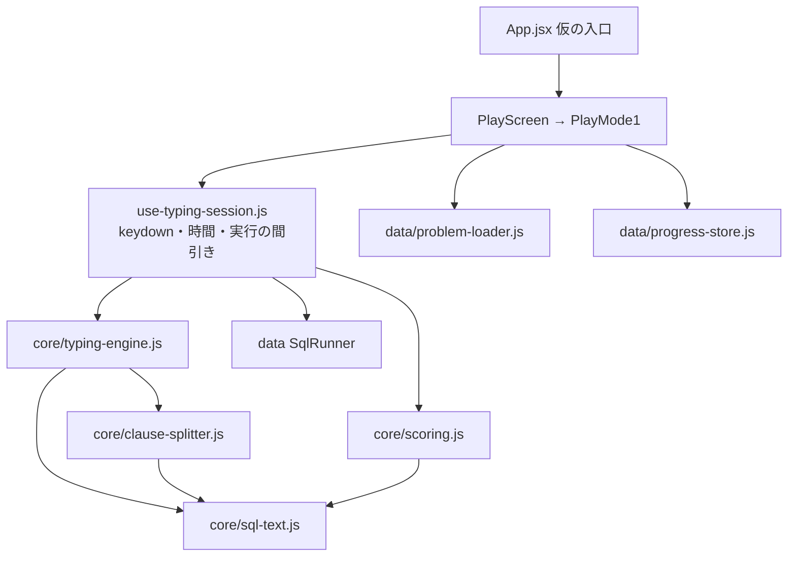

# 設計書

## アーキテクチャ概要



## コンポーネント設計

### 1. `sql-text.js`

```js
/** @typedef {{ type: 'word'|'string'|'quoted'|'number'|'symbol'|'space'|'comment', text: string, start: number, end: number }} Token */
export function tokenize(sql) {}
```
- 文字列 `'...'`（`''` は中の `'`）、識別子 `"..."`、`--` と `/* */` のコメント、空白、単語（英字・数字・`_`）、数、記号（1文字ずつ。`>=` なども1文字ずつ）
- 閉じていない `'` は最後までを文字列にする（打っている途中のSQLも扱うため）
- `$$` の文字列は今は扱わない（初級・中級に出ない）

### 2. `clause-splitter.js`

```js
export function splitClauses(sql) {} // { ok, clauses: [{ kind, start, end, writtenOrder, execOrder }] }
```
- 括弧の外（深さ0）の単語を見て、`SELECT`・`FROM`・`WHERE`・`GROUP BY`・`HAVING`・`ORDER BY`・`LIMIT` で区切る。`OFFSET` は `LIMIT` の句の一部
- 句の終わりは、次の句の始まりの手前（後ろの空白は含めない）
- 実行順：FROM 1・WHERE 2・GROUP BY 3・HAVING 4・SELECT 5・ORDER BY 6・LIMIT 7 を、そのSQLにある句だけで1から詰める
- `ok: false`：最初が `SELECT` でない、同じ句が2回、句の並びが文法の順番でない（書き換え系は中級で足す）

### 3. `typing-engine.js`

```js
export function buildTarget(displaySql) {}   // { text, slots, clauseEnds }
export function createTypingState(target) {} // { position, okCount, missCount, missedSlots, lastMissAt }
export function pressKey(state, target, key) {} // { state, result, clauseEnded?, done? }
```
- **機能設計書から変えた点**：`pressKey(state, key)` ではなく `pressKey(state, target, key)` にする。状態に target を持たせると、1キーごとに大きな target をコピーし直すことになるため。状態は小さな値だけにする
- スロット：`{ kind: 'char', expected, caseSensitive, start }` か `{ kind: 'separator', start, end }`（`start`・`end` は表示用SQLの中の位置。画面はこれで元の改行・字下げのまま描く）
- 前後の空白は打たない（スロットにしない）
- `clauseEnds`：各句の最後の文字のスロット番号 → その句が何番目か。そのスロットを打ち終えたら `clauseEnded` を返す
- 判定：
  - 文字列の外の英字は大文字・小文字を区別しない。文字列の中は区別する。文字列の中の空白は普通の文字（区切りではない）
  - 区切りスロットは `' '` と `'Enter'` が正解
  - 長さ2以上のキー（`Shift`・`Backspace`・`Tab` など）は `ignored`。ただし `Enter` は区切りでないところでは `miss`
  - 打ち終えた後のキーは `ignored`

### 4. `scoring.js`

```js
export function computeTypingStats({ okCount, missCount, elapsedMs }) {} // { cpm, accuracy, rank }
export function weakPointKey(target, slotIndex, keywords) {}             // '(' / 'SELECT' / null
export function countTypedKeys(target, keywords) {}                      // { key: 回数 }
export function topWeakPoints(mistakes, typed, { minTyped = 20, limit = 3 }) {}
```
- ランクは機能設計書の表（S：250・98%、A：180・95%、B：120・90%、それ以外 C）
- `elapsedMs` が0のときは cpm 0（割り算の0を避ける）
- キーワードの判定：そのスロットを含む単語を大文字にし、隣の単語とつないだ2語（`ORDER BY`・`IS NULL` など）が用語辞典にあればそれ、なければ1語で探す。どちらもなければ数えない（列名やテーブル名は苦手に入れない）

### 5. `problem-loader.js`

- `import chapters from '/data/chapters.yaml'`、`import.meta.glob('/data/problems/*/*.yaml')`（章ごとに読み込み）、`keywords.yaml`・`characters.yaml`
- Zod で確かめ、合わなければ「どのファイルのどこが」の例外（本番のデータはビルド前の検証で止まっているので、開発中にだけ起きる）

### 6. `progress-store.js`

```js
export function createEmptyProgress() {}
export function loadProgress(storage) {}  // { progress, recovered }
export function saveProgress(storage, progress) {} // { ok } 書けなくても例外にしない
export function recordPlay(progress, { problemId, mode, cleared, date, best, mistakes, typed }) {}
```
- `storage` は引数で受け取る（テストで作り物を渡す。画面は `window.localStorage`）
- 壊れた記録（JSON として読めない・形が違う）は `sql-typing:progress:broken-<日時>` に退避してから初期化し、`recovered: true`
- 最高記録：モード1・2はランクが高い方 → 同じなら正確さが高い方 → 同じなら速い方（実装検証の指摘を受けて本人が決定。最初の案は「速さが大きい方、同じなら正確さ」）
- `days[date]` に plays と cleared を足す（KPI「継続」用）

### 7. 画面

| ファイル | 役割 |
|---|---|
| `src/ui/App.jsx` | 仮の入口と、遊ぶ画面の切り替え。学習記録の読み込み、壊れていたときの1回だけの表示 |
| `src/ui/screens/PlayScreen.jsx` | 問題とモードを受け取り、モードの中身を出す（今はモード1だけ） |
| `src/ui/components/PlayMode1.jsx` | なぞり書き：TypingArea・結果の表・上の帯。終わったら TypingResult |
| `src/ui/components/TypingArea.jsx` | スロットを表示用SQLの位置に重ねて描く（打った・今・まだ・ミス） |
| `src/ui/components/ResultTable.jsx` | 結果の表。行数、NULL、50行まで。行の出入りを Motion で動かす |
| `src/ui/components/TypingResult.jsx` | 結果：速さ・正確さ・時間・ランク・苦手 |
| `src/ui/state/use-typing-session.js` | keydown を1か所で受ける、時間を測る、句の終わりで実行（最新の1つだけ）、終わったら記録 |
| `src/ui/state/progress.js` | 学習記録を読み、保存する（localStorage を使うのはここだけ） |

- 打ちながらの実行は `SELECT` で始まる問題だけ（書き換え系を途中で実行すると、DBが変わってしまうため）
- 問題を始めるときに `prepare`（章の初期データ＋extraSql）

## データフロー

### モード1を1問遊ぶ
```
1. 入口で「1問目をなぞり書きで遊ぶ」→ PlayScreen が問題を読み、runner.prepare
2. buildTarget(display) → createTypingState
3. keydown → pressKey。最初の ok/miss で時計を始める
4. clauseEnded → runner.run(display.slice(0, 句の終わり))（実行中なら最新だけ予約）→ 表を更新。エラーなら前の表のまま
5. done → computeTypingStats → recordPlay → saveProgress → TypingResult
```

## エラーハンドリング戦略

- 打ちながらの実行のエラー：前の表のまま（途中のSQLはエラーになるのが普通）。表示しない
- 問題データの形の間違い：例外（開発中だけ。本番はビルド前に止まる）
- localStorage に書けない：遊ぶことは続ける。「この環境では記録が保存されません」を出す

## テスト戦略

### ユニットテスト（先に書く）
- sql-text：各種トークン、閉じていない文字列、`''`、コメント
- clause-splitter：初級9問の形、括弧・文字列の中のキーワード、実行順、ok: false の形
- typing-engine：大文字・小文字、区切り（Space・Enter）、文字列の中、miss で進まない、ignored、clauseEnded、done、前後の空白
- scoring：cpm・正確さ・ランクの境目、時間0、苦手のキー（記号・1語・2語・列名は数えない）、上位3つ
- progress-store：空の記録、読み込み、壊れた記録の退避、書けないとき、recordPlay（最高記録・日ごと・苦手の合計）

### 統合テスト
- 問題データの検証：beginner-01 の display（なければ answer）が ClauseSplitter で分けられ、各句の途中までのSQLを PGlite で実行しても例外にならない（見える化C のため）

### E2E
- `tests/e2e/play-modes/mode1-trace.spec.js`：上の受け入れ条件

## 依存ライブラリ

```json
{ "devDependencies": { "@vitest/coverage-v8": "^5.1.0" } }
```

## 実装の順序

1. sql-text → clause-splitter → typing-engine → scoring（それぞれテストを先に）
2. coverage の設定
3. problem-loader・progress-store・問題1・用語
4. 画面
5. E2E

## セキュリティ考慮事項

- 打つ文字・結果はすべて React の通常の描画で出す
- localStorage を使うのは `src/ui/state/progress.js` だけ（ESLint の決まりに合わせ、データレイヤーの関数に storage を渡す）

## パフォーマンス考慮事項

- `pressKey` は状態の小さな値だけを作り直す（target はコピーしない）
- 表示用SQLのスロットごとに `<span>` を描く。初級のSQLは200文字以下なので、1キーで全部描き直しても 16ms に収まる（E2E で体感を確認）

## 将来の拡張性

- ChoiceEngine（モード2）は sql-text と typing-engine の比べ方を使う
- Stepper（見える化A）は clause-splitter の結果を使う
