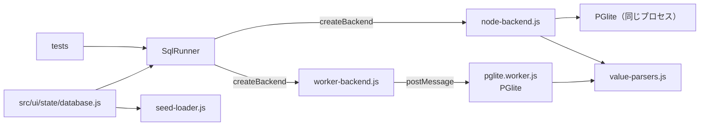

# 設計書

## アーキテクチャ概要



- `SqlRunner` は「バックエンドを作る関数」を受け取る。ブラウザでは Worker 版、テストでは Node 版を渡す
- 打ち切り・実行待ちの列・初期状態への戻し方は `SqlRunner` に1つだけ書き、バックエンドは「SQLを流す」だけにする

## コンポーネント設計

### 1. バックエンドの形（共通）

```js
/**
 * @typedef {Object} SqlBackend
 * @property {(sql: string) => Promise<void>} exec        複数の文を流す（初期データ用）
 * @property {(sql: string) => Promise<RawResult>} query  1つの文を実行（学習者のSQL用）。PG のエラーは { code, message, position } で reject
 * @property {() => void} terminate                        すぐに止める（打ち切り用）
 * @typedef {{ fields: { name: string, dataTypeID: number }[], rows: unknown[][], affectedRows?: number }} RawResult
 */
```

### 2. `pglite.worker.js` と `worker-backend.js`

**実装の要点**:
- `PGliteWorker`（PGlite 付属の Worker）は使わず、**自前の小さな Worker** にする
  - 理由：打ち切りのときに `worker.terminate()` で確実に止めたい。`PGliteWorker` は複数タブで1つのDBを共有するための仕組み（リーダーの選出など）を持っていて、止めて作り直す動きが読みにくい。このアプリはタブごとに別のDBでよい
- やりとりは `{ id, type: 'exec' | 'query', sql }` → `{ id, ok, result | error }`。最初に `type: 'ready'` で起動を待つ
- PG のエラーは `{ code, message, position }` だけを取り出して返す（エラーのオブジェクトそのものは Worker の外に送れないため）

### 3. `node-backend.js`

- 同じプロセスで `PGlite.create()`。`terminate()` は `close()` を呼ぶだけ
- **制約**：同じプロセスの WebAssembly は止められないので、Node 版では打ち切りの時間が来ても実行は最後まで走る（結果は捨てて timeout を返す）。打ち切りの動きは作り物のバックエンドで単体テストする

### 4. `value-parsers.js`

PGlite の型ごとの変換を、Worker 版と Node 版で同じにする。

| 型（OID） | PGlite の既定 | このアプリ |
|---|---|---|
| DATE（1082） | `Date`（UTC の0時） | `'YYYY-MM-DD'` の文字列（タイムゾーンでずれないように） |
| TIMESTAMP（1114）・TIMESTAMPTZ（1184） | `Date` | 文字列のまま |
| NUMERIC（1700） | 文字列（`'750.0000000000000000'`） | 数値（判定で `1000` と `1000.0` を同じにするため） |
| INT8（20） | 数値 | 数値（大きすぎるときは文字列） |

### 5. `SqlRunner`（`sql-runner.js`）

```js
export class SqlRunner {
  constructor({ createBackend, timeoutMs = 5000, startAttempts = 3 }) {}
  async ready() {}
  async prepare({ seedSql, extraSql }) {}
  async reset() {}
  async run(sql, { timeoutMs } = {}) {}  // { ok: true, result } | { ok: false, error } | { ok: false, timeout: true }
  async close() {}
}
```

**実装の要点**:
- **実行待ちの列**：`ready`・`prepare`・`reset`・`run` は1本の Promise の鎖につなぎ、前が終わってから次を流す
- **初期状態への戻し方を変える**：機能設計書の「スナップショットのテーブルにコピーして戻す」ではなく、**スキーマを作り直して初期データを流し直す**
  - 理由：学習者が `DROP TABLE`・`ALTER TABLE`・`CREATE INDEX` をすると、スナップショット方式では戻せない。流し直す方式なら何をされても戻る。PGlite で実測すると、スキーマの作り直しは3ms
  - 手順：`ROLLBACK`（閉じていないトランザクションを閉じる）→ `public` 以外の学習者が作ったスキーマも含めて `DROP SCHEMA ... CASCADE` → `CREATE SCHEMA public` → 初期データ → `extraSql`
- **複数の文**：PGlite の `query()` は複数の文を受け付けず `42601 cannot insert multiple commands into a prepared statement` を返す。これを見て `error.multipleStatements = true` を付ける（自前で `;` を数えない）
- **打ち切り**：`Promise.race` で時間を測り、時間切れなら `terminate()` → バックエンドを作り直し → `reset()` してから `{ ok: false, timeout: true }` を返す
- **結果の形**：`columns`（列名の配列）、`rows`（値の配列の配列）、`affectedRows`（書き換え系）。値は `string | number | boolean | null`

### 6. `seed-loader.js`

- `import.meta.glob('/data/seeds/*.sql', { query: '?raw', import: 'default' })` で章の初期データを文字列として読む。`loadSeed('beginner.sql')`

### 7. 画面（`src/ui/state/database.js`、`App.jsx`）

- `getSqlRunner()`：アプリに1つだけの `SqlRunner`（Worker 版）を作って返す（StrictMode で2回呼ばれても1つ）
- `useDatabaseStatus()`：`starting` → `ready`（`products` の行数）／`error`
- `App.jsx`：状態を1行で表示する

## データフロー

### アプリを開いたとき
```
1. App が useDatabaseStatus() を呼ぶ
2. getSqlRunner() が Worker を起動 → ready()
3. loadSeed('beginner.sql') → prepare({ seedSql })
4. run('SELECT count(*) FROM products') → 「準備完了（products 30行）」
```

## エラーハンドリング戦略

- 学習者のSQLのエラー・打ち切り・複数の文：結果のオブジェクトで返す（例外にしない）
- PGlite が起動しない（3回失敗）、Worker が落ちた、PG 以外のエラー：例外（プログラムやブラウザの問題）。画面は「データベースを起動できませんでした。ページを読み込み直してください」

## テスト戦略

### 単体テスト（作り物のバックエンド）
- 実行が順番どおりに1つずつ動く
- 打ち切り：時間切れで `timeout`、`terminate` が呼ばれ、作り直して `prepare` の内容が流し直される。後に並んだ実行はそのあと動く
- 起動の再試行（2回失敗して3回目で成功／3回とも失敗で例外）
- 複数の文の印、値の変換（`value-parsers.js`）

### 統合テスト（Node 版の PGlite）
- `SELECT` の結果の形、日付・NUMERIC・BIGINT・boolean
- エラーの `code`・`position`、複数の文
- `UPDATE`／`DROP TABLE`／閉じていない `BEGIN`／学習者が作ったスキーマのあとの `reset()`、`SERIAL` の次の番号
- 問題データの検証：初期データの決まり、正解SQLの実行（テスト用の壊れた問題で、検証が失敗すること）

### E2E
- ビルドしたものを開くと「準備完了（products 30行）」

## 依存ライブラリ

追加なし（`@electric-sql/pglite` は土台づくりで入れた）

## ディレクトリ構造

```
data/seeds/beginner.sql
src/data/seed-loader.js
src/data/sql-runner/sql-runner.js
src/data/sql-runner/value-parsers.js
src/data/sql-runner/worker-backend.js
src/data/sql-runner/pglite.worker.js
src/data/sql-runner/node-backend.js
src/data/sql-runner/index.js
src/ui/state/database.js
src/ui/App.jsx（変更）
tests/helpers/make-runner.js
tests/helpers/answer-checks.js
tests/helpers/fixtures/answer-broken/…（正解SQLが動かない問題）
tests/unit/data/sql-runner.test.js
tests/unit/data/value-parsers.test.js
tests/integration/sql-runner/node-runner.test.js
tests/integration/data-validation/problems.test.js（変更）
tests/integration/data-validation/answer-checks.test.js
tests/e2e/smoke/app-boot.spec.js（変更）
```

## 実装の順序

1. `value-parsers.js` → 単体テスト
2. `SqlRunner` → 作り物のバックエンドで単体テスト
3. `node-backend.js` → 統合テスト
4. `beginner.sql` → 初期データの決まりの検証
5. 正解SQLの実行の検証（`answer-checks.js`）
6. `pglite.worker.js`・`worker-backend.js`・`seed-loader.js`・画面 → E2E
7. 配る量の測定

## セキュリティ考慮事項

- 学習者のSQLは Worker の中の PGlite だけで実行する。外への通信はない
- Worker に渡すのは文字列だけ。Worker から返すのは結果とエラーの文字列・数値だけ

## パフォーマンス考慮事項

- PGlite の起動（Node で約1.4秒）は、画面の表示を止めずに裏で行う
- `reset()` は初期データを流し直すので、初期データが大きくなる上級（5万行）では時間を測り直す

## 将来の拡張性

- 上級のインデックス比較で5万行を作るときは `extraSql` に `generate_series` を書く
- 判定の作業で、ここで返す `QueryResult` をそのまま比べる
