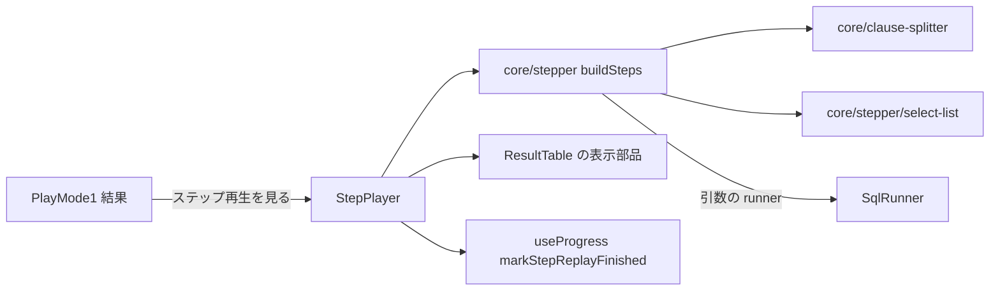

# 設計書

## アーキテクチャ概要



## 機能設計書から変えた点

- **SQLの組み立て直しに `pgsql-ast-parser` を使わない**：ClauseSplitter の句の範囲（文字の位置）で、元のSQLの文字をそのまま切り貼りして段階のSQLを作る
  - 理由：初級の単一テーブルの形なら、句の文字をつなぎ直すだけで段階のSQLが作れる。構文木を経由すると、解析できない書き方・`toSql` で書き方が変わる心配が増える。正しさは「最後の段階が元のSQLの結果と一致するか」で毎回確かめる
  - `pgsql-ast-parser` は中級（JOIN・GROUP BY）で必要になったら使う。依存は残しておく

## コンポーネント設計

### 1. `src/core/stepper/select-list.js`（純粋な関数）

```js
export function splitSelectList(selectClauseText) {} // { distinct: boolean, items: { text, sourceColumn?, alias? }[] }
```
- `SELECT` と `DISTINCT` を取り除き、括弧の外のカンマで項目に分ける
- 項目が「列名」「列名 AS 別名」「列名 別名」のときだけ `sourceColumn`・`alias` を持つ（名前の変わった列の矢印に使う）

### 2. `src/core/stepper/index.js`

```js
export async function buildSteps(sql, runner) {}
// { ok: true, steps } | { ok: false, reason: 'unsupported' | 'error' | 'mismatch', message }
```

**対応する形**：ClauseSplitter で分けられ、`GROUP BY`・`HAVING` がなく、FROM 句が「テーブル名1つ（別名可）」で、SELECT の項目に集計関数（count・sum・avg・min・max）がないもの。

**段階のSQL**（`F` = FROM 句の文字、`W` = WHERE 句、`L` = SELECT の項目、`O` = ORDER BY 句、`M` = LIMIT 句）：

| 段階 | SQL | 前との差 |
|---|---|---|
| FROM | `SELECT ctid::text AS __rid, * F` | なし |
| WHERE | `SELECT ctid::text AS __rid, * F W` | 消えた rid |
| SELECT | `SELECT ctid::text AS __rid, L F W` | 消えた列・名前の変わった列 |
| DISTINCT | SELECT の結果を、`__rid` 以外の値でまとめる（JS） | まとまった rid |
| ORDER BY | DISTINCT なし：`SELECT ctid::text AS __rid, L F W O`。DISTINCT あり：元のSQLから LIMIT を除いて実行し、値でまとまりの代表に対応づける | 並び替えたか |
| LIMIT | 元のSQLを実行し、ORDER BY の段階の先頭から同じ行数（OFFSET があれば飛ばす）を対応づける | 消えた rid |

- 句がない段階は作らない（ORDER BY がなければ ORDER BY の段階なし）
- 最後に、最後の段階の値の列が、元のSQLをそのまま実行した結果と（順番も含めて）一致するかを確かめる。違えば `mismatch`
- 段階のSQLがエラーになったら `error`（学習者のSQLの間違いは、判定ではなくここで見せる）
- `__rid` は表示しない（`columns`・`values` から外し、`rid` として持つ）

**Step の形**（機能設計書の `Step`）：`{ label, range, columns, rows: [{ rid, values }], diff: { removed, removedColumns, renamedColumns, merged, reordered }, rowCountBefore }`

### 3. 画面

| ファイル | 役割 |
|---|---|
| `src/ui/components/StepPlayer.jsx` | buildSteps を呼び、段階を切り替える。SQLの句に実行順の番号を付け、今の句を光らせる。再生・一時停止・進む・戻る・最初から（→ ← Space Home） |
| `src/ui/components/StepTable.jsx` | 段階の表。消える行を赤くしてから消す（2つの場面：印を付ける → 消す）、消える列を灰色に、名前の変わった列に「元 → 新」 |
| `src/ui/state/use-step-replay.js` | 段階の番号・場面・自動再生のタイマー（React の部分） |
| `src/ui/state/step-replay-timing.js` | 段階ごとの長さ（機能設計書の表）と速さの掛け算（純粋な関数。単体テスト） |
| `PlayMode1.jsx` | 結果に「ステップ再生を見る」ボタン。押すと結果の表の欄が StepPlayer に変わる |
| `src/data/progress-store.js` | `markStepReplayFinished(progress, problemId)` |
| `src/ui/state/progress.js` | `markReplayFinished(problemId)` |

- キー操作：ステップ再生を開いている間は、なぞり書きのキー（Enter でもう一度）とぶつからないように、StepPlayer がキーを受ける（Enter は使わない）

## テスト戦略

- 単体：`splitSelectList`、段階の長さ、`markStepReplayFinished`
- 統合（Node 版 PGlite）：初級9問の正解SQLの形すべてで ok・最後の段階が一致。各段階の差（WHERE・SELECT・AS・DISTINCT・ORDER BY・LIMIT/OFFSET）。unsupported の形。エラーになるSQL
- E2E：1問目をクリア → ステップ再生 → FROM 30行 → 次へ → SELECT → 最後まで → 読み込み直しても記録が残る

## 実装の順序

1. select-list → stepper（テストを先に）
2. progress-store の markStepReplayFinished（テストを先に）
3. 画面
4. E2E
