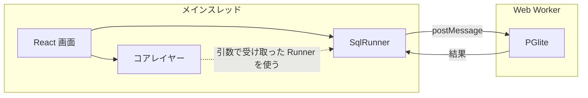

# 技術仕様書 (Architecture Design Document)

> - 元にした資料：[product-requirements.md](product-requirements.md)、[functional-design.md](functional-design.md)。
> - バージョンは 2026-11-11 時点で `npm view` で確かめた最新版。メジャーバージョンを固定し、マイナー以下の更新は受け入れる（`^`）。

## テクノロジースタック

### 言語・ランタイム

| 技術 | バージョン | 選定理由 |
|------|-----------|----------|
| JavaScript（ES2022、ES Modules） | — | 本人の希望（決定17）。型の補助は JSDoc と Zod で行う。`tsconfig` は使わず、`jsconfig.json` の `checkJs` をエディタの補助としてだけ使う（ビルドを止める条件にはしない） |
| Node.js | v26.x（手元は v26.12.1） | 開発サーバー・ビルド・テストの実行。PGlite は Node でも同じパッケージで動くので、統合テストをブラウザなしで回せる |
| npm | 11.x（手元は 11.20.0） | Node.js に同梱。`package-lock.json` で依存を固定する |

### フレームワーク・ライブラリ

| 技術 | バージョン | 用途 | 選定理由 |
|------|-----------|------|----------|
| React | ^19.3 | 画面 | Next.js で経験がある。状態に応じて画面を作り直す書き方が、モード切り替え・ステップ再生に向く |
| Vite | ^8.3 | 開発サーバー・ビルド | サーバー機能のいらない SPA を最も少ない設定で作れる。Web Worker と WebAssembly の読み込みに標準で対応している |
| @vitejs/plugin-react | ^6.3 | Vite で React を使う | 公式のプラグイン |
| @electric-sql/pglite | ^0.5 | ブラウザの中の PostgreSQL | 本物の PostgreSQL を WebAssembly で動かす。`EXPLAIN ANALYZE` が使える（上級で必要）。自前の Web Worker の中で動かす（付属の `PGliteWorker` は使わない。下の「実行のしくみ」） |
| pgsql-ast-parser | ^12.0 | SQLの構文解析 | PostgreSQL の書き方を JS の構文木にし、SQLに戻せる（`toSql`）。**今は使っていない**：初級の Stepper は句の範囲で元のSQLの文字を切り貼りして段階のSQLを作る（2026-11-11 の見える化A の作業で決めた）。中級の JOIN・GROUP BY の段階で必要になったら使う |
| motion | ^14.12 | アニメーション | `layout` アニメーションで、行の並び替え・消える動きを少ないコードで書ける |
| @xyflow/react | ^12.12 | DBの地図 | テーブルの箱と線の図。拡大・移動もそのまま使える |
| yaml | ^2.9 | YAML の読み込み | 問題データの読み込み（ビルド時とテスト時） |
| zod | ^4.6 | データの形の検証 | 問題データ・学習記録の形を、TypeScript なしで確かめられる。スキーマを1か所に書けば、アプリとテストの両方で使える |

### 開発ツール

| 技術 | バージョン | 用途 | 選定理由 |
|------|-----------|------|----------|
| @rollup/plugin-yaml | ^5.0 | YAML を Vite でそのまま `import` する | 問題データをビルドに同梱できる。実行時に YAML を解析しなくて済む |
| vitest | ^5.1 | 単体テスト・統合テスト | Vite と同じ設定で動く。Node で PGlite を動かして統合テストができる |
| @vitest/coverage-v8 | ^5.1 | カバレッジ | `src/core/` の行カバレッジ 90% を `npm run check`（`vitest run --coverage`）で確かめる。下回ると失敗する |
| @playwright/test | ^1.65 | 画面のテスト（E2E） | 実際のブラウザでキー入力を送れる。タイピングのテストに必要 |
| eslint | ^10.14 | 書き方のチェック | レイヤーをまたぐ `import` の禁止（下の「依存のルール」）を機械的に確かめる |
| @eslint/js・globals | ^10.0・^17.14 | ESLint 10 のフラット設定 | 推奨ルールと、ブラウザ／Node のグローバル変数の定義 |
| eslint-plugin-react-hooks | ^7.1 | フックの使い方のチェック | `useEffect` の依存の書き忘れなどを止める |
| prettier | ^3.9 | 整形 | 整形の議論をなくす |
| wrangler | ^4.160 | Cloudflare Pages への公開（P1） | 公開の段階で入れる。MVPでは入れない |

## アーキテクチャパターン

### レイヤードアーキテクチャ

```
┌──────────────────────────────┐
│ 画面レイヤー  src/ui/          │ ← 表示とキー入力。状態は Context + useReducer
├──────────────────────────────┤
│ コアレイヤー  src/core/        │ ← タイピング判定・選択肢・判定・ステップ・スコア・エラー和訳
├──────────────────────────────┤
│ データレイヤー src/data/       │ ← PGlite（Worker）・問題データ・学習記録（localStorage）
└──────────────────────────────┘
        共通の決まり  src/schema/ ← Zod スキーマ（全レイヤーと tests から使う）
```

#### 画面レイヤー（`src/ui/`）
- **責務**: 画面の表示、キー入力・クリックの受付、アニメーション、画面の状態（今どの画面か、今どのモードか）
- **許可される操作**: コアレイヤーとデータレイヤーの関数を呼ぶ。`src/schema/` を読む
- **禁止される操作**: SQLの文字列を組み立てる、文字の正誤を自分で判定する、localStorage・PGlite を直接触る

#### コアレイヤー（`src/core/`）
- **責務**: 学習のルールそのもの（タイピングの判定、選択肢の確定、実行結果の比較、句の分解、段階ごとの表の作成、スコア、エラーの和訳）
- **許可される操作**: `src/schema/` を読む。`SqlRunner` を**引数で受け取って**使う（`Stepper`・`Judge`）
- **禁止される操作**: React・DOM・localStorage・PGlite を `import` する。乱数と現在時刻は引数で受け取る（テストで固定できるように）

#### データレイヤー（`src/data/`）
- **責務**: PGlite の起動と実行、問題データの読み込み、学習記録の読み書き
- **許可される操作**: PGlite・localStorage・`data/` のファイル。`src/schema/` を読む
- **禁止される操作**: 学習のルール（正誤の判定など）を書く。React を `import` する

#### 依存のルール

```
ui → core → schema
ui → data → schema
core → data は禁止（SqlRunner は ui から core に渡す）
data → core / ui は禁止
core → ui は禁止
```
ESLint の `no-restricted-imports` で、上の禁止をビルド前のチェックで止める。

### 実行のしくみ（スレッド）



- PGlite は自前の Worker（`src/data/sql-runner/pglite.worker.js`）の中に置く。重いSQLでもキー入力と描画は止まらない（PRD：キー入力の反応 16ms 以内）
- 付属の `PGliteWorker` を使わない理由：`PGliteWorker` は複数タブで1つのDBを共有する仕組み（リーダーの選出など）を持っていて、打ち切りで止めて作り直す動きが読みにくい。このアプリはタブごとに別のDBでよく、`worker.terminate()` で確実に止められる自前の Worker の方が単純
- やりとりは `{ id, type: 'ready' | 'exec' | 'query', sql }` → `{ id, ok, result | error }`。エラーは `{ code, message, position }` だけを送る
- **打ち切り（5秒）**：`SqlRunner.run` がタイマーを持ち、5秒で返事がなければ Worker を `terminate()` して作り直し、初期状態を流し直す。PGlite の中の `statement_timeout` には頼らない（WebAssembly の中で1本の処理になっているため、確実に止まる保証がない）
- **打ち切りが効くのは Worker 版だけ**：テスト用の Node 版は同じプロセスで WebAssembly を動かすので、実行中はタイマーも動かない。打ち切りの動きは作り物のバックエンドで単体テストする
- **起動と流し直しの上限**：起動は1回30秒・3回まで、初期状態の流し直しは15秒まで。Worker が落ちた（`error`・`messageerror`）ら、その Worker は捨てて次の操作で作り直す
- **実行は1つずつ**：`SqlRunner` は実行待ちの列を持ち、前の実行が終わってから次を流す。見える化C は「待っている間に来た新しい要求は最新の1つだけ残す」

## データ永続化戦略

### ストレージ方式

| データ種別 | ストレージ | フォーマット | 理由 |
|-----------|----------|-------------|------|
| 問題・章・登場人物・用語辞典 | `data/`（リポジトリの中）→ ビルドで JS に同梱 | YAML | 人が読み書きしやすい。ビルドに入れるので実行時の通信がいらない |
| お店の初期データ | `data/seeds/*.sql` → `?raw` で文字列として同梱 | SQL | そのまま PGlite に流せる |
| 遊んでいる間のDB | PGlite のメモリの中（保存しない） | — | 問題を開くたびに初期状態から作り直すので、保存する必要がない |
| 学習記録 | localStorage `sql-typing:progress` | JSON（`version` 付き） | ログインなし（決定2）。1つのキーにまとめ、書き込みは1か所から |

### バックアップ戦略

- **方法**：学習記録の書き出し（JSONファイルのダウンロード）と読み込み（P1）。自動のバックアップは持たない（ブラウザの外に出す手段がこれしかないため）
- **記録の形が変わるとき**：`version` を上げ、`ProgressStore` に「古い形 → 新しい形」の変換を1つずつ書く。変換できない記録は捨てずに `sql-typing:progress:broken-<日時>` に退避してから初期化する
- **書き込み**：クリア・設定変更のたびに全体を書き直す（1回あたり数KBなので、分割しない）

## パフォーマンス要件

### レスポンスタイム

| 操作 | 目標時間 | 測定環境 |
|------|---------|---------|
| 初回表示（章の一覧が操作できるまで） | 3秒以内（2回目以降1秒以内） | Chrome 最新版、一般的な家庭用回線、ビルド済みのファイル |
| PGlite の起動 | 一覧を表示している間に裏で終わる。最初の問題を開くまでに使えなければ「準備中」を出す | 同上 |
| キー入力から画面への反映 | 16ms 以内 | Chrome の Performance パネルで、1キーの処理時間を測る |
| 見える化C（句を打ち終えてから表が変わるまで） | 300ms 以内 | 初級データ（30行） |
| 判定（実行ボタンから結果まで） | 500ms 以内 | 初級・中級データ |
| ステップ再生の準備（`buildSteps`） | 500ms 以内 | 初級データ。段階のSQLは、元のSQLのほかに最大7本（集計：FROM・WHERE・グループの鍵・HAVING・SELECT・ORDER BY・LIMIT） |
| アニメーション | 毎秒60コマ | 一般的なノートPC、表50行まで |

### リソース使用量

| リソース | 上限 | 理由 |
|---------|------|------|
| 配る量（brotli 後） | 初回 5MB 以内（公開先の Cloudflare Pages は brotli で配るため、brotli で測る。2026-11-11 に本人が gzip から変更） | 初回表示 3秒の目標のため。問題データは章ごとに分ける。**実測（2026-11-11、DBが動く作業の時点）：brotli 3.71MB（gzip 5.49MB）**。ほぼ PGlite 本体（`.wasm`・`.data`）。画面の表示に必要な JS は gzip 69KB で、PGlite は裏で読むので一覧の表示は待たせない |
| メモリ（タブ全体） | 300MB 以内 | PGlite（初級〜中級のデータ）＋ React。上級の5万行のデータは、その問題を開いたときだけ作る |
| localStorage | 100KB 以内 | 学習記録は問題数 × モード数の記録だけ。ブラウザの上限（約5MB）に十分余裕がある |

## セキュリティアーキテクチャ

### データ保護

- **暗号化**：しない。保存するのは学習記録だけで、個人情報を持たない
- **外部への送信**：アプリのコードに `fetch`・`XMLHttpRequest`・`WebSocket` で外に送る処理を書かない（`src/` の中では ESLint のエラーにする。どうしても使うときは `eslint-disable-next-line` と理由のコメントを書く）
- **Content Security Policy**（公開時、P1）：`default-src 'self'; script-src 'self' 'wasm-unsafe-eval'; worker-src 'self' blob:; connect-src 'self'`。外部のスクリプト・接続を許さない
- **配信の圧縮（brotli）**：圧縮は Cloudflare Pages、伸張はブラウザが行い、アプリは brotli のライブラリを持たない。配るのは誰にでも同じ静的ファイルだけで、秘密の値（クッキー・トークン）も利用者ごとに変わるレスポンスもないため、圧縮を使った盗み見（BREACH・CRIME）は当てはまらない（2026-11-11 判断）。ログインや利用者ごとのページを足すときは見直す

### 入力検証

- **学習者のSQL**：検証しない（学習者が書いたものをそのまま PGlite に渡すのがこのアプリの目的）。壊されても困らないよう、DBはブラウザの中だけにあり、問題を開くたびに作り直す
- **複数の文**：`;` で区切られた2つ目の文があれば実行しない（機能設計）
- **問題データ**：Zod で検証（開発中は画面に、ビルド前はテストで）
- **学習記録・読み込むファイル（P1）**：Zod で検証。合わなければ使わない
- **表示**：すべて React の通常の描画で表示し、HTMLとして解釈させない（`dangerouslySetInnerHTML` を使わない。ESLint で禁止）

## スケーラビリティ設計

### データ増加への対応

- **想定データ量**：3章 × 約10問 ＋ 複合問題 ＝ 約40問。問題YAML 1つは2〜4KB
- **劣化の対策**：問題データは `import.meta.glob('/data/problems/<章>/*.yaml')` で章ごとに別のファイルにして、その章を開いたときに読み込む
- **DBの大きさ**：中級までは各テーブル数十〜数百行。上級のインデックス比較だけ5万行を使い、`generate_series` でその場で作る（ファイルとして配らない）

### 機能拡張性

- **問題の追加**：YAML を1つ置き、`chapters.yaml` の `problemIds` に足すだけ。コードの変更はいらない
- **章の追加**：`chapters.yaml` に章を足し、`data/seeds/` に初期データSQLを置く
- **ステップ再生の拡張**：`Stepper` の中で、句の種類ごとに「段階を作る関数」を表で持つ（`{ WHERE: buildWhereStep, ... }`）。集計（GROUP BY・HAVING）は `pushGroupedSteps` の段階ごとの関数で足した（2026-11-12）。中級の `JOIN` も同じように関数を足す
- **上級の専用の見える化**（P2）：問題YAMLに `viz: 'indexRace' | 'planTree' | 'txTimeline'` を足し、画面側でその見える化のコンポーネントを出す。`viz` がない問題は今までどおりステップ再生
- **設定**：見える化Bの on/off、再生の速さ（機能設計の `Settings`）

## テスト戦略

### ユニットテスト
- **フレームワーク**：Vitest（Node 環境）
- **対象**：`src/core/` の全モジュール、`src/data/progress-store.js`（localStorage はテスト用の作り物に差し替える）
- **カバレッジ目標**：`src/core/` の行カバレッジ 90% 以上（学習のルールそのものなので、ここが壊れると全モードが壊れる）

### 統合テスト
- **方法**：Vitest から Node 版の PGlite を直接起動する（Worker は使わない。`SqlRunner` は Worker 版と Node 版を同じ形で作る）
- **対象**：`Judge`・`Stepper` と PGlite の組み合わせ、**問題データの検証**（機能設計の「問題データの検証」の全項目）
- **ビルドとの関係**：`npm run build` の前に `npm run validate:data`（問題データの検証だけを走らせる）を実行し、1つでも失敗したらビルドを止める（`prebuild` スクリプト）

### E2Eテスト
- **ツール**：Playwright（Chromium）。`vite preview` でビルド済みのものを相手にする
- **1つのテストの上限は60秒**：各テストでブラウザの中の PGlite を起動する。並べて流すと PC が忙しく、起動だけで20秒を超えることがあるため（テストの中の起動待ちは30秒）
- **シナリオ**：機能設計の「E2Eテスト」のとおり（4モードのクリア、モード2の間違い、ターニングポイント、記録が残る、狭い画面）

### まとめて実行するコマンド
- `npm run check` ＝ ESLint ＋ Prettier の確認 ＋ 単体テスト ＋ 統合テスト（問題データの検証を含む）
- `npm run test:e2e` ＝ ビルド ＋ Playwright
- 作業の完了条件は `npm run check` が通ること（UIを触った作業は `npm run test:e2e` も）。この条件は `CLAUDE.md` と開発ガイドラインに書く

## 技術的制約

### 環境要件
- **ブラウザ**：Chrome・Edge の最新版（WebAssembly・Web Worker・ES Modules の Worker が必要）
- **画面**：幅1280px以上を推奨。768px未満はタイピング不可
- **開発環境**：Windows 11、Node.js v26、npm 11
- **必要な外部依存**：なし（実行時に外部のサービスを使わない）

### パフォーマンス制約
- PGlite は接続が1つだけ。同時に2つのトランザクションを本当に動かすことはできない → 上級のトランザクションの見える化はシミュレーションにする（決定11）
- PGlite の WebAssembly が約3MB あるため、初回の読み込みはこれより速くできない。2回目以降はブラウザのキャッシュに頼る（ファイル名にハッシュを付けて、長くキャッシュさせる）
- `pgsql-ast-parser` は PostgreSQL のすべての書き方には対応していない。解析できないSQLはステップ再生をあきらめ、最終結果だけを見せる（判定は PGlite の結果で行うので、解析できなくても判定には影響しない）

### セキュリティ制約
- 学習者のSQLは何でも実行できる。守る対象は「ブラウザの中のDB」だけなので、問題を開くたびに作り直すことで対応する
- 外部のスクリプト・CDN を使わない。フォントも同梱するか、OS のフォントを使う

## 依存関係管理

| ライブラリ | 用途 | バージョン管理方針 |
|-----------|------|-------------------|
| react / react-dom | 画面 | `^19`（メジャー固定） |
| vite / @vitejs/plugin-react | ビルド | `^8` / `^6` |
| @electric-sql/pglite | DB | `~0.5`（0.x のためマイナーも固定。上げるときは統合テストを全部通してから） |
| pgsql-ast-parser | 構文解析 | `^12` |
| motion | アニメーション | `^14` |
| @xyflow/react | DBの地図 | `^12` |
| yaml / @rollup/plugin-yaml | YAML | `^2` / `^5` |
| zod | 検証 | `^4` |
| vitest / @playwright/test | テスト | `^5` / `^1` |
| eslint / prettier | 書き方・整形 | `^10` / `^3` |

- `package-lock.json` をリポジトリに入れ、インストールは `npm ci` で行う
- 依存を足すときは、この表と理由を更新する（開発ガイドラインのルール）
