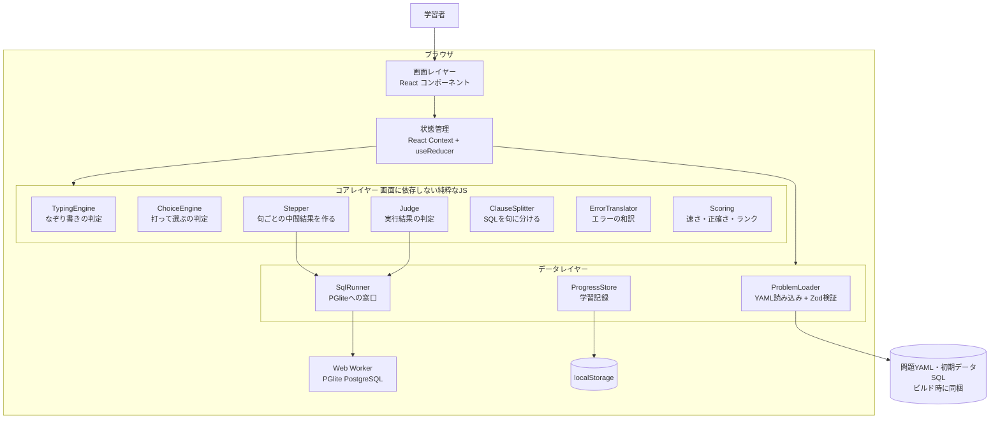
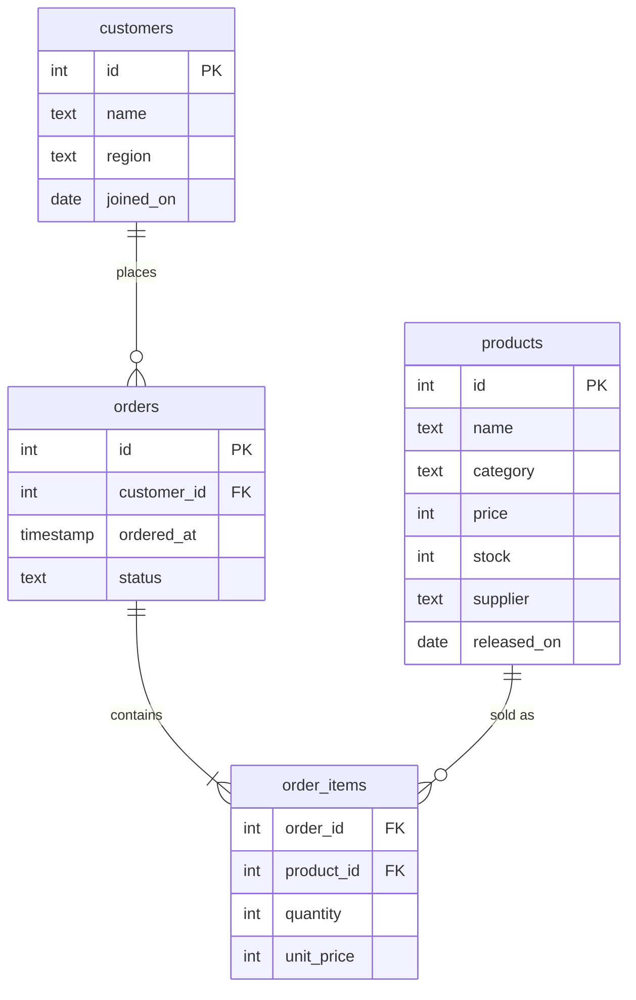
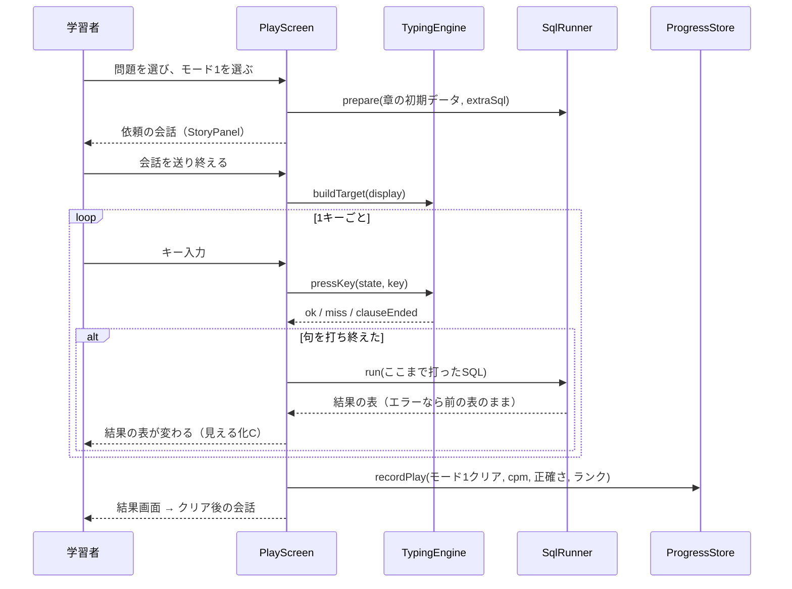
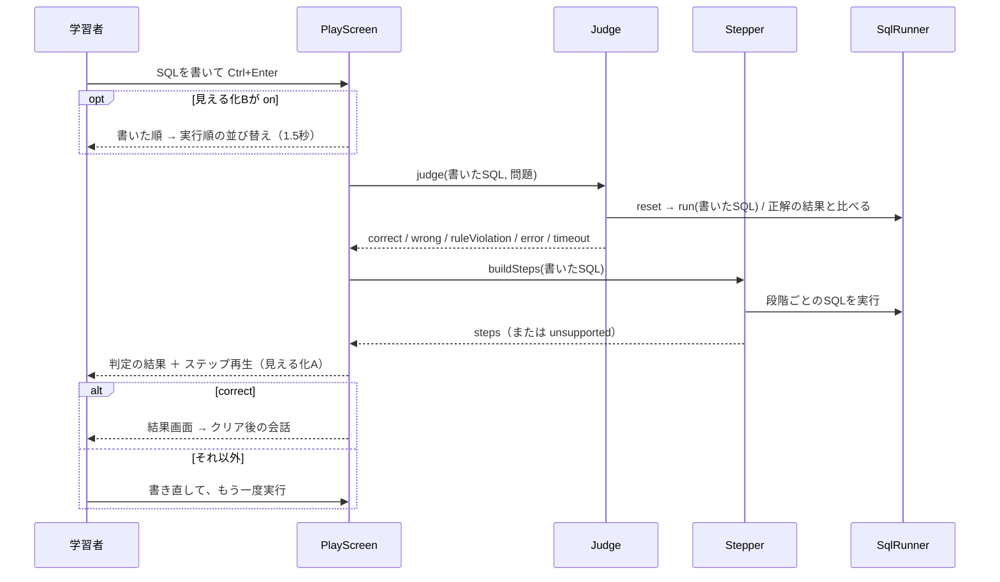
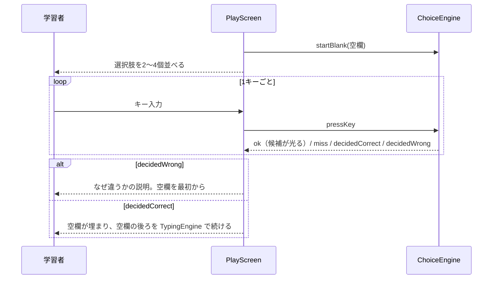
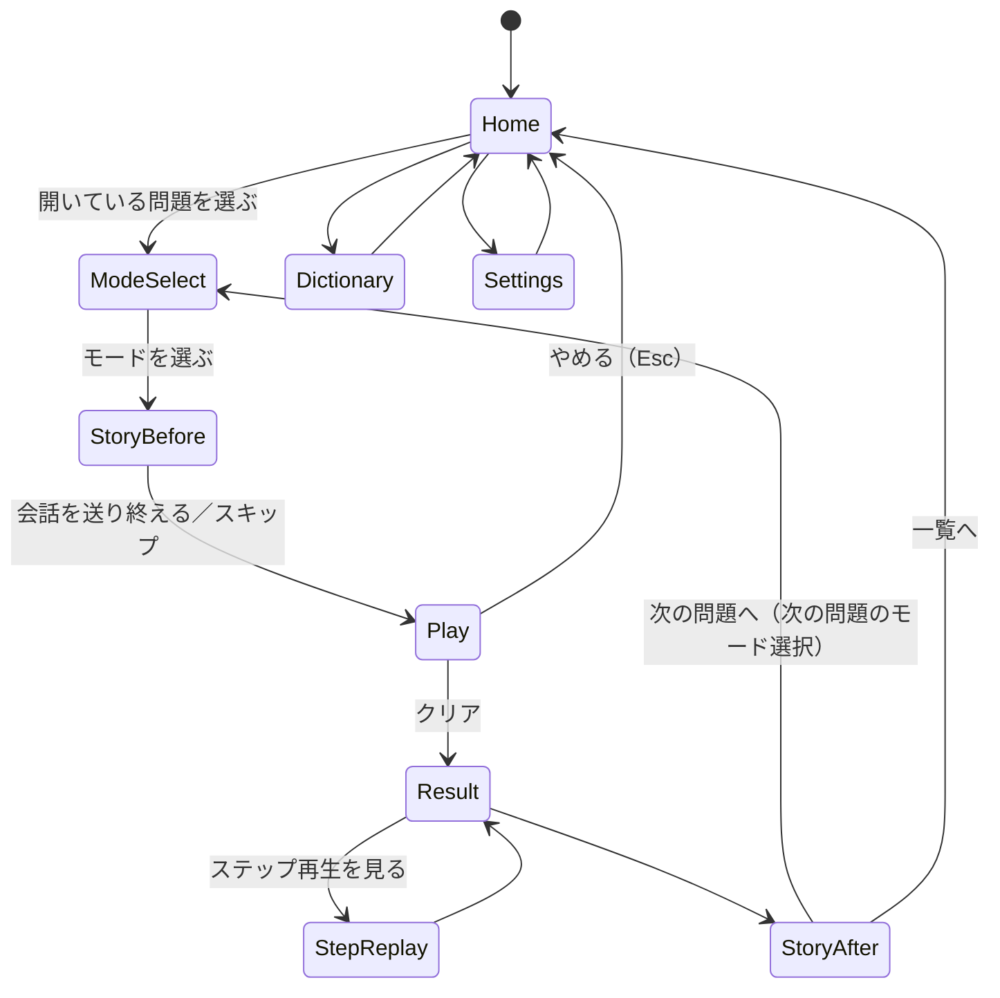

# 機能設計書 (Functional Design Document)

> - 元にした資料：[docs/product-requirements.md](product-requirements.md)。MVP（P0：初級1章）の機能を中心に書き、P1・P2 は拡張しやすくするための前提だけを書く。
> - 言語は JavaScript。この文書の型は JSDoc の `@typedef` で書く（実装でもそのまま JSDoc として使う）。

## システム構成図

すべてブラウザの中で動く。サーバーはファイルを配るだけ（Cloudflare Pages）。



**レイヤーのルール**：
- 画面レイヤーは、コアレイヤーとデータレイヤーを呼ぶだけ。SQLの判定や文字の判定を画面の中に書かない
- コアレイヤーは React にも PGlite にも依存しない（`Stepper` と `Judge` は `SqlRunner` を引数で受け取る）。Vitest だけでテストできる
- PGlite は Web Worker の中で動かす。重いSQLで画面が固まらないようにし、5秒を超えたら Worker ごと作り直して打ち切る

## 技術スタック

| 分類 | 技術 | 選定理由 |
|------|------|----------|
| 言語 | JavaScript（ES2022）＋ JSDoc | 本人の希望（決定17）。型の補助は JSDoc と Zod で行う |
| 土台 | Vite + React 19 | 1ページで動き続けるゲームなので、サーバー機能のいらない SPA が最も単純。React は Next.js で経験あり |
| DB | PGlite（Web Worker 版） | ブラウザで動く本物の PostgreSQL。`EXPLAIN ANALYZE` も使える（上級で必要） |
| SQLの構文解析 | pgsql-ast-parser | PostgreSQL の書き方を JS で構文木にできる。句ごとの中間クエリを作るのに使う |
| アニメーション | Motion（旧 Framer Motion） | 行が消える・並び替わる動き（`layout` アニメーション）を少ないコードで書ける |
| DBの地図 | React Flow（@xyflow/react） | テーブルの箱と線の図を自分で描かずに済む |
| 問題データ | YAML（yaml パッケージ）＋ Zod | 会話が長くても読み書きしやすい。形の間違いを Zod で止める |
| 学習記録 | localStorage | ログインなし（決定2） |
| テスト | Vitest / Playwright | 単体テストと画面テスト（決定14） |
| 公開 | Cloudflare Pages | 静的ファイルをそのまま置ける（P1） |

## データモデル定義

### お店のDB（PGliteの中のテーブル）

DBの値は英語と数字だけ（決定13）。初級では `products` だけを使う。中級以降のテーブルは、拡張を見越して形だけ決めておく。

```sql
-- 初級
CREATE TABLE products (
  id          SERIAL PRIMARY KEY,
  name        TEXT    NOT NULL,          -- 例: 'Mug Cup Blue'
  category    TEXT    NOT NULL,          -- 'kitchen' / 'stationery' / 'interior' / 'bag'
  price       INTEGER NOT NULL,          -- 税込の円
  stock       INTEGER NOT NULL,          -- 在庫数。0 もある
  supplier    TEXT,                      -- 仕入れ先。NULL もある（IS NULL の練習用）
  released_on DATE    NOT NULL           -- 発売日
);
-- 中級で追加（P1）: customers(id, name, region, joined_on)
--                    orders(id, customer_id, ordered_at, status)
--                    order_items(order_id, product_id, quantity, unit_price)
-- 上級で追加（P2）: access_logs など（インデックスの比較用に5万行を生成）
```

**初期データの決まり**：
- `products` は30行。全カテゴリに5行以上、`stock = 0` が3行以上、`supplier IS NULL` が3行以上、名前に `Mug` を含むものが3行以上
- 値段と名前はすべて違う（`ORDER BY price` の並びが1つに決まり、名前で行を見分けられるように）
- 決まりは `tests/integration/data-validation/problems.test.js` で確かめる
- 初期データは章ごとに1つのSQLファイル（`data/seeds/beginner.sql`）。問題ごとに足したい行は、問題YAMLの `setup.extraSql` に書く

### ER図（中級までの完成形）



### エンティティ：Chapter（章）

`data/chapters.yaml` に全章を並べる。

```js
/**
 * @typedef {Object} Chapter
 * @property {string} id            - 'beginner' / 'intermediate' / 'advanced'
 * @property {1|2|3} level          - 1=初級 2=中級 3=上級
 * @property {string} title         - 章の題名（日本語）
 * @property {string} seed          - 初期データSQLのファイル名（例 'beginner.sql'）
 * @property {string[]} tables      - この章で使えるテーブル（DBの地図に出す）
 * @property {string[]} newTables   - この章で新しく増えるテーブル（地図で印を付ける）
 * @property {string[]} problemIds  - 問題IDを出題順に並べたもの。最後がターニングポイント
 */
```

### エンティティ：Problem（問題）

1問1ファイル。`data/problems/<章id>/<2桁の番号>-<短い英語名>.yaml`（例：`data/problems/beginner/03-where.yaml`）。

```js
/**
 * @typedef {Object} Problem
 * @property {string} id                 - 'beginner-03' の形。ファイル名と一致させる
 * @property {string} chapterId
 * @property {number} order              - 章の中の順番（1から）
 * @property {string} title              - 問題の題名（日本語）
 * @property {'normal'|'composite'|'turningPoint'} kind
 *           normal=1つの内容 / composite=前のレベルも混ぜた複合 / turningPoint=章の山場（モード3・4でのみクリア）
 * @property {Story} story
 * @property {Setup} setup
 * @property {string} answer             - 正解SQL（判定の基準）。末尾の ; は付けない
 * @property {string} [display]          - モード1・2で見せる整形済みSQL（改行入り）。省略時は answer を自動整形
 * @property {Blank[]} blanks            - モード2の空欄（1〜3個）
 * @property {[string, string, string]} hints - モード3のヒント3段階（①使う句 ②句の順番 ③骨組み）
 * @property {JudgeRule} judge
 * @property {string[]} keywords         - この問題で使うキーワード（用語辞典・苦手の記録とつなぐ）
 */

/**
 * @typedef {Object} Story
 * @property {Line[]} before   - 依頼の会話（3〜8行。turningPoint は10行程度）
 * @property {Line[]} after    - クリア後の反応（1〜4行）
 * @typedef {Object} Line
 * @property {string} speaker  - characters.yaml の id。'player' は主人公
 * @property {string} text     - 日本語のセリフ
 */

/**
 * @typedef {Object} Setup
 * @property {string} [extraSql]   - 章の初期データに加えて、この問題だけで流すSQL
 */

/**
 * @typedef {Object} Blank          - モード2の空欄
 * @property {string} answer        - 正解の文字列。display の中にそのまま含まれていること
 * @property {Choice[]} wrong       - 間違いの選択肢（1〜3個）
 * @typedef {Object} Choice
 * @property {string} text          - 選択肢の文字列
 * @property {string} why           - なぜ違うかの一言説明（日本語）
 */

/**
 * @typedef {Object} JudgeRule
 * @property {boolean} ordered            - true なら行の順番も比べる
 * @property {boolean} [checkColumnNames] - true なら列の名前も比べる（AS の問題で使う）。既定 false
 * @property {string[]} [require]         - 必ず使うキーワード（例 ['BETWEEN']）
 * @property {string[]} [forbid]          - 使ってはいけないキーワード
 * @property {string} [compareTable]      - 書き換え系（P1）：実行後にこのテーブルの中身を比べる
 * @property {string[]} [ignoreColumns]   - 書き換え系で比べない列（SERIAL の id など、正しい書き方でも値が変わる列）
 */
```

**制約（Zod とテストで確かめる）**：
- `id` がファイル名と一致し、全問で重ならない
- `answer` が PGlite で実行でき、エラーにならない。結果が0行の問題は作らない（判定の意味がなくなるため）
- `blanks[].answer` が `display`（なければ `answer`）の中に1回だけ出てくる
- モード2の選択肢（正解＋間違い）は2〜4個。**どの選択肢も、別の選択肢の先頭部分になっていない**（例：`price > 100` と `price > 1000` は同時に置けない。打ち切った時点で確定するため）
- 間違いの選択肢を `answer` の空欄に入れたSQLは、判定で不正解になる（間違いのはずの選択肢が正解と同じ結果を出していないか）
- `keywords` はすべて用語辞典（`data/keywords.yaml`）にある
- `kind: turningPoint` は章の最後の1問だけ（作っている途中の章では0問でもよい。あるなら1問だけで、最後）
- `chapters.yaml` の `problemIds` と問題ファイルが1対1で対応し、並び順と `order` が一致する
- 会話の `speaker` はすべて `characters.yaml` にいる
- 会話は `before` 3〜8行（ターニングポイントは12行まで）・`after` 1〜4行、1行40文字以内
- `display` があるなら、`answer` と打つ文字として同じ（違ってよいのは改行・字下げと、文字列の外の大文字・小文字だけ）
- 章・用語・登場人物の id が重ならない。登場人物の `color` が `tokens.css` に定義されている
- `answer`・`display`・選択肢は英数字・記号・空白だけ（日本語を入れない）。`answer` の末尾に `;` を付けない

どの制約をどこで確かめるか：1ファイルの中で決まるもの → `src/schema/problem-schema.js`（Zod）、ファイルをまたぐもの → `src/schema/cross-checks.js`、PGlite で実行して確かめるもの（正解SQLが動く・0行でない・間違いの選択肢が不正解になる・順番が1つに決まる）→ `tests/integration/data-validation/`（SqlRunner を作る作業で足す）。

**問題YAMLの例**：

```yaml
id: beginner-03
chapterId: beginner
order: 3
title: 1000円以上の商品
kind: normal
story:
  before:
    - { speaker: tencho, text: 来週のギフト特集、1000円以上の商品を候補にしたいの。 }
    - { speaker: senpai, text: 一覧から手で拾うと半日かかるな…… }
    - { speaker: player, text: 少し待ってください。 }
  after:
    - { speaker: senpai, text: "……え、もう出たの？" }
answer: SELECT name, price FROM products WHERE price >= 1000
blanks:
  - answer: WHERE price >= 1000
    wrong:
      - { text: HAVING price >= 1000, why: HAVING はグループにまとめた後の絞り込み。まとめていない今は WHERE。 }
      - { text: ORDER BY price, why: ORDER BY は並び替えるだけで、行は減らない。 }
hints:
  - 使う句は SELECT・FROM・WHERE の3つ。
  - 書く順は SELECT → FROM → WHERE。
  - SELECT 列, 列 FROM products WHERE price ??? 1000
judge: { ordered: false }
keywords: [SELECT, FROM, WHERE]
```

### エンティティ：Character（登場人物）

`data/characters.yaml`。名前は本人が決めたもの（2026-11-11）。

```js
/**
 * @typedef {Object} Character
 * @property {string} id      - 'player' / 'tencho' / 'senpai' / 'eigyo'
 * @property {string} name    - 表示名（主人公=あなた、店長=木村、先輩=吉永、営業=長島）
 * @property {string} role    - 肩書き（日本語）
 * @property {string} color   - 名前の表示色（CSS 変数名）
 */
```

### エンティティ：Keyword（用語辞典）

`data/keywords.yaml`。

```js
/**
 * @typedef {Object} Keyword
 * @property {string} word        - 'WHERE'。複数語は 'ORDER BY' のように1つにする
 * @property {string} english     - 英語としての意味（日本語で）例：'どこで／〜であるところの'
 * @property {string} meaning     - SQLでの意味 例：'条件で行を絞り込む'
 * @property {string} example     - 短い例 例：'WHERE price >= 1000'
 * @property {1|2|3} level        - 初めて出てくるレベル
 */
```
初めて出てくる問題へのリンクは、問題の `keywords` から自動で作る（手で書かない）。

### エンティティ：Progress（学習記録）

localStorage のキー `sql-typing:progress` に JSON で1つだけ保存する。

```js
/**
 * @typedef {Object} Progress
 * @property {1} version                               - 形を変えたら上げる。合わなければ移し替える
 * @property {Object<string, ProblemRecord>} problems  - キーは問題ID
 * @property {Object<string, number>} mistakes         - 打ち間違えた回数。キーは記号1文字かキーワード（例 '(' / 'BETWEEN'）
 * @property {Object<string, number>} typed            - 打った回数（苦手の割合を出すため。キーは mistakes と同じ）
 * @property {Object<string, DayLog>} days             - キーは 'YYYY-MM-DD'。KPI「継続」用
 * @property {Settings} settings
 *
 * @typedef {Object} ProblemRecord
 * @property {Object<'1'|'2'|'3'|'4', ModeRecord>} modes
 * @property {boolean} stepReplayFinished              - ステップ再生を最後まで見たか（KPI用）
 *
 * @typedef {Object} ModeRecord
 * @property {boolean} cleared
 * @property {number} plays
 * @property {Best} [best]
 *
 * @typedef {Object} Best
 * @property {number} timeMs
 * @property {number} [cpm]          - モード1・2：1分あたりの正しい入力文字数
 * @property {number} [accuracy]     - モード1・2：正確さ 0〜100
 * @property {'S'|'A'|'B'|'C'} [rank]
 * @property {number} [runs]         - モード3・4：実行した回数
 * @property {number} [hintsOpened]  - モード3：開いたヒントの数
 *
 * @typedef {Object} DayLog
 * @property {number} plays
 * @property {number} cleared
 *
 * @typedef {Object} Settings
 * @property {boolean} reorderAnimation   - 見える化Bを流すか。既定 true
 * @property {number} replaySpeed         - ステップ再生の速さ 0.5 / 1 / 2。既定 1
 */
```

**問題が開いているかどうかは保存しない**。`problems` のクリア状況と `chapters.yaml` の順番から毎回計算する（保存した値と計算がずれる事故を防ぐ）。

## コンポーネント設計

### コアレイヤー（`src/core/`、画面に依存しない）

#### TypingEngine（モード1・モード2の空欄以外）

**責務**:
- 正解SQLを「打つべき文字の列（スロット）」に変換する
- 1回のキー入力が正しいかを判定し、位置を進める
- 句の切れ目に来たことを知らせる（見える化C のため）

**インターフェース**:
```js
/** @returns {TypingTarget} { text, slots, clauseEnds } */
export function buildTarget(displaySql) {}
/** @returns {TypingState} 先頭から打ち始める状態 { position, okCount, missCount, missedSlots, lastMissAt } */
export function createTypingState(target) {}
/**
 * @param {TypingState} state
 * @param {TypingTarget} target
 * @param {string} key  - KeyboardEvent.key（'a' / 'A' / ' ' / 'Enter' / '(' など）
 * @returns {{ state: TypingState, result: 'ok'|'miss'|'ignored', clauseEnded?: number, done?: boolean }}
 */
export function pressKey(state, target, key) {}
/**
 * @typedef {{ kind: 'char', expected: string, caseSensitive: boolean, start: number }
 *         | { kind: 'separator', start: number, end: number }} Slot
 *   start・end は表示用SQLの中の位置。画面はこれで元の改行・字下げのまま描く
 */
```

`pressKey` に `target` を引数で渡すのは、状態に target を持たせると1キーごとに大きな target をコピーし直すことになるため（状態は小さな値だけにする）。

**スロットの作り方（決定13のルール）**:
1. `display` を先頭から読み、文字列リテラル `'...'` の中かどうかを記録する
2. 文字列の外の、連続する空白・改行は1つの「区切りスロット」にまとめる。区切りスロットは Space と Enter のどちらでも正解
3. 文字列の外の英字は、大文字・小文字を区別しない
4. 文字列の中の文字は、そのまま一致したときだけ正解
5. 正しくないキーは `miss`。位置は進めず、そのスロットを赤くする印を付ける
6. Shift・Ctrl などの単独のキー、Backspace は `ignored`（止まる方式なので消す必要がない）。`Enter` は区切りスロットでは正解、それ以外では `miss`
7. 識別子 `"..."` の中も大文字・小文字を区別する（PostgreSQL で区別されるため）
8. 前後の空白はスロットにしない。打ち終えたあとのキーは `ignored`

**句の切れ目**：`ClauseSplitter` が返す各句の終わりの位置を持っておき、その位置のスロットを打ち終えたときに `clauseEnded`（何番目の句か）を返す。

#### ChoiceEngine（モード2の空欄）

**責務**:
- 空欄に来たとき、選択肢（正解＋間違い）を並べる。並び順は毎回シャッフルする
- 打った文字に合う選択肢を絞り込み、1つを打ち切ったら確定する

**インターフェース**:
```js
/** @returns {ChoiceState} */
export function startBlank(blank, randomFn) {}
/** @returns {{ state: ChoiceState, result: 'ok'|'miss'|'ignored'|'decidedCorrect'|'decidedWrong', why?: string }} */
export function pressKey(state, key) {}
```

**判定のルール**:
- 比べ方は TypingEngine と同じ（大文字・小文字、空白、文字列の中）
- まだ確定していない選択肢のうち、今まで打った文字と先頭が合うものを「候補」として光らせる
- 打ったキーで候補が0個になる場合は `miss`（モード1と同じく止まる）
- 候補の1つを最後まで打ち切ったら確定。正解なら `decidedCorrect` で空欄の次へ、間違いなら `decidedWrong` で `why` を表示し、その空欄を最初からやり直す
- 選択肢がほかの選択肢の先頭部分にならないことは、問題データの検証で保証する（打ち切った時点で1つに決まる）

#### ClauseSplitter

**責務**:
- SQLを最上位の句（`SELECT` / `FROM` / `WHERE` / `GROUP BY` / `HAVING` / `ORDER BY` / `LIMIT`）に分け、各句の文字の範囲と、書いた順・実行順を返す

**インターフェース**:
```js
/** @returns {{ clauses: Clause[], ok: boolean }} */
export function splitClauses(sql) {}
/**
 * @typedef {Object} Clause
 * @property {'SELECT'|'FROM'|'WHERE'|'GROUP BY'|'HAVING'|'ORDER BY'|'LIMIT'} kind
 * @property {number} start          - 元のSQLの中の開始位置
 * @property {number} end
 * @property {number} writtenOrder   - 書いた順（1から）
 * @property {number} execOrder      - 実行順（FROM=1, WHERE=2, GROUP BY=3, HAVING=4, SELECT=5, ORDER BY=6, LIMIT=7 を詰めたもの）
 */
```
- 括弧の中（サブクエリ）と文字列の中のキーワードは数えない
- `DISTINCT` は `SELECT` 句の一部として扱い、`Stepper` で別の段階にする

#### Stepper（見える化A の中身を作る）

**責務**:
- 1つのSQLから、実行順の各段階での「その時点の表」を作る
- 段階と段階の間で、どの行が消えたか・どの行がまとまったか・行がどう並び替わったかを計算する

**インターフェース**:
```js
/**
 * @param {string} sql
 * @param {SqlRunner} runner
 * @returns {Promise<{ ok: true, steps: Step[] } | { ok: false, reason: 'unsupported'|'error'|'mismatch', message: string }>}
 */
export async function buildSteps(sql, runner) {}

/**
 * @typedef {Object} Step
 * @property {string} label            - 'FROM' / 'WHERE' / 'SELECT' / 'DISTINCT' / 'ORDER BY' / 'LIMIT'
 * @property {[number, number]} range  - SQLの中で光らせる文字の範囲（DISTINCT は SELECT 句の範囲）
 * @property {string[]} columns        - `__rid` は含めない
 * @property {StepRow[]} rows
 * @property {number|null} rowCountBefore - 1つ前の段階の行数（「30行 → 21行」の表示用。最初の段階は null）
 * @property {StepDiff} diff           - 1つ前の段階からの変化
 *
 * @typedef {Object} StepRow
 * @property {string} rid              - 行の目印（元テーブルの ctid）。DISTINCT 後は先頭の行の rid
 * @property {Array<string|number|null>} values
 *
 * @typedef {Object} StepDiff
 * @property {string[]} removed            - この段階で消えた行の rid（WHERE / LIMIT）
 * @property {string[]} removedColumns     - この段階で消えた列（SELECT）
 * @property {Object<string,string>} renamedColumns - AS で変わった列名 { 元: 新 }
 * @property {Object<string,string[]>} merged      - まとまった行 { 残る rid: [吸収された rid...] }（DISTINCT）
 * @property {boolean} reordered           - 並び順が変わったか（ORDER BY）
 */
```

**作り方（初級の単一テーブル）**：各段階を「本物のSQL」としてPGliteで実行し、行の目印 `ctid` で前の段階とつなぐ。

| 段階 | 実行するSQL（`t` はテーブル、`w` は条件、`p` は選ぶ列、`o` は並び順） | 前との差の求め方 |
|---|---|---|
| FROM | `SELECT ctid::text AS __rid, * FROM t` | なし（最初の段階） |
| WHERE | `SELECT ctid::text AS __rid, * FROM t WHERE w` | FROM にあって WHERE にない `__rid` が消えた行 |
| SELECT | `SELECT ctid::text AS __rid, p FROM t WHERE w` | 消えた列・名前の変わった列を、列名の比較で出す |
| DISTINCT | SELECT の結果を、`__rid` 以外の値が同じ行どうしでまとめる（JSで計算） | まとまった行の組 |
| ORDER BY | `SELECT ctid::text AS __rid, p FROM t WHERE w ORDER BY o`（DISTINCT があるときは `SELECT DISTINCT p FROM t WHERE w ORDER BY o` を実行し、値で前の段階の行に対応づける） | 並び順の違い |
| LIMIT | DISTINCT なし：`SELECT p, ctid::text AS __rid FROM t WHERE w ORDER BY o LIMIT …`。DISTINCT あり：元のSQLの結果の値で前の段階の行に対応づける（DISTINCT のあとは値が重ならない） | 前後の消えた行 |

- 段階のSQLは、ClauseSplitter の句の範囲（文字の位置）で、元のSQLの句の文字をそのまま切り貼りして作る（`pgsql-ast-parser` は使わない。初級の単一テーブルなら切り貼りで足り、構文木を経由すると書き方が変わる心配が増えるため。中級で必要になったら使う）。SELECT の項目は `src/core/stepper/select-list.js` で、括弧・文字列の外のカンマで分ける
- 対応する形：句に分けられ、`GROUP BY`・`HAVING` がなく、FROM 句がテーブル名1つ（別名可）で、SELECT の項目に集計関数（`string_agg` なども）・ウィンドウ関数がなく、`DISTINCT ON`・`SELECT ALL`・`SELECT ... INTO` でなく、括弧の外に `OFFSET`（LIMIT 句の中は可）・`FETCH`・`FOR`・`WINDOW`・`UNION` などがないもの。ClauseSplitter が句として数えない語が、直前の句の文字に混ざって別の段階で行が減るのを防ぐため
- 行の目印 `ctid::text AS __rid` は項目の**末尾**に足す（先頭に足すと `ORDER BY 2` のような列番号がずれる）
- 最初に元のSQLを実行する。エラーなら `error`（PostgreSQL のメッセージ付き。学習者のSQLの間違い）。元のSQLが成功したあとに段階のSQLだけが失敗したら `unsupported`（学習者が書いていないSQLのエラーは見せない）
- SELECT の段階の消えた列・名前の変わった列は、項目の「元の列」から決める（結果の列名との一致では決めない）。元の列は FROM の段階に実在するものだけ（`TRUE`・`CURRENT_DATE` を列と取り違えない）、引用符なしの名前は小文字で比べる、同じ列を2回以上使うときは名前の変わった表示をしない、`*` があればどの列も消えない
- LIMIT の段階は、DISTINCT がなければ元の ORDER BY と LIMIT をそのまま付けて行の目印つきで実行し、残る行を決める（同じ値の行を取り違えない）。残る行が ORDER BY の段階の並びの中で続いていなければ `mismatch`
- 最後の段階の表が、元のSQLをそのまま実行した結果と一致することを確かめる（ORDER BY・LIMIT があれば並びも）。一致しなければ `mismatch`（間違った見える化を見せない）
- まだ対応していない形（中級以降の `GROUP BY` / `JOIN` など、MVPの範囲外）は `unsupported` を返し、画面は「この形のステップ再生はまだありません」と出す
- 中級（P1）では、`GROUP BY`（各行のグループの値を `SELECT __rid, (グループ式) ...` で求めて色分け）と `JOIN`（左右のテーブルの ctid を両方持たせる）の段階をここに足す

#### Judge

**責務**:
- 書いたSQLと正解SQLを実行し、問題の `judge` のルールで正解かどうかを決める

**インターフェース**:
```js
/** 正解の結果を作る（問題を開いたときに1回）。前とあとに DB を初期状態に戻す */
export async function computeExpected({ problem, runner }) {} // { ok: true, table } | { ok: false, message }
/**
 * @param {{ sql: string, problem: Problem, runner: SqlRunner, expected?: Expected }} args
 *   expected を省くとその場で computeExpected する。正解SQLが動かないとき（問題データの間違い）は例外
 * @returns {Promise<JudgeResult>}
 *
 * @typedef {Object} JudgeResult
 * @property {'correct'|'wrong'|'ruleViolation'|'error'|'timeout'} status
 * @property {string} [reason]       - 'empty' / 'columnCount' / 'columnNames' / 'columnOrder' / 'rowCount' / 'values' / 'order' / 'tableMissing'
 * @property {string} [message]      - 日本語の説明（例：'行の数が違います（あなた：12行／正解：8行）'）
 * @property {QueryResult} [mine]
 * @property {QueryResult} [expected]
 * @property {TranslatedError} [error]
 */
export async function judge(args) {}
// 純粋な関数（単体テストする）：cellsEqual・normalizeCell・compareTables・findRuleViolation
```

**判定の順番**:
1. SQLが空（空白・コメントだけ）なら `wrong / empty`
2. DBを問題の初期状態に戻し、書いたSQLを実行する。エラーなら `error`（ErrorTranslator で和訳）、5秒を超えたら `timeout`。書き換え系（`compareTable`）は実行後のテーブルの中身を読み、テーブルがなくなっていれば `wrong / tableMissing`
3. 正解の結果と比べる（正解の結果は問題を開いたときに `computeExpected` で一度だけ作ってとっておく）
4. 列の数を比べる → 違えば `wrong / columnCount`
5. `checkColumnNames` が true なら列名を比べる（大文字・小文字は無視）→ `wrong / columnNames`
6. 行の数を比べる → `wrong / rowCount`
7. 値を比べる（同じ行が2つあれば2つとも要る）。`ordered` が false なら並びは無視。列の名前が同じで並び順だけが違い、並べ直すと合うなら `wrong / columnOrder`、そうでなければ `wrong / values`（違う行の例を出す）
8. `ordered` が true なら、そのままの順番で比べる → `wrong / order`
9. `require` と `forbid` を確かめる → 合わなければ `ruleViolation`（結果は正しいことも伝える）
10. すべて通れば `correct`
11. 最後に DB を初期状態に戻す（例外・打ち切りのときも）。judge は reset → 実行 → reset を順に行うので、画面からは1つずつ呼ぶ（2つを同時に呼ぶと、片方の実行の間にもう片方の reset が入る）。最後の reset が失敗すると、その例外が判定の結果に代わって投げられる

**値の比べ方**：
- 数値は許容誤差（相対 1e-9）で比べる（`1000` と `1000.0`、`0.1 + 0.2` と `0.3` は同じ）。丸めて比べると目盛りの境目で同じ値が分かれるため、丸めない
- NaN・±Infinity は NaN どうし・同じ向きの Infinity どうしだけ同じ（NULL とは違う）
- 数値と文字列（`1` と `'1'`）、`NULL` と文字列 `'NULL'` は違う。`NULL` は `NULL` どうしだけ同じ
- 日付は `YYYY-MM-DD` の文字列（SqlRunner がそろえる）
- 書き換え系は並びと列の名前を比べない。`ignoreColumns`（例 `['id']`）の列は比べない（SERIAL の id は、`VALUES` の行の順番を変えた正しい別解でも値が変わるため）
- 既知の制限：17桁を超える NUMERIC は数値にすると丸まる（初級・中級には出ない）。`checkColumnNames` は大文字・小文字を区別しない（`AS "Total"` と `AS total` は同じ）

**条件（require・forbid）の探し方**：空白・コメント・文字列・`"…"` の識別子を除いたトークンで、記号を残したまま並びを探す（`ORDER, BY` は ORDER BY ではない）。`t.in` のように直前が `.` の単語は列名なので数えない。`COUNT`・`SUM` などの関数名は、次が `(` のときだけ数える（`SELECT 30 AS count` で COUNT を使ったことにしない）。既知の制限：サブクエリの中だけに出てくる語も数える、`NOT BETWEEN` も BETWEEN を使ったことになる。

#### ErrorTranslator

**責務**: PostgreSQL のエラー（SQLSTATE コードと英語のメッセージ）を、日本語の説明とよくある原因に変える。

**インターフェース**:
```js
/** @returns {{ code: string, original: string, title: string, causes: string[] }} */
export function translateError(pgError) {}
```

**MVPで用意する和訳（10種類以上）**：

| SQLSTATE | 名前 | 日本語の題名 | よくある原因の例 |
|---|---|---|---|
| 42601 | syntax_error | 書き方が文法に合っていません | カンマの付け忘れ・付けすぎ、句の順番の間違い、`'` の閉じ忘れ |
| 42P01 | undefined_table | そのテーブルはありません | テーブル名のつづり間違い（`product` と `products`） |
| 42703 | undefined_column | その列はありません | 列名のつづり間違い。文字列を `"` で囲んでいる（`'` を使う） |
| 42883 | undefined_function | その関数・演算子はありません | 型の違うものどうしを比べている |
| 22P02 | invalid_text_representation | 値の形が型に合いません | 数値の列を `'abc'` と比べている |
| 42804 | datatype_mismatch | 型が合いません | 条件に数値や文字列だけを書いている |
| 42803 | grouping_error | GROUP BY に入っていない列があります | （中級）集計しない列を SELECT に入れている |
| 42702 | ambiguous_column | どのテーブルの列か決められません | （中級）JOIN で同じ名前の列がある |
| 22012 | division_by_zero | 0で割っています | 割る数が0の行がある |
| 42P10 | invalid_column_reference | ORDER BY の指定が正しくありません | `SELECT DISTINCT` で、選んでいない列で並べている |
| 23502 | not_null_violation | 空にできない列を空にしようとしています | （中級）`INSERT` で必要な列を書いていない |
| 22007 | invalid_datetime_format | 日付・時刻の書き方が正しくありません | 日付を `'年-月-日'` の形で書いていない |
| 22008 | datetime_field_overflow | ありえない日付・時刻です | 13月や32日のような日付 |
| 2201W | invalid_row_count_in_limit_clause | LIMIT の数が正しくありません | LIMIT に負の数 |
| 23505 | unique_violation | 同じ値がすでにあります | （中級）`id` が重なっている |

同じコードでも原因が違うものは、英語の原文の形で見分けて題名・原因を変える：

| コード | 原文の形 | 題名 |
|---|---|---|
| 42P01 | `invalid reference to FROM-clause entry` | 別名を付けたテーブルを、元の名前で書いています |
| 42803 | `aggregate functions are not allowed in WHERE` | WHERE の中では集計関数を使えません（HAVING を勧める） |
| 22P02 | `type boolean` | 条件のところに、条件ではない値を書いています |
| 42601 | `at end of input` | 題名は 42601 のまま、原因の先頭に「SQLが途中で終わっています」を足す |

2つ以上の文（SqlRunner の `multipleStatements`）は「1回に実行できるSQLは1つです」。当てはまらないコードは「エラーが起きました」＋英語の原文を出す（原因は空）。英語の原文は、どのエラーでも折りたたんで見られるようにする。

#### Scoring

**責務**: モード1・2の速さ・正確さとランクを計算する。苦手の記録を集める。

**計算**:
- 速さ（cpm）＝ `正しく打ったスロットの数 ÷ かかった分`。区切りスロットも1文字として数える。かかった時間は「最初のキー入力から最後のスロットを打ち終えるまで」
- 正確さ（%）＝ `正しく打った数 ÷ (正しく打った数 ＋ miss の数) × 100`（小数第1位まで）
- ランク（速さと正確さの両方を満たす最も高いもの）：

| ランク | 速さ（cpm） | 正確さ |
|---|---|---|
| S | 250 以上 | 98% 以上 |
| A | 180 以上 | 95% 以上 |
| B | 120 以上 | 90% 以上 |
| C | 上のどれにも当てはまらない | |

（数値は仮。MVPを遊んでから見直す）

**苦手の記録**：miss が起きたスロットについて、そのスロットが記号なら記号1文字、英字ならそのスロットを含むキーワード（`keywords.yaml` にある単語）を `mistakes` に足す。打ち終えたスロットは同じ決まりで `typed` に足す。結果画面の「苦手」は、`typed` が20回以上のものの中から `mistakes ÷ typed` が大きい順に3つ。

- 2語のキーワード（`ORDER BY`・`IS NULL`）は、隣の単語とつないで用語辞典にあれば2語で数える（1語より優先）
- `typed` はキーワードを1語（2語のものは2語で1つ）につき1回、記号は1文字につき1回数える（キーワードの文字数で割合がゆがまないように）
- 列名・テーブル名・数・文字列の中の英数字・区切りは数えない。文字列の中の記号（`'`・`%` など）は数える

**インターフェース**：`computeTypingStats({ okCount, missCount, elapsedMs })`・`rankFor(cpm, accuracy)`・`weakPointKey(target, slotIndex, keywords)`・`countTypedKeys(target, keywords)`・`topWeakPoints(mistakes, typed, { minTyped, limit })`。cpm は小数を切り捨て、時間0のときは0。正確さは打っていなければ100。

### データレイヤー（`src/data/`）

#### SqlRunner

**責務**:
- PGlite を Web Worker の中で起動し、SQLを実行して結果を返す
- 章の初期データを流し、問題の初期状態をとっておき、いつでも戻せるようにする
- 5秒を超えたSQLを打ち切る

**インターフェース**:
```js
export class SqlRunner {
  /** PGliteを起動する。何度呼んでも1回だけ起動する */
  async ready() {}
  /** 章の初期データ＋問題の extraSql を流した状態を作り、「初期状態」として覚える */
  async prepare({ seedSql, extraSql }) {}
  /** 初期状態に戻す */
  async reset() {}
  /**
   * @param {string} sql
   * @returns {Promise<{ ok: true, result: QueryResult } | { ok: false, error: PgError } | { ok: false, timeout: true }>}
   */
  async run(sql, { timeoutMs = 5000 } = {}) {}
  /** バックエンドを止める */
  async close() {}
}
/**
 * @typedef {string|number|boolean|null} SqlValue
 * @typedef {Object} QueryResult
 * @property {string[]} columns
 * @property {SqlValue[][]} rows
 * @property {number} affectedRows     - 書き換え系で書き換えた行数（SELECT は 0）
 *
 * @typedef {Object} PgError
 * @property {string} code             - SQLSTATE（例 '42P01'）
 * @property {string} message          - PostgreSQL の英語のメッセージ
 * @property {number} [position]       - エラーの位置（SQLの何文字目か。1から）
 * @property {boolean} multipleStatements - 2つ以上の文を実行しようとした
 */
```

**中身（バックエンド）**：`SqlRunner` は「バックエンドを作る関数」を受け取る。ブラウザでは自前の Web Worker（`pglite.worker.js`）の中で PGlite を動かす Worker 版、テストでは同じプロセスで動かす Node 版を渡す。PGlite 付属の `PGliteWorker`（複数タブで1つのDBを共有する仕組み）は使わない。打ち切りのときに `worker.terminate()` で確実に止めて作り直したいので、タブごとに別のDBを持つ。

**実行待ちの列**：`ready`・`prepare`・`reset`・`run`・`close` は1本の列に並び、前が終わってから次が動く。

**初期状態の戻し方**：スキーマごと作り直して、初期データを流し直す。手順は `ROLLBACK`（閉じていないトランザクションを閉じる）→ `DISCARD ALL`（設定・`SET ROLE`・`SET SESSION AUTHORIZATION`・`PREPARE`・カーソル・`LISTEN`・一時テーブル・アドバイザリーロックを片付ける。トランザクションの中では実行できないので `ROLLBACK` と別に流す）→ `public` と学習者が作ったスキーマを `DROP SCHEMA ... CASCADE` → `CREATE SCHEMA public` → 初期データ → `extraSql`。テーブルの中身をコピーしておく方式にしなかったのは、学習者の `DROP TABLE`・`ALTER TABLE`・`CREATE INDEX` で戻せなくなるため（流し直しは PGlite で数ms）。

**戻らないもの（問題として出さない）**：クラスタ全体に残るもの（`CREATE ROLE`・`CREATE DATABASE`・ラージオブジェクト・`CREATE FOREIGN DATA WRAPPER`）と、`information_schema` や拡張 `plpgsql` を消す操作。権限やデータベースの管理はスコープ外（PRD）なので、これらを使う問題は作らない。もし必要になったら、`reset` のたびにバックエンドごと作り直す（ブラウザでは WebAssembly の読み直しで重い）か、PGlite の `dumpDataDir` で初期状態を保存する方式を検討する。

**作り直したあと**：打ち切り・`close()`・PG 以外のエラー（Worker が落ちた など）でバックエンドを捨てたら、次に使う前に必ず初期状態を流し直す（空のDBで実行しない）。打ち切り後の作り直しに失敗しても `timeout` は返し、次の操作でもう一度作り直す。`prepare()` が失敗したら、前の初期状態のまま（次に使うときに流し直す）。`prepare()` の前の `run()`・`reset()` は例外。

**上限時間**：1回の起動は30秒、初期状態の流し直しは15秒まで待つ（WebAssembly の読み込みが止まったときに「準備中」のまま止まらないように）。起動は3回まで試す。

**値の型**：DATE は `'YYYY-MM-DD'`、TIMESTAMP は文字列のまま（タイムゾーンでずれないように）。NUMERIC と BIGINT（`count(*)` など）は数値（判定で `1000` と `1000.0` を同じにするため。安全に扱えない大きな値だけ文字列）。真偽値は boolean。型ごとの変換は `value-parsers.js` で、Worker 版と Node 版で同じものを使う。

**1つの文だけ実行する**：PGlite の `query()` は2つ以上の文を受け付けず、SQLSTATE `42601`（`cannot insert multiple commands into a prepared statement`）を返す。`SqlRunner` はこれを見て `multipleStatements: true` を付けて返す（`;` を自分で数えない）。画面は「1回に実行できるSQLは1つです」と出す。末尾の `;` が1つあるだけのSQLは実行できる。

**エラーの扱い**：PG のエラー（`code` がある）は `{ ok: false, error }` で返す。PG のエラーでないもの（Worker が落ちた、起動に3回失敗した）は例外にする。

**Node 版の制約**：同じプロセスの WebAssembly が動いている間は Node のイベントループも止まるので、打ち切りの時計が動かない（`pg_sleep(2)` は `timeoutMs: 500` でも2秒後に ok で返る）。打ち切りの動きは作り物のバックエンドで単体テストする。終わらない正解SQLがあると、問題データの検証（と `npm run build` の `prebuild`）自体が止まる。

**PG のエラーの見分け方**：`code` が SQLSTATE の形（数字と大文字の5文字）のものだけを PG のエラーとする（Node の `ENOENT` などを学習者のエラーと取り違えないため）。

#### ProblemLoader

**責務**:
- `chapters.yaml`・問題YAML・`characters.yaml`・`keywords.yaml` を読み、Zod で形を確かめて返す
- 問題データは章ごとに、必要になってから読み込む（`import.meta.glob` で章ごとに分ける）

**インターフェース**:
```js
export function loadChapters() {}                  // Chapter[]（ビルドに同梱。同期で読める）
export async function loadProblems(chapterId) {}   // Problem[]（章の順番どおり。章ごとに読み込む）
export async function loadProblem(problemId) {}    // Problem
export function loadCharacters() {}                // Character[]
export function loadKeywords() {}                  // Keyword[]
```
形が合わないデータは、開発中は画面に赤いエラーで出す。本番のビルドでは、同じ Zod の決まりをテストで先に確かめて、ビルドを止める（壊れたデータは配らない）。

#### ProgressStore

**責務**:
- localStorage の学習記録を読み書きする
- 壊れていたら初期状態にし、そのことを知らせる
- 書き出し・読み込み（P1）

**インターフェース**:
```js
/** localStorage（使えなければそのページの間だけ覚える作り物）。localStorage に触るのはここだけ */
export function getBrowserStorage() {} // { storage, persistent }
export function createEmptyProgress() {}
/** @returns {{ progress: Progress, recovered: boolean }} recovered=true は壊れていて初期化したとき */
export function loadProgress(storage, now) {}
/** @returns {{ ok: boolean }} 書けなくても例外にしない */
export function saveProgress(storage, progress) {}
export function clearProgress(storage) {} // P1（設定画面）で作る
/** 遊んだ結果を記録に入れた新しい Progress を返す（元は変えない） */
export function recordPlay(progress, { problemId, mode, cleared, date, best, mistakes, typed }) {}
/** 問題が開いているか：前の問題がどれかのモードでクリア済みなら開く。章の最初の問題は前の章のターニングポイントがモード3・4でクリア済みなら開く */
export function isUnlocked(progress, chapters, problemId) {}
```

**最高記録の選び方**（本人の決定。2026-11-11）：モード1・2は、ランクが高い回 → 同じランクなら正確さが高い回 → 同じ正確さなら速い回。速いだけで正確さの低い回が、正確な回の記録を上書きしないようにするため。モード3・4は時間が短い回。一度クリアしたモードは、あとでクリアしなかった回があってもクリアのまま。

### 画面レイヤー（`src/ui/`）

| コンポーネント | 責務 |
|---|---|
| `App` | 画面の切り替え、`SqlRunner` と学習記録を Context で配る、画面幅の判定（768px未満はタイピングを開けない） |
| `HomeScreen` | 章と問題の一覧、星4つ、開いていない問題の表示、各問題のモード選択 |
| `StoryPanel` | 会話を1行ずつ表示。Enter / クリックで送る。スキップ |
| `PlayScreen` | 1問を遊ぶ画面。モードによって中身を切り替える |
| `TypingArea` | モード1・2：薄い正解SQLの上に打った文字を重ねて表示。miss の赤い光り |
| `ChoiceList` | モード2：空欄の下の選択肢。候補が光る。間違いの説明 |
| `SqlEditor` | モード3・4：複数行の入力欄（`textarea`）。Ctrl+Enter で実行。Tab でスペース2つ |
| `HintPanel` | モード3：ヒントを1つずつ開く |
| `ResultTable` | 結果の表。行の追加・削除・並び替えを Motion の `layout` で動かす |
| `StepPlayer` | 見える化A：buildSteps を呼ぶ、SQLの句に実行順の番号を付けて今の句を光らせる、再生・一時停止・進む・戻る・最初から、段階の一言の説明 |
| `StepTable` | 見える化A の1段階の表：印の場面（消える行・まとまる行・消える列）と変化の場面、行数の変化、AS の「元 → 新」 |
| `ReplayDemoScreen` | ステップ再生の見本（`/?demo`）。初級の形のSQLを選んでステップ再生を見る |
| `ReorderIntro` | 見える化B：句のチップが書いた順から実行順へ入れ替わる（1.5秒） |
| `JudgePanel` | 判定の結果、和訳したエラー、違いの説明 |
| `ResultScreen` | クリア後の記録（速さ・正確さ・ランク／時間・実行回数・ヒント数）、苦手の上位3つ、ステップ再生へのボタン、次の問題へ |
| `SchemaMap` | DBの地図（React Flow）。触っているテーブルを光らせる。新しいテーブルの印。箱を押すと先頭20行 |
| `KeywordTip` | SQLの中のキーワードにカーソルを当てたら説明を出す |
| `DictionaryScreen` | 用語辞典。レベル別の一覧、初めて出てくる問題へのリンク |
| `SettingsScreen` | 見える化Bの on/off、再生の速さ、学習記録を消す |

## ユースケース図

### ユースケース1：モード1（なぞり書き）で1問を遊ぶ



**フロー説明**:
1. 問題を開いた時点でDBを問題の初期状態にする
2. 依頼の会話を読む（スキップ可）
3. 1キーごとに TypingEngine で判定。句を打ち終えるたびに、そこまでのSQLを実行して表を変える。文として成り立たないところ（例：`SELECT name` で `FROM` がまだない）ではエラーになるので、表は前のままにする
4. 最後まで打てばクリア。正解SQLを打ち写しているので、判定（Judge）は通さない
5. 結果画面から、ステップ再生（見える化A）を見られる

### ユースケース2：モード3・4（自分で書く）で1問を遊ぶ



**フロー説明**:
1. 実行するたびに、DBを初期状態に戻してから実行する
2. 間違っていても、書いたSQLのステップ再生は見られる（「自分のSQLがどう動いて、なぜ違う結果になったか」を見せる）
3. ターニングポイントは、この流れでクリアしたときだけ章のクリアになる

### ユースケース3：モード2（打って選ぶ）の空欄



## 画面遷移図



- スマホ（幅768px未満）では `ModeSelect` から先に進めず、ストーリーの読み返し・用語辞典・DBの地図だけ開ける
- キーボードだけで操作できるようにする：会話送り＝Enter、モード選択＝1〜4のキー、実行＝Ctrl+Enter、次へ＝Enter、やめる＝Esc

## UI設計

### 遊ぶ画面（PlayScreen）の配置

幅1280px以上を前提にした、上から下へ1列の配置（2026-11-11、本人の希望で2列から変更）。打っている間に目が行く入力エリアを画面の真ん中に大きく置き、結果の表はそのすぐ下に置く（打った瞬間の表の変化が、視線を少し下げるだけで見える。表の列も横いっぱいに使える）。

| 場所（上から） | 中身 |
|---|---|
| 上の帯 | 章名・問題名・モード・経過時間・（モード1・2）今の速さと正確さ |
| 真ん中（舞台） | 案内の1行・日本語入力の知らせ／TypingArea（文字は2.4rem、中は左寄せのまま横の真ん中に置く）または SqlEditor／ChoiceList（モード2）／HintPanel（モード3） |
| 舞台の下 | クリアしたときの結果（TypingResult）・JudgePanel |
| その下（横いっぱい） | ResultTable・StepPlayer（切り替え） |
| 右下の小窓 | SchemaMap（小さく表示。クリックで大きくする） |

**サイト全体の大きさ**：ルートの文字を125%（ブラウザの既定16pxなら20px）にする（本人の希望。ブラウザで125%表示にしたときの大きさ）。文字・余白・角・幅はすべて rem で書き、`src/ui/styles/global.css` の `html { font-size }` を変えるだけで全体が同じ割合で変わるようにする。

画面全体の見た目（色・フォント・一覧画面などの配置）は、一覧画面を作る作業であらためて決める。

### 結果の表（ResultTable）

| 項目 | 説明 | フォーマット |
|---|---|---|
| 行数 | 表の上に「12行」と表示。変化したときは「30行 → 12行」 | 数字 |
| 値 | 数値は右寄せ、文字列は左寄せ | `NULL` は灰色の斜体で `NULL` と表示 |
| 多い行 | 50行を超えたら先頭50行だけ表示し、「ほか◯行」と出す | |

### カラーコーディング

| 色 | 用途 |
|---|---|
| 赤 | 打ち間違えた文字、WHERE で消える行、エラー |
| 緑 | 正解、クリアした星 |
| 黄 | 今実行している句（ステップ再生）、光っている選択肢の候補 |
| 青 | DBの地図で今のSQLが触っているテーブル |
| 灰 | まだ打っていない文字、開いていない問題、`NULL` |

ライトとダークの両方の配色を CSS 変数で持つ（色の値はアーキテクチャ設計以降で決める）。

### ステップ再生（StepPlayer）の動き

| 段階 | 動き（Motion） | 長さ（印 → 変化） |
|---|---|---|
| FROM | 全行が現れる | 0 → 0.6秒 |
| WHERE | 消える行が赤くなり打ち消し線が付く → 横にずれて消える → 残った行が詰まる | 1.8 → 0.8秒 |
| SELECT | 消える列が灰色の打ち消し線になる → 消える。AS の列は見出しが「元 → 新」 | 1.5 → 0.5秒 |
| DISTINCT | まとまる組ごとに違う色になり、残る行は太字、まとまって消える行は文字が薄く打ち消し線 → 1行に重なる | 1.8 → 0.6秒 |
| ORDER BY | 行が新しい位置へ動く（行の目印を key にした layout アニメーション） | 0 → 0.8秒 |
| LIMIT | 消える行が赤くなる → 消える | 1.5 → 0.3秒 |

- 行が消える・列が消える・行がまとまる段階は、「印の場面（前の段階の表に印を付ける）」→「変化の場面（この段階の表）」の2つに分ける。1ステップ進めたとき（止めているとき）も印の場面から始まり、少し待って変化の場面になる
- 自動再生では段階の間に1秒止まり、最後の段階で止まる。`replaySpeed`（0.5 / 1 / 2）で全体の速さを変えられる（長さは `src/ui/state/step-replay-timing.js`）
- 操作：→ 次へ、← 戻る、Space 再生／一時停止、Home 最初から（ボタンもある）。Enter（もう一度）・Esc（もどる）はなぞり書きの画面のまま。ボタンにフォーカスがあるときの Enter・Space はそのボタンが受ける（Tab でボタンに移って押せるように）
- 進み方の決まり（印 → 変化 → 次へ、最後で止まる、手で動かすと自動再生は止まる、最後で止まっているときの再生は最初から）は `src/ui/state/step-replay-machine.js` の reducer にまとめる
- 最後の段階の変化を見せたら、学習記録の `stepReplayFinished` を true にする（KPI「見える化の利用」）
- 入口：モード1のクリアの結果の「ステップ再生を見る」。押すと結果の表の欄がステップ再生に変わる（モード3・4からの入口は判定の作業で足す）
- **見本のページ**（`/?demo`、入口からはリンクしない）：初級の形のSQL（WHERE・AS・DISTINCT と ORDER BY・ORDER BY と LIMIT・AND）を選んでステップ再生を見られる。`&speed=0.05` のように速さも変えられる。印の見た目を目と E2E で確かめるため（1問目には消える行・まとまる行がない）
- 印の付いた行・列には `data-mark`（`removing`・`merging`・`merging-keep`・`removing-column`）を付け、E2E で数える
- 表示用の行は50行まで（結果の表と同じ）。OS の「動きを減らす」設定では動きを付けない

## ファイル構造（データ）

```
data/
├── chapters.yaml          # 全章の一覧と出題順
├── characters.yaml        # 登場人物
├── keywords.yaml          # 用語辞典
├── seeds/
│   └── beginner.sql       # 初級の初期データ（products 30行）
└── problems/
    └── beginner/
        ├── 01-select-all.yaml
        ├── 02-select-columns.yaml
        ├── 03-where.yaml
        ├── 04-and-or.yaml
        ├── 05-in-between.yaml
        ├── 06-like-null.yaml
        ├── 07-order-limit.yaml
        ├── 08-distinct.yaml
        └── 09-turning-point.yaml
```

### 初級1章の問題（案）

依頼の会話は問題YAMLを書くときに作る。ここでは正解SQLの形を決める。

| # | 題名（仮） | 正解SQL（形） | 判定 |
|---|---|---|---|
| 1 | 在庫表を見せて | `SELECT * FROM products` | ordered: false |
| 2 | 名前と値段だけでいい | `SELECT name AS item, price FROM products` | checkColumnNames: true |
| 3 | 1000円以上の商品 | `SELECT name, price FROM products WHERE price >= 1000` | |
| 4 | キッチン用品の在庫切れ間近 | `SELECT name, stock FROM products WHERE category = 'kitchen' AND stock < 5` | |
| 5 | 特集に合う商品 | `SELECT name, category, price FROM products WHERE category IN ('kitchen', 'bag') AND price BETWEEN 500 AND 2000` | require: [IN, BETWEEN] |
| 6 | 仕入れ先の確認 | `SELECT name, supplier FROM products WHERE name LIKE '%Mug%' OR supplier IS NULL` | require: [LIKE, IS NULL] |
| 7 | 高い順に5つ | `SELECT name, price FROM products ORDER BY price DESC LIMIT 5` | ordered: true |
| 8 | 扱っているカテゴリ | `SELECT DISTINCT category FROM products ORDER BY category` | ordered: true |
| TP | セール前夜のリスト | `SELECT name AS item, category, price FROM products WHERE stock > 0 AND supplier IS NOT NULL AND category IN ('kitchen', 'interior') AND price BETWEEN 1000 AND 5000 ORDER BY price DESC LIMIT 10` | ordered: true, checkColumnNames: true |

※ 7 は同じ値段の商品があると順番が1つに決まらないため、初期データの値段はすべて違うものにする（`data/seeds/beginner.sql`。データ検証で確かめる）。

## パフォーマンス最適化

- **PGlite は裏で先に起動する**：アプリを開いたらすぐ Worker で起動を始め、一覧画面の表示は待たせない
- **正解の結果はとっておく**：問題を開いたときに正解SQLを1回だけ実行し、判定ではそれを使う
- **見える化Cは句の終わりだけ実行**：1キーごとには実行しない。前の実行が終わっていないときは、最新の1つだけ実行する
- **ステップ再生は必要になってから作る**：結果画面で「ステップ再生」を押したとき（モード3・4は実行のたび）に `buildSteps` を呼ぶ
- **問題データは章ごとに分けて読み込む**（PRD のスケーラビリティ要件）
- **表の描画は50行まで**（UI設計）

## セキュリティ考慮事項

- **SQLは外に出さない**：SQLはブラウザの中の PGlite だけで実行する。`fetch` で送る処理を書かない
- **学習者のSQLが壊せるのはブラウザの中のDBだけ**：`DROP TABLE` などをされても、`prepare` からやり直せば戻る。問題を開くたびに初期状態を作り直す
- **表示は React の通常の描画だけで行う**：DBの値・問題データを `dangerouslySetInnerHTML` で表示しない
- **外部スクリプトを入れない**：アクセス解析・広告・CDN からのスクリプトを読み込まない（PRD のプライバシー要件）
- **学習記録の読み込み（P1）は Zod で確かめる**：形の合わないファイルは読み込まない

## エラーハンドリング

### エラーの分類

| エラー種別 | 処理 | ユーザーへの表示 |
|-----------|------|-----------------|
| 学習者のSQLのエラー | ErrorTranslator で和訳。DBは次の実行の前に初期状態に戻す | 和訳した題名・よくある原因・英語の原文（折りたたみ） |
| 5秒を超えたSQL | Worker を作り直し、`prepare` からやり直す | 「5秒で打ち切りました。終わらない条件になっていないか確かめてください」 |
| 複数の文 | 実行しない | 「1回に実行できるSQLは1つです」 |
| ステップ再生に未対応の形 | 最終結果だけ表示 | 「この形のステップ再生はまだありません」 |
| PGlite が起動しない | 3回まで再試行。だめなら止める | 「データベースを起動できませんでした。ページを読み込み直してください」と、ブラウザの対応状況 |
| 問題データの形の間違い | 開発中は画面に出す。ビルドではテストで止める | （開発中）どのファイルのどの項目が違うか |
| 学習記録が壊れている | 初期状態で起動 | 「学習記録を読み込めなかったため、最初からになりました」（1回だけ） |
| localStorage に書けない（容量・プライベートモード） | 遊ぶことは続けられるようにする | 「この環境では記録が保存されません」 |

## テスト戦略

### ユニットテスト（Vitest、`tests/unit/`）
- `TypingEngine`：大文字・小文字、区切りスロット（Space / Enter）、文字列の中の区別、miss で進まないこと、句の終わりの通知
- `ChoiceEngine`：候補の絞り込み、打ち切ったときの確定、正解・間違いの確定、候補が0になる miss
- `ClauseSplitter`：句の範囲と実行順。括弧・文字列の中のキーワードを数えないこと
- `Scoring`：cpm・正確さ・ランクの境目の値
- `ErrorTranslator`：表のすべてのコード、原文の形で出し分けるもの、2つ以上の文、未知のコード
- `Judge` の純粋な部分：値の比べ方（許容誤差・NaN・Infinity・NULL）、表の比べ方（各 `reason`）、`require`・`forbid` の探し方（ドット付きの語・記号をはさむ語・関数名）
- `ProgressStore`：壊れたデータからの復帰、`isUnlocked`（ターニングポイントはモード3・4だけで次の章が開く）

### 統合テスト（Vitest + PGlite（Node 版）、`tests/integration/`）
- `Judge`：正解・別解（`IN` と `OR` の書き換え）・行数違い・順番違い・列名違い・列の並び順違い・`require` 違反・エラー・2つ以上の文・タイムアウト（作り物の SqlRunner）・判定のあと DB が初期状態に戻ること・書き換え系（`compareTable`・`ignoreColumns`・テーブルを消したとき）・空のSQL
- `Stepper`：初級9問の正解SQLすべてで、最後の段階が元のSQLの結果と一致すること。WHERE で消えた行・DISTINCT でまとまった行が正しいこと
- **問題データの検証（安全柵、PRD の開発プロセス要件）**：`data/` の全ファイルについて
  - Zod の形に合う
  - 正解SQLが実行でき、0行でない
  - 空欄の正解が display に1回だけある。選択肢が2〜4個で、どれも別の選択肢の先頭部分でない
  - 間違いの選択肢を入れたSQLが、判定で正解にならず、`ruleViolation` にもならない（結果が正解と変わる。`checkWrongChoices`）
  - `keywords` がすべて用語辞典にある。ターニングポイントが章の最後に1つだけ
  - `ordered: true` の問題で、並び順が1つに決まる（`checkOrderDetermined`：ORDER BY の後ろに `ctid`（DISTINCT・GROUP BY のときは行全体）の昇順と降順を足して実行し、結果が同じか比べる。ORDER BY がなければ失敗。WITH・UNION などの形は確かめられないので失敗にする。既知の制限：同じ並びの値の行が前から読んでも後ろから読んでも同じ並びのときは見逃す）

### E2Eテスト（Playwright、`tests/e2e/`）
- 初級1問目を、モード1〜4のそれぞれで最後まで遊んでクリアできる
- モード2で間違いの選択肢を打ち切ると説明が出て、やり直せる
- ターニングポイントはモード1・2ではクリア扱いにならず、モード4でクリアすると次の章が開く（テスト用の記録を localStorage に入れて確かめる）
- ページを読み込み直しても、クリア状況が残っている
- 幅375pxの画面では、タイピングを開始できない
