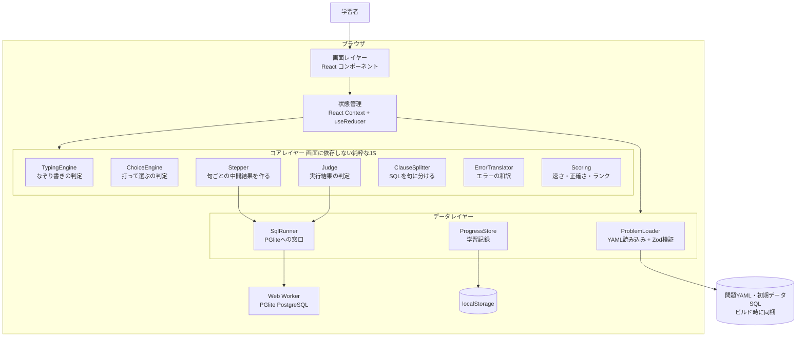
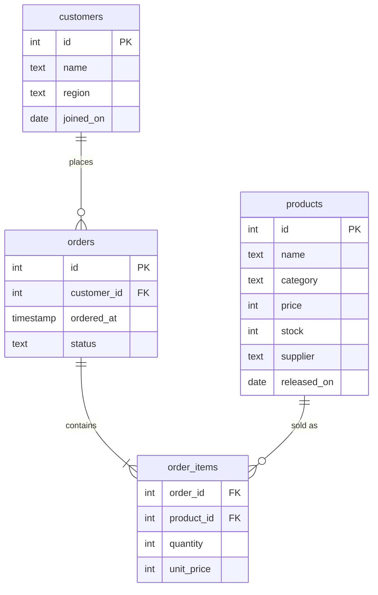
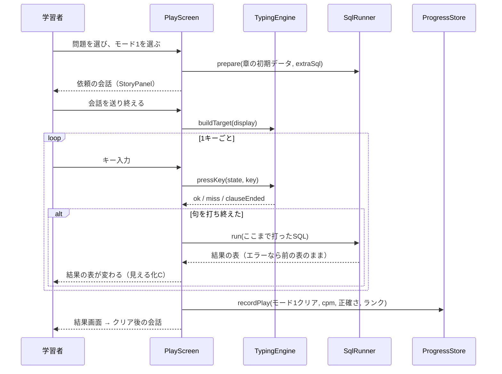
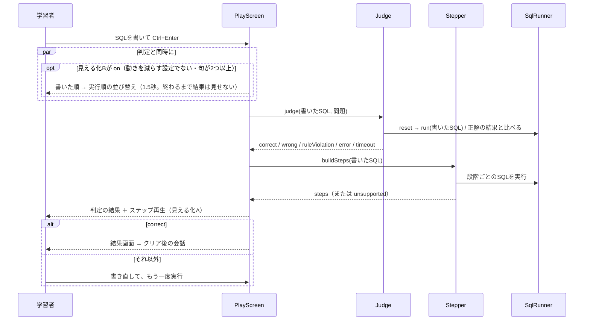
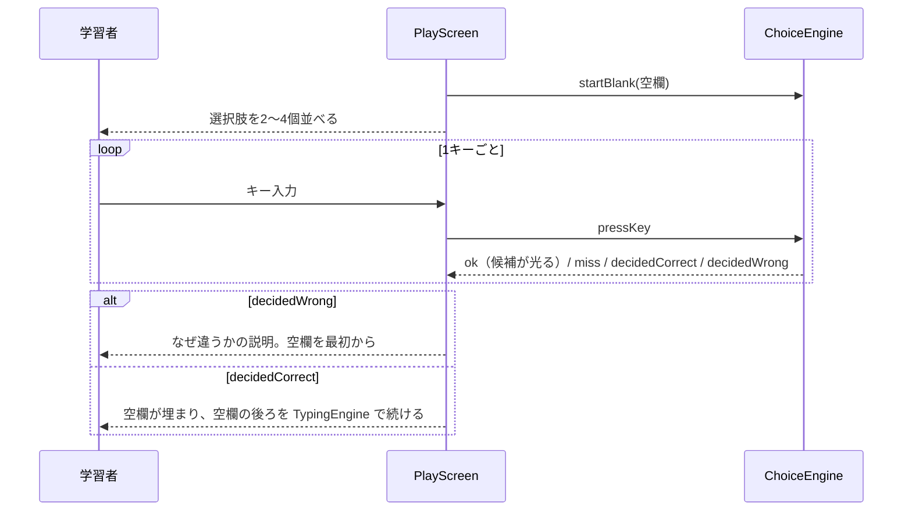
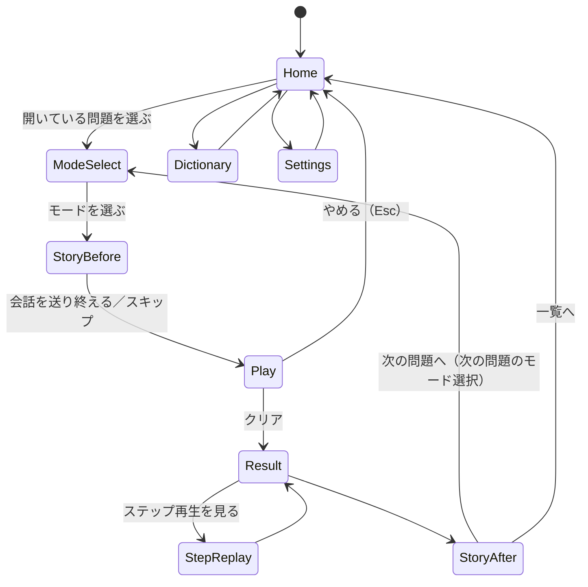

# 機能設計書 (Functional Design Document)

> - 元にした資料：[docs/product-requirements.md](product-requirements.md)。MVP（P0：初級1章）の機能を中心に書き、P1・P2 は拡張しやすくするための前提だけを書く。
> - 言語は JavaScript。この文書の型は JSDoc の `@typedef` で書く（実装でもそのまま JSDoc として使う）。

## システム構成図

すべてブラウザの中で動く。サーバーはファイルを配るだけ（Cloudflare Pages）。



**レイヤーのルール**：
- 画面レイヤーは、コアレイヤーとデータレイヤーを呼ぶだけ。SQLの判定や文字の判定を画面の中に書かない
- コアレイヤーは React にも PGlite にも依存しない（`Stepper` と `Judge` は `SqlRunner` を引数で受け取る）。Vitest だけでテストできる
- PGlite は Web Worker の中で動かす。重いSQLで画面が固まらないようにし、5秒を超えたら Worker ごと作り直して打ち切る

## 技術スタック

| 分類 | 技術 | 選定理由 |
|------|------|----------|
| 言語 | JavaScript（ES2022）＋ JSDoc | 本人の希望（決定17）。型の補助は JSDoc と Zod で行う |
| 土台 | Vite + React 19 | 1ページで動き続けるゲームなので、サーバー機能のいらない SPA が最も単純。React は Next.js で経験あり |
| DB | PGlite（Web Worker 版） | ブラウザで動く本物の PostgreSQL。`EXPLAIN ANALYZE` も使える（上級で必要） |
| SQLの構文解析 | pgsql-ast-parser | PostgreSQL の書き方を JS で構文木にできる。句ごとの中間クエリを作るのに使う |
| アニメーション | Motion（旧 Framer Motion） | 行が消える・並び替わる動き（`layout` アニメーション）を少ないコードで書ける |
| DBの地図 | React Flow（@xyflow/react） | テーブルの箱と線の図を自分で描かずに済む |
| 問題データ | YAML（yaml パッケージ）＋ Zod | 会話が長くても読み書きしやすい。形の間違いを Zod で止める |
| 学習記録 | localStorage | ログインなし（決定2） |
| テスト | Vitest / Playwright | 単体テストと画面テスト（決定14） |
| 公開 | Cloudflare Pages | 静的ファイルをそのまま置ける（P1） |

## データモデル定義

### お店のDB（PGliteの中のテーブル）

DBの値は英語と数字だけ（決定13）。初級では `products` だけを使う。中級では `customers`・`orders`・`order_items` を足す（2026-11-12 に `data/seeds/intermediate.sql` を作った）。上級では `access_logs` を足す（`data/seeds/advanced.sql`）。上級の問題は products・中級のテーブルもそのまま使う（在庫1個の Shoulder Bag Leather（id 28）がトランザクションの場面になる）。

```sql
-- 初級
CREATE TABLE products (
  id          SERIAL PRIMARY KEY,
  name        TEXT    NOT NULL,          -- 例: 'Mug Cup Blue'
  category    TEXT    NOT NULL,          -- 'kitchen' / 'stationery' / 'interior' / 'bag'
  price       INTEGER NOT NULL,          -- 税込の円
  stock       INTEGER NOT NULL,          -- 在庫数。0 もある
  supplier    TEXT,                      -- 仕入れ先。NULL もある（IS NULL の練習用）
  released_on DATE    NOT NULL           -- 発売日
);
-- 中級で追加：customers(id SERIAL PK, name, region, joined_on DATE)
--             orders(id SERIAL PK, customer_id → customers.id, ordered_at TIMESTAMP, status)
--             order_items(order_id → orders.id, product_id → products.id, quantity, unit_price, PK(order_id, product_id))
-- 上級で追加：access_logs(id SERIAL PK, customer_id → customers.id, session_id, path, accessed_at TIMESTAMP)
--   5万行を generate_series で作る（インデックスの比較用。2026-11-12 に data/seeds/advanced.sql を作った）
```

**初期データの決まり**：
- `products` は30行。全カテゴリに5行以上、`stock = 0` が3行以上、`supplier IS NULL` が3行以上、名前に `Mug` を含むものが3行以上
- 値段と名前はすべて違う（`ORDER BY price` の並びが1つに決まり、名前で行を見分けられるように）
- 決まりは `tests/integration/data-validation/problems.test.js` で確かめる
- 初期データは章ごとに1つのSQLファイル（`data/seeds/beginner.sql`・`intermediate.sql`）。問題ごとに足したい行は、問題YAMLの `setup.extraSql` に書く
- 上級（`advanced.sql`）：`intermediate.sql` をそのまま含め、access_logs 5万行を `generate_series` で足す（ファイルを小さく保ち、毎回同じ行に）。session_id はすべて違う（1行だけを探す問い合わせができる）。最後に `ANALYZE`。初期状態に戻すのは、温まったあと 0.2〜0.3 秒
- 中級（`intermediate.sql`）：products は `beginner.sql` をそのまま含める（同じであることを確かめる）。customers 10人（region は north・south・east・west）、うち2人は注文がない（LEFT JOIN で NULL が出る）。orders 20件（2026年8〜10月、status は paid・shipped・cancelled、cancelled は2件）。order_items 33行。一度も注文されていない商品がある。値引きの1行を除き unit_price は商品の price と同じ

### ER図（中級までの完成形）



### エンティティ：Chapter（章）

`data/chapters.yaml` に全章を並べる。

```js
/**
 * @typedef {Object} Chapter
 * @property {string} id            - 'beginner' / 'intermediate' / 'advanced'
 * @property {1|2|3} level          - 1=初級 2=中級 3=上級
 * @property {string} title         - 章の題名（日本語）
 * @property {string} seed          - 初期データSQLのファイル名（例 'beginner.sql'）
 * @property {string[]} tables      - この章で使えるテーブル（DBの地図に出す）
 * @property {string[]} newTables   - この章で新しく増えるテーブル（地図で印を付ける）
 * @property {string[]} problemIds  - 問題IDを出題順に並べたもの。最後がターニングポイント
 */
```

### エンティティ：Problem（問題）

1問1ファイル。`data/problems/<章id>/<2桁の番号>-<短い英語名>.yaml`（例：`data/problems/beginner/03-where.yaml`）。

```js
/**
 * @typedef {Object} Problem
 * @property {string} id                 - 'beginner-03' の形。ファイル名と一致させる
 * @property {string} chapterId
 * @property {number} order              - 章の中の順番（1から）
 * @property {string} title              - 問題の題名（日本語）
 * @property {'normal'|'composite'|'turningPoint'} kind
 *           normal=1つの内容 / composite=前のレベルも混ぜた複合 / turningPoint=章の山場（モード3・4でのみクリア）
 * @property {Story} story
 * @property {Setup} setup
 * @property {string} answer             - 正解SQL（判定の基準）。末尾の ; は付けない
 * @property {string} [display]          - モード1・2で見せる整形済みSQL（改行入り）。省略時は answer を自動整形
 * @property {Blank[]} blanks            - モード2の空欄（1〜3個）
 * @property {[string, string, string]} hints - モード3のヒント3段階（①使う句 ②句の順番 ③骨組み）
 * @property {JudgeRule} judge
 * @property {string[]} keywords         - この問題で使うキーワード（用語辞典・苦手の記録とつなぐ）
 * @property {{ kind: 'index'|'plan'|'transaction', query?: string }} [visual] - 上級の見える化（書く画面で、実行したあとに出す）。index は query を学習者のSQLの前後で比べる。plan は学習者の SELECT（query があればそれ）の実行計画の木。transaction は2人の同時の注文のシミュレーション（query は使わない）
 */

/**
 * @typedef {Object} Story
 * @property {Line[]} before   - 依頼の会話（3〜8行。turningPoint は10行程度）
 * @property {Line[]} after    - クリア後の反応（1〜4行）
 * @typedef {Object} Line
 * @property {string} speaker  - characters.yaml の id。'player' は主人公
 * @property {string} text     - 日本語のセリフ
 */

/**
 * @typedef {Object} Setup
 * @property {string} [extraSql]   - 章の初期データに加えて、この問題だけで流すSQL
 */

/**
 * @typedef {Object} Blank          - モード2の空欄
 * @property {string} answer        - 正解の文字列。display の中にそのまま含まれていること
 * @property {Choice[]} wrong       - 間違いの選択肢（1〜3個）
 * @typedef {Object} Choice
 * @property {string} text          - 選択肢の文字列
 * @property {string} why           - なぜ違うかの一言説明（日本語）
 */

/**
 * @typedef {Object} JudgeRule
 * @property {boolean} ordered            - true なら行の順番も比べる
 * @property {boolean} [checkColumnNames] - true なら列の名前も比べる（AS の問題で使う）。既定 false
 * @property {string[]} [require]         - 必ず使うキーワード（例 ['BETWEEN']）
 * @property {string[]} [forbid]          - 使ってはいけないキーワード
 * @property {string} [compareTable]      - 書き換え系（P1）：実行後にこのテーブルの中身を比べる
 * @property {string} [compareQuery]      - 作る系（上級）：実行後にこの SELECT を流した結果を比べる（CREATE INDEX・CREATE TABLE は中身では比べられないので、カタログから作ったものを読む）。SELECT だけ。compareTable と一緒には書けない
 * @property {string[]} [ignoreColumns]   - 書き換え系で比べない列（SERIAL の id など、正しい書き方でも値が変わる列）
 */
```

**制約（Zod とテストで確かめる）**：
- `id` がファイル名と一致し、全問で重ならない
- `answer` が PGlite で実行でき、エラーにならない。結果が0行の問題は作らない（判定の意味がなくなるため）
- `blanks[].answer` が `display`（なければ `answer`）の中に1回だけ出てくる
- モード2の選択肢（正解＋間違い）は2〜4個。**どの選択肢も、別の選択肢の先頭部分になっていない**（例：`price > 100` と `price > 1000` は同時に置けない。打ち切った時点で確定するため）
- 間違いの選択肢を `answer` の空欄に入れたSQLは、判定で不正解になる（間違いのはずの選択肢が正解と同じ結果を出していないか）
- `keywords` はすべて用語辞典（`data/keywords.yaml`）にある
- `kind: turningPoint` は章の最後の1問だけ（作っている途中の章では0問でもよい。あるなら1問だけで、最後）
- `chapters.yaml` の `problemIds` と問題ファイルが1対1で対応し、並び順と `order` が一致する
- 会話の `speaker` はすべて `characters.yaml` にいる
- 会話は `before` 3〜8行（ターニングポイントは12行まで）・`after` 1〜4行、1行40文字以内
- `display` があるなら、`answer` と打つ文字として同じ（違ってよいのは改行・字下げと、文字列の外の大文字・小文字だけ）
- 章・用語・登場人物の id が重ならない。登場人物の `color` が `tokens.css` に定義されている
- `answer`・`display`・選択肢は英数字・記号・空白だけ（日本語を入れない）。`answer` の末尾に `;` を付けない

どの制約をどこで確かめるか：1ファイルの中で決まるもの → `src/schema/problem-schema.js`（Zod）、ファイルをまたぐもの → `src/schema/cross-checks.js`、PGlite で実行して確かめるもの（正解SQLが動く・0行でない・間違いの選択肢が不正解になる・順番が1つに決まる）→ `tests/integration/data-validation/`（SqlRunner を作る作業で足す）。

**問題YAMLの例**：

```yaml
id: beginner-03
chapterId: beginner
order: 3
title: 1000円以上の商品
kind: normal
story:
  before:
    - { speaker: tencho, text: 来週のギフト特集、1000円以上の商品を候補にしたいの。 }
    - { speaker: senpai, text: 一覧から手で拾うと半日かかるな…… }
    - { speaker: player, text: 少し待ってください。 }
  after:
    - { speaker: senpai, text: "……え、もう出たの？" }
answer: SELECT name, price FROM products WHERE price >= 1000
blanks:
  - answer: WHERE price >= 1000
    wrong:
      - { text: HAVING price >= 1000, why: HAVING はグループにまとめた後の絞り込み。まとめていない今は WHERE。 }
      - { text: ORDER BY price, why: ORDER BY は並び替えるだけで、行は減らない。 }
hints:
  - 使う句は SELECT・FROM・WHERE の3つ。
  - 書く順は SELECT → FROM → WHERE。
  - SELECT 列, 列 FROM products WHERE price ??? 1000
judge: { ordered: false }
keywords: [SELECT, FROM, WHERE]
```

### エンティティ：Character（登場人物）

`data/characters.yaml`。名前は本人が決めたもの（2026-11-11）。

```js
/**
 * @typedef {Object} Character
 * @property {string} id      - 'player' / 'tencho' / 'senpai' / 'eigyo'
 * @property {string} name    - 表示名（主人公=あなた、店長=木村、先輩=吉永、営業=長島）
 * @property {string} role    - 肩書き（日本語）
 * @property {string} color   - 名前の表示色（CSS 変数名）
 */
```

### エンティティ：Keyword（用語辞典）

`data/keywords.yaml`。

```js
/**
 * @typedef {Object} Keyword
 * @property {string} word        - 'WHERE'。複数語は 'ORDER BY' のように1つにする
 * @property {string} english     - 英語としての意味（日本語で）例：'どこで／〜であるところの'
 * @property {string} meaning     - SQLでの意味 例：'条件で行を絞り込む'
 * @property {string} example     - 短い例 例：'WHERE price >= 1000'
 * @property {1|2|3} level        - 初めて出てくるレベル
 */
```
初めて出てくる問題へのリンクは、問題の `keywords` から自動で作る（手で書かない）。

### エンティティ：Progress（学習記録）

localStorage のキー `sql-typing:progress` に JSON で1つだけ保存する。

```js
/**
 * @typedef {Object} Progress
 * @property {1} version                               - 形を変えたら上げる。合わなければ移し替える
 * @property {Object<string, ProblemRecord>} problems  - キーは問題ID
 * @property {Object<string, number>} mistakes         - 打ち間違えた回数。キーは記号1文字かキーワード（例 '(' / 'BETWEEN'）
 * @property {Object<string, number>} typed            - 打った回数（苦手の割合を出すため。キーは mistakes と同じ）
 * @property {Object<string, DayLog>} days             - キーは 'YYYY-MM-DD'。KPI「継続」用
 * @property {Settings} settings
 *
 * @typedef {Object} ProblemRecord
 * @property {Object<'1'|'2'|'3'|'4', ModeRecord>} modes
 * @property {boolean} stepReplayFinished              - ステップ再生を最後まで見たか（KPI用）
 *
 * @typedef {Object} ModeRecord
 * @property {boolean} cleared
 * @property {number} plays
 * @property {Best} [best]
 *
 * @typedef {Object} Best
 * @property {number} timeMs
 * @property {number} [cpm]          - モード1・2：1分あたりの正しい入力文字数
 * @property {number} [accuracy]     - モード1・2：正確さ 0〜100
 * @property {'S'|'A'|'B'|'C'} [rank]
 * @property {number} [runs]         - モード3・4：実行した回数
 * @property {number} [hintsOpened]  - モード3：開いたヒントの数
 *
 * @typedef {Object} DayLog
 * @property {number} plays
 * @property {number} cleared
 *
 * @typedef {Object} Settings
 * @property {boolean} reorderAnimation   - 見える化Bを流すか。既定 true
 * @property {number} replaySpeed         - ステップ再生の速さ 0.5 / 1 / 2。既定 1
 * @property {boolean} predictionQuiz     - 見える化D：ステップ再生の前に予想クイズを出すか。既定 true（古い記録にはないので、読むときに既定が入る）
 */
```

**問題が開いているかどうかは保存しない**。`problems` のクリア状況と `chapters.yaml` の順番から毎回計算する（保存した値と計算がずれる事故を防ぐ）。

## コンポーネント設計

### コアレイヤー（`src/core/`、画面に依存しない）

#### TypingEngine（モード1・モード2の空欄以外）

**責務**:
- 正解SQLを「打つべき文字の列（スロット）」に変換する
- 1回のキー入力が正しいかを判定し、位置を進める
- 句の切れ目に来たことを知らせる（見える化C のため）

**インターフェース**:
```js
/** @returns {TypingTarget} { text, slots, clauseEnds } */
export function buildTarget(displaySql) {}
/** @returns {TypingState} 先頭から打ち始める状態 { position, okCount, missCount, missedSlots, lastMissAt } */
export function createTypingState(target) {}
/**
 * @param {TypingState} state
 * @param {TypingTarget} target
 * @param {string} key  - KeyboardEvent.key（'a' / 'A' / ' ' / 'Enter' / '(' など）
 * @returns {{ state: TypingState, result: 'ok'|'miss'|'ignored', clauseEnded?: number, done?: boolean }}
 */
export function pressKey(state, target, key) {}
/**
 * @typedef {{ kind: 'char', expected: string, caseSensitive: boolean, start: number }
 *         | { kind: 'separator', start: number, end: number }} Slot
 *   start・end は表示用SQLの中の位置。画面はこれで元の改行・字下げのまま描く
 */
```

`pressKey` に `target` を引数で渡すのは、状態に target を持たせると1キーごとに大きな target をコピーし直すことになるため（状態は小さな値だけにする）。

**スロットの作り方（決定13のルール）**:
1. `display` を先頭から読み、文字列リテラル `'...'` の中かどうかを記録する
2. 文字列の外の、連続する空白・改行は1つの「区切りスロット」にまとめる。区切りスロットは Space と Enter のどちらでも正解
3. 文字列の外の英字は、大文字・小文字を区別しない
4. 文字列の中の文字は、そのまま一致したときだけ正解
5. 正しくないキーは `miss`。位置は進めず、そのスロットを赤くする印を付ける
6. Shift・Ctrl などの単独のキー、Backspace は `ignored`（止まる方式なので消す必要がない）。`Enter` は区切りスロットでは正解、それ以外では `miss`
7. 識別子 `"..."` の中も大文字・小文字を区別する（PostgreSQL で区別されるため）
8. 前後の空白はスロットにしない。打ち終えたあとのキーは `ignored`

**句の切れ目**：`ClauseSplitter` が返す各句の終わりの位置を持っておき、その位置のスロットを打ち終えたときに `clauseEnded`（何番目の句か）を返す。

#### ChoiceEngine（モード2の空欄）

**責務**:
- 空欄に来たとき、選択肢（正解＋間違い）を並べる。並び順は毎回シャッフルする
- 打った文字に合う選択肢を絞り込み、1つを打ち切ったら確定する

**インターフェース**:
```js
/** @returns {ChoiceState} */
export function startBlank(blank, randomFn) {}
/** @returns {{ state: ChoiceState, result: 'ok'|'miss'|'ignored'|'decidedCorrect'|'decidedWrong', why?: string }} */
export function pressKey(state, key) {}
```

**判定のルール**:
- 比べ方は TypingEngine と同じ（大文字・小文字、空白、文字列の中）
- まだ確定していない選択肢のうち、今まで打った文字と先頭が合うものを「候補」として光らせる
- 打ったキーで候補が0個になる場合は `miss`（モード1と同じく止まる）
- 候補の1つを最後まで打ち切ったら確定。正解なら `decidedCorrect` で空欄の次へ、間違いなら `decidedWrong` で `why` を表示し、その空欄を最初からやり直す
- 選択肢がほかの選択肢の先頭部分にならないことは、問題データの検証で保証する（打ち切った時点で1つに決まる）
- 選んだ間違いは、その空欄ではもう候補にならない（打ち消し線で残す）
- 状態：`choices`（`{ text, correct, why, target }` を混ぜた順）・`typed`（候補に共通の、打ったスロットの数）・`candidates`・`rejected`。`pressKey` の `decidedWrong` は `why` と選んだ `text` も返す

#### 空欄つきのなぞり書き（`blank-typing.js`、モード1・2）

**責務**：TypingEngine（空欄の外）と ChoiceEngine（空欄の中）をつなぐ。空欄がなければ TypingEngine とまったく同じなので、モード1もこれで動かす（打つ決まりを1か所にする）

```js
/** 各空欄の正解が表示用SQLのどのスロットか（改行・字下げの違いは区切りどうしとして同じ、文字列の外は大文字・小文字を区別しない）。見つからない・重なるなら投げる */
export function locateBlanks(target, blanks) {} // [{ start, end, blank }]（表示用SQLの中の順）
export function createBlankTypingState(target, blanks, randomFn) {} // { typing, ranges, active, choice, filled, wrongChoices }
/** @returns {{ state, result: 'ok'|'miss'|'ignored'|'decidedCorrect'|'decidedWrong', inBlank, clauseEnded?, done?, why?, text? }} */
export function pressBlankKey(state, target, key, randomFn) {}
/** 表示用SQLの空欄の答えの文字を空白にしたもの（長さと改行は変えない）。DBの地図で、モード2の空欄の答えのテーブルを光らせないため */
export function maskBlankAnswers(displaySql, blanks) {}
```

- 空欄の始まりに来たら、その空欄の選択肢を並べる（先頭が空欄なら最初から）
- 空欄の中の ok・miss も、打った数・ミスの数（速さ・正確さ）に入れる。間違いの選択肢を打ち切ったキーも、打った文字としては正しいので ok に数え、選び間違えた回数（`wrongChoices`）は別に数える。選び間違いは正確さ・ランクに入れず、結果に回数だけを出す（本人の決定。2026-11-12。ランクは打つ速さと正確さの評価、選ぶ力は選び間違いの回数で見る）
- 空欄の中の miss は、表示用SQLのスロットの「ミスした」印と苦手（記号・キーワード）には入れない（選び方の迷いと打ち間違いを分けられないため）。苦手の「打った回数」（`countTypedKeys`）からも空欄のスロットを外し、分母をそろえる
- 正解を選ぶと位置を空欄の終わりへ進め、空欄の中で終わった句のうち最後のものを `clauseEnded` で知らせる（見える化C）。次がすぐ空欄なら続けて始める

#### ClauseSplitter

**責務**:
- SQLを最上位の句（`SELECT` / `FROM` / `WHERE` / `GROUP BY` / `HAVING` / `ORDER BY` / `LIMIT`）に分け、各句の文字の範囲と、書いた順・実行順を返す

**インターフェース**:
```js
/** @returns {{ clauses: Clause[], ok: boolean }} */
export function splitClauses(sql) {}
/**
 * @typedef {Object} Clause
 * @property {'SELECT'|'FROM'|'WHERE'|'GROUP BY'|'HAVING'|'ORDER BY'|'LIMIT'} kind
 * @property {number} start          - 元のSQLの中の開始位置
 * @property {number} end
 * @property {number} writtenOrder   - 書いた順（1から）
 * @property {number} execOrder      - 実行順（FROM=1, WHERE=2, GROUP BY=3, HAVING=4, SELECT=5, ORDER BY=6, LIMIT=7 を詰めたもの）
 */
```
- 括弧の中（サブクエリ）と文字列の中のキーワードは数えない
- `DISTINCT` は `SELECT` 句の一部として扱い、`Stepper` で別の段階にする

#### Prediction（見える化D の材料、`prediction.js`）

```js
/** ステップ再生の段階から「結果は何行になる？」の4択を作る */
export function buildRowCountQuiz(steps) {} // { answer, choices（小さい順に4つ）, flow: [{ label, rows }] }
```
- 正解は最後の段階の行の数
- 紛らわしい選択肢は、途中の段階の行の数を前から先に使う（「WHERE で減る前の全部の行」「JOIN で増えた行」など、よくある考え違い）。足りなければ 正解の半分、正解 + 半分、正解 −1, +1, −2, +2 … の順で埋める。同じ数とマイナスは入れない
- 足りるうちは、段階の中で一番多い行の数を超える数は使わない（どの段階にもない大きな数はすぐ外せる）。「正解 + 1」「正解の倍」だけで埋めると、正解の隣の数が並んで正解が透けるので、半分の数を混ぜる（実装検証）。例：30行 → WHERE 21行なら 11・20・21・30
- 乱数を使わないので、同じ SQL ならいつも同じ選択肢になる（テストしやすく、やり直しても同じ問い）

#### ReorderChips（見える化B の材料、`reorder.js`）

**責務**:
- 書いたSQLを句のチップ（句の種類・短くした句の文字・書いた順・実行順）にする。画面（`ReorderIntro`）はこれを書いた順 → 実行順に並べ替えて見せる

**インターフェース**:
```js
/**
 * @param {string} sql
 * @param {number} [maxLength=28] - チップの文字の上限（超えたら maxLength-1 文字で切って「…」）
 * @returns {ReorderChip[] | null} 書いた順。句に分けられない・句が1つだけ（入れ替わりがない）なら null
 */
export function buildReorderChips(sql, maxLength) {}
/** @typedef {{ kind: ClauseKind, label: string, writtenOrder: number, execOrder: number }} ReorderChip */
```
- 句に分けるのは ClauseSplitter（括弧・文字列の中のキーワードでは分けない）。チップの文字は、句の中の空白・改行を1つの空白にまとめる

#### Stepper（見える化A の中身を作る）

**責務**:
- 1つのSQLから、実行順の各段階での「その時点の表」を作る
- 段階と段階の間で、どの行が消えたか・どの行がまとまったか・行がどう並び替わったかを計算する

**インターフェース**:
```js
/**
 * @param {string} sql
 * @param {SqlRunner} runner
 * @returns {Promise<{ ok: true, steps: Step[] } | { ok: false, reason: 'unsupported'|'error'|'mismatch', message: string }>}
 */
export async function buildSteps(sql, runner) {}

/**
 * @typedef {Object} Step
 * @property {string} label            - 'FROM' / 'JOIN' / 'WHERE' / 'GROUP BY' / 'HAVING' / 'SELECT' / 'DISTINCT' / 'ORDER BY' / 'LIMIT'
 * @property {[number, number]} range  - SQLの中で光らせる文字の範囲（DISTINCT は SELECT 句の範囲）
 * @property {string[]} columns        - `__rid` は含めない
 * @property {StepRow[]} rows
 * @property {number|null} rowCountBefore - 1つ前の段階の行数（「30行 → 21行」の表示用。最初の段階は null）
 * @property {StepDiff} diff           - 1つ前の段階からの変化
 *
 * @typedef {Object} StepRow
 * @property {string} rid              - 行の目印（元テーブルの ctid。JOIN のあとは、つないだテーブルの ctid を + でつないだもの）。DISTINCT・集計のあとは、まとまった組の先頭の行の rid（0行の集計は `group:<鍵>`）
 * @property {Array<string|number|null>} values
 *
 * @typedef {Object} StepDiff
 * @property {string[]} removed            - この段階で消えた行の rid（WHERE / LIMIT）
 * @property {string[]} removedColumns     - この段階で消えた列（SELECT）
 * @property {number[]} removedColumnIndexes - 消えた列の位置（同じ名前の列があっても見分けられる。画面はこちらで印を付ける）
 * @property {Object<string,string>} renamedColumns - AS で変わった列名 { 元: 新 }
 * @property {Object<string,string[]>} merged      - まとまった行 { 残る rid: [吸収された rid...] }（DISTINCT・集計の SELECT）
 * @property {boolean} reordered           - 並び順が変わったか（ORDER BY・GROUP BY）
 * @property {Object<string,number>} groups - 各行のグループの番号 { rid: 番号 }（GROUP BY・HAVING。最初に出てきた順。色分けのため）
 * @property {boolean} aggregated          - 集計した SELECT の段階か
 * @property {JoinDiff|null} join          - JOIN の段階だけ：{ kind: 'INNER'|'LEFT', table, alias, columns, rows（右の表の行）, pairs: { 左の目印: [右の目印...] } }
 */
```

**作り方（初級の単一テーブル）**：各段階を「本物のSQL」としてPGliteで実行し、行の目印 `ctid` で前の段階とつなぐ。

| 段階 | 実行するSQL（`t` はテーブル、`w` は条件、`p` は選ぶ列、`o` は並び順） | 前との差の求め方 |
|---|---|---|
| FROM | `SELECT ctid::text AS __rid, * FROM t` | なし（最初の段階） |
| WHERE | `SELECT ctid::text AS __rid, * FROM t WHERE w` | FROM にあって WHERE にない `__rid` が消えた行 |
| SELECT | `SELECT ctid::text AS __rid, p FROM t WHERE w` | 消えた列・名前の変わった列を、列名の比較で出す |
| DISTINCT | SELECT の結果を、`__rid` 以外の値が同じ行どうしでまとめる（JSで計算） | まとまった行の組 |
| ORDER BY | `SELECT ctid::text AS __rid, p FROM t WHERE w ORDER BY o`（DISTINCT があるときは `SELECT DISTINCT p FROM t WHERE w ORDER BY o` を実行し、値で前の段階の行に対応づける） | 並び順の違い |
| LIMIT | DISTINCT なし：`SELECT p, ctid::text AS __rid FROM t WHERE w ORDER BY o LIMIT …`。DISTINCT あり：元のSQLの結果の値で前の段階の行に対応づける（DISTINCT のあとは値が重ならない） | 前後の消えた行 |

- 段階のSQLは、ClauseSplitter の句の範囲（文字の位置）で、元のSQLの句の文字をそのまま切り貼りして作る（`pgsql-ast-parser` は使わない。構文木を経由すると書き方が変わる心配が増えるため。中級の JOIN・GROUP BY も切り貼りで足りた。2026-11-12）。SELECT の項目は `src/core/stepper/select-list.js` で、括弧・文字列の外のカンマで分ける
- 対応する形：句に分けられ、FROM 句がテーブル名1つ（別名可）で、ウィンドウ関数がなく、`DISTINCT ON`・`SELECT ALL`・`SELECT ... INTO` でなく、括弧の外に `OFFSET`（LIMIT 句の中は可）・`FETCH`・`FOR`・`WINDOW`・`UNION` などがないもの。ClauseSplitter が句として数えない語が、直前の句の文字に混ざって別の段階で行が減るのを防ぐため
- 行の目印 `ctid::text AS __rid` は項目の**末尾**に足す（先頭に足すと `ORDER BY 2` のような列番号がずれる）
- 最初に元のSQLを実行する。エラーなら `error`（PostgreSQL のメッセージ付き。学習者のSQLの間違い）。元のSQLが成功したあとに段階のSQLだけが失敗したら `unsupported`（学習者が書いていないSQLのエラーは見せない）
- SELECT の段階の消えた列・名前の変わった列は、項目の「元の列」から決める（結果の列名との一致では決めない）。元の列は FROM の段階に実在するものだけ（`TRUE`・`CURRENT_DATE` を列と取り違えない）、引用符なしの名前は小文字で比べる、同じ列を2回以上使うときは名前の変わった表示をしない、`*` があればどの列も消えない
- LIMIT の段階は、DISTINCT がなければ元の ORDER BY と LIMIT をそのまま付けて行の目印つきで実行し、残る行を決める（同じ値の行を取り違えない）。残る行が ORDER BY の段階の並びの中で続いていなければ `mismatch`
- 最後の段階の表が、元のSQLをそのまま実行した結果と一致することを確かめる（ORDER BY・LIMIT があれば並びも）。一致しなければ `mismatch`（間違った見える化を見せない）
- まだ対応していない形（RIGHT JOIN・サブクエリの FROM・ウィンドウ関数など）は `unsupported` を返し、画面は「この形のステップ再生はまだありません」と出す

**JOIN（2026-11-12）**：FROM 句は `src/core/stepper/from-clause.js` の `parseFrom` で、最初のテーブルと `[INNER] JOIN`・`LEFT [OUTER] JOIN`（ON つき）の並びに分ける。RIGHT・FULL・CROSS・NATURAL・USING・カンマ・サブクエリ・LATERAL・別名のない同じテーブルは `unsupported`。

| 段階 | 実行するSQL | 前との差の求め方 |
|---|---|---|
| FROM | `SELECT r0.*, r0.ctid::text AS __rid FROM <最初のテーブル>` | なし（最初のテーブルだけ） |
| JOIN（1つずつ） | `SELECT *, <ここまでの目印> AS __rid FROM <k 番目の JOIN の終わりまで>`、右の表は `SELECT *, ctid::text AS __rid FROM "<右のテーブル>"` | 合体した行の目印は「左の目印+右の ctid」（LEFT で相手がなければ `+-`）。最後の `+` で分けて、左の行ごとのつながる右の行（`diff.join.pairs`）、INNER で消える左の行（`removed`） |
| WHERE 以降 | 今までと同じ。行の目印の式を `r0.ctid::text \|\| '+' \|\| coalesce(r1.ctid::text, '-') …` にする | 今までと同じ |

- 合体した行の並びは、左の行の並び → 右の表の並び（前の段階から行が大きく動かないように）
- SELECT の段階の消えた列・GROUP BY の別名の置き換えは、合体した表の列で比べる。合体した表には同じ名前の列（orders.id と customers.id）があるので、消える列は位置（`removedColumnIndexes`）で持つ。`o.id` のようにテーブルを書いた項目はそのテーブルの列、書いていなければ同じ名前の列が1つのときだけ。`o.*` はそのテーブルの列を全部使う。同じ名前の列を2つ使うと、名前の変わった表示はしない
- 並べたあとの LIMIT は、ORDER BY の段階の並びをそのまま切る（`LIMIT n [OFFSET m]` を読む。読めない形・ORDER BY のない LIMIT は今まで通り行の目印つきで実行する）。1対多の JOIN の後ろでは並びの鍵に同じ値が出やすく、段階ごとに別のSQLを流すと並びがずれるため。切った行が正しいかは最後の一致の確かめで見る
- FROM の読み方：`left(...)`・`right(...)` は関数として ON の続きに読む。スキーマ名つきのテーブル・関数の FROM は、その形を言う理由で `unsupported`

**集計（GROUP BY・HAVING・集計関数。2026-11-12）**：GROUP BY・HAVING・集計関数のどれかがあれば集計するSQLとして、WHERE のあとを次の段階にする（`src/core/stepper/index.js` の `pushGroupedSteps`）。各行のグループの鍵 `k` は `ROW(GROUP BY の項目)::text`（GROUP BY がなければ `'all'`：全部の行が1つのグループ）。GROUP BY 句の項目は `src/core/stepper/group-by.js` の `splitGroupBy` で分ける。

| 段階 | 実行するSQL（`g` は GROUP BY 句、`h` は HAVING 句） | 前との差の求め方 |
|---|---|---|
| GROUP BY | `SELECT *, ctid::text AS __rid, k AS __grp FROM t WHERE w` | 行の目印 → グループの鍵。前の段階の並びのまま、グループが最初に出てきた順に安定に寄せる（`groups`・`reordered`） |
| HAVING | `SELECT k AS __grp FROM t WHERE w g h` | 残るグループの行だけ。消える行は、そのグループの行すべて（`removed`・`groups`） |
| SELECT | `SELECT p, k AS __grp FROM t WHERE w g h` | 鍵で、グループの最初の行の目印につなぐ。ほかの行は `merged`。並びはグループの番号の順 |
| ORDER BY・LIMIT | 上に `o`・`LIMIT …` を付ける | 鍵で目印に直す。LIMIT は今までと同じく続いていること |

- `GROUP BY 1`（括弧つきの `(1)` も）のような列の番号と、SELECT の別名での GROUP BY は、段階のSQLの中ではそのまま使えない（「1という値」・ない列になる）ので、`resolveGroupItems` で SELECT の項目の式に置き換える（入力の列名と同じ名前は、別名より列を優先する。PostgreSQL と同じ）
- 集計するSQLかは、サブクエリの外に集計関数があるかで決める（`src/core/stepper/aggregates.js`。`(SELECT avg(price) ...)` の集計は外の行をまとめない）
- 最後の守り：集計のあとの行が、グループごとに1行ずつか（鍵・目印が重ならず、行数がグループの数と同じ。LIMIT のあとは少なくてよい）を確かめ、外れたら `mismatch`（鍵の文字と本物のグループ分けがずれる `1.0` と `1.00` のようなとき、途中の段階がうそになるため）
- 集計の SELECT の段階は `diff.aggregated = true`（まとまる行がなくても、段階の一言を「集計」にする）
- 扱わない（`unsupported`）：DISTINCT と集計を一緒に使う、ウィンドウ関数（`OVER`）、`ROLLUP`・`CUBE`・`GROUPING SETS`

#### Explain（実行計画を読む、`explain.js`）

```js
/** EXPLAIN (ANALYZE, FORMAT JSON) の結果（PGlite は JSON の文字列）を計画の木と時間にする */
export function parseExplain(raw) {} // { plan: PlanNode, executionMs, planningMs }
/** テーブルから読んだ行の数。読む節（Seq Scan・Index Scan・Index Only Scan・Bitmap Heap Scan・Tid Scan）ごとに「返した行 + 条件で取り除いた行」× loops を足す */
export function rowsRead(plan) {}
/** 読み方の一覧 [{ nodeType, relation, index }] */
export function scanKinds(plan) {}
/** query を、changeSql を実行する前と後で EXPLAIN ANALYZE する。前と後に DB を初期状態に戻す */
export async function compareChange({ runner, query, changeSql }) {} // { ok, before, after } | { ok: false, stage, message }
/** query を初期状態の DB で EXPLAIN ANALYZE する（実行計画の木）。前と後に DB を初期状態に戻す */
export async function explainQuery({ runner, query }) {} // { ok: true, summary } | { ok: false, message }
```
- `PlanNode`：`{ nodeType, relation, alias, index, rows（Actual Rows × loops を丸めたもの）, removed（Rows Removed by Filter・Index Recheck・Join Filter の合計 × loops を丸めたもの）, loops, totalMs, subplan（Parent Relationship が SubPlan・InitPlan。親へ行が流れるのではなく、親が呼ぶ副問い合わせ）, children }`。Actual Rows は1回あたりの平均で小数のことがある。実行されなかった節は loops 0（行も0）。Bitmap Heap Scan のインデックスは子の Bitmap Index Scan から取る。Index Only Scan がテーブルを見に行った回数（Heap Fetches）は数えない
- EXPLAIN ANALYZE は実際に実行するので、query は SELECT だけ。`compareChange`・`explainQuery` は SELECT で始まらない query を実行せずに断り（`isSelectQuery`。WITH は書き換えを含められるので入れない）、問題データの形（`visual` の refine）でも止める。実行計画を読めなかったときも例外にせず `{ ok: false, ... }` で返す
- 初期状態に戻すのは前と後の2回（上級は5万行を入れ直すので、ブラウザで合わせて約2秒）

#### TxSimulation（トランザクションのタイムライン、`tx-simulation.js`）

PGlite は接続が1つで、2つのトランザクションを同時に動かせないので、PostgreSQL（READ COMMITTED）の見え方と行の鍵を、在庫1個の1行（products の id 28、Shoulder Bag Leather。初期データでも在庫1個）だけについて真似る。DB は使わない。

```js
export const TX_SCENARIOS; // { unsafe：鍵なし（SELECT で見てから UPDATE）, locked：鍵あり（SELECT ... FOR UPDATE）, atomic：1文で確かめて減らす（UPDATE ... AND stock > 0） }
export function startTx(scenarioId) {} // 在庫 1・注文 0・鍵なし
export function nextStep(state, side) {} // 'A' | 'B' の次の手順 { kind, sql }。終わっていれば null
export function canStep(state, side) {} // 終わっていない・待っていない
export function stepTx(state, side) {} // 1つ進めた新しい状態（元は変えない。進めなければ同じ状態）
export function autoRun(state, order) {} // order の順に進める。番の側が進めなければもう片方
export function txOutcome(state) {} // null | { kind: 'oversold' | 'safe', stock, orders }
export const READ_FIRST_ORDER; // 両方が先に在庫を読む順
```
- 手順：BEGIN → 在庫を読む（locked は FOR UPDATE）→ UPDATE で1減らす → INSERT で注文 → COMMIT。読んだ在庫が1未満なら、読んだあとは ROLLBACK。atomic は在庫を読まず、BEGIN → `UPDATE ... WHERE id = 28 AND stock > 0` → INSERT → COMMIT。UPDATE は鍵を取り、確定した最新の在庫（自分の変更があればそれ）が1未満なら1行も変えずに ROLLBACK へ（PostgreSQL は待ったあと、最新の行で WHERE を確かめ直す）。1行も変えなかったときは行の鍵を外す（書き換えた行にだけ鍵が残るため）
- 見え方：自分の変更（`ownStock`・`ownOrders`）は自分にだけ見え、COMMIT で確定した値（`stock`・`orders`）になる。読む手順は、自分の変更があればそれ、なければ確定した値を見る
- 行の鍵：UPDATE と FOR UPDATE は鍵を取る。相手が持っていれば待ち（`wait` の event）、相手の COMMIT・ROLLBACK で鍵が外れると、その手順がすぐ進む（`resume` の event）。待ったあとの UPDATE は、確定した最新の在庫から1減らす（PostgreSQL が待ったあと最新の行で計算し直すのと同じ）。だから鍵なしで両方が先に読むと、在庫は -1 になる
- event：`{ side, kind: 'run' | 'wait' | 'resume', step, sql, note, seen? }`（時間の順）
- 扱わない：デッドロック、ほかの分離レベル、2行以上。ROLLBACK で待っている相手が進む道（`releaseLock` の ROLLBACK）は、この2つの場面では通らない（在庫 0 を見て ROLLBACK するのは、相手が先に終わったときだけ）が、場面を足したときのために COMMIT と同じに書いておく

#### Judge

**責務**:
- 書いたSQLと正解SQLを実行し、問題の `judge` のルールで正解かどうかを決める

**インターフェース**:
```js
/** 正解の結果を作る（問題を開いたときに1回）。前とあとに DB を初期状態に戻す */
export async function computeExpected({ problem, runner }) {} // { ok: true, table } | { ok: false, message }
/**
 * @param {{ sql: string, problem: Problem, runner: SqlRunner, expected?: Expected }} args
 *   expected を省くとその場で computeExpected する。正解SQLが動かないとき（問題データの間違い）は例外
 * @returns {Promise<JudgeResult>}
 *
 * @typedef {Object} JudgeResult
 * @property {'correct'|'wrong'|'ruleViolation'|'error'|'timeout'} status
 * @property {string} [reason]       - 'empty' / 'columnCount' / 'columnNames' / 'columnOrder' / 'rowCount' / 'values' / 'order' / 'tableMissing'
 * @property {string} [message]      - 日本語の説明（例：'行の数が違います（あなた：12行／正解：8行）'）
 * @property {QueryResult} [mine]
 * @property {QueryResult} [expected]
 * @property {TranslatedError} [error]
 */
export async function judge(args) {}
// 純粋な関数（単体テストする）：cellsEqual・normalizeCell・compareTables・findRuleViolation
```

**判定の順番**:
1. SQLが空（空白・コメントだけ）なら `wrong / empty`
2. DBを問題の初期状態に戻し、書いたSQLを実行する。エラーなら `error`（ErrorTranslator で和訳）、5秒を超えたら `timeout`。書き換え系（`compareTable`）は実行後のテーブルの中身を読み、テーブルがなくなっていれば `wrong / tableMissing`。作る系（`compareQuery`）は実行後にその SELECT を流した結果を読む。どちらも並びと列の名前は比べない。作る系の不正解の文は、カタログの行を見せず「作ったものが、依頼と違います。…見直しましょう」にする（読んだカタログの行は学習者には意味がわからないため）
3. 正解の結果と比べる（正解の結果は問題を開いたときに `computeExpected` で一度だけ作ってとっておく）
4. 列の数を比べる → 違えば `wrong / columnCount`
5. `checkColumnNames` が true なら列名を比べる（大文字・小文字は無視）→ `wrong / columnNames`
6. 行の数を比べる → `wrong / rowCount`
7. 値を比べる（同じ行が2つあれば2つとも要る）。`ordered` が false なら並びは無視。列の名前が同じで並び順だけが違い、並べ直すと合うなら `wrong / columnOrder`、そうでなければ `wrong / values`（違う行の例を出す）
8. `ordered` が true なら、そのままの順番で比べる → `wrong / order`
9. `require` と `forbid` を確かめる → 合わなければ `ruleViolation`（結果は正しいことも伝える）
10. すべて通れば `correct`
11. 最後に DB を初期状態に戻す（例外・打ち切りのときも）。judge は reset → 実行 → reset を順に行うので、画面からは1つずつ呼ぶ（2つを同時に呼ぶと、片方の実行の間にもう片方の reset が入る）。最後の reset が失敗すると、その例外が判定の結果に代わって投げられる

**値の比べ方**：
- 数値は許容誤差（相対 1e-9）で比べる（`1000` と `1000.0`、`0.1 + 0.2` と `0.3` は同じ）。丸めて比べると目盛りの境目で同じ値が分かれるため、丸めない
- NaN・±Infinity は NaN どうし・同じ向きの Infinity どうしだけ同じ（NULL とは違う）
- 数値と文字列（`1` と `'1'`）、`NULL` と文字列 `'NULL'` は違う。`NULL` は `NULL` どうしだけ同じ
- 日付は `YYYY-MM-DD` の文字列（SqlRunner がそろえる）
- 書き換え系は並びと列の名前を比べない。`ignoreColumns`（例 `['id']`）の列は比べない（SERIAL の id は、`VALUES` の行の順番を変えた正しい別解でも値が変わるため）
- 既知の制限：17桁を超える NUMERIC は数値にすると丸まる（初級・中級には出ない）。`checkColumnNames` は大文字・小文字を区別しない（`AS "Total"` と `AS total` は同じ）

**条件（require・forbid）の探し方**：空白・コメント・文字列・`"…"` の識別子を除いたトークンで、記号を残したまま並びを探す（`ORDER, BY` は ORDER BY ではない）。`t.in` のように直前が `.` の単語は列名なので数えない。`COUNT`・`SUM` などの関数名は、次が `(` のときだけ数える（`SELECT 30 AS count` で COUNT を使ったことにしない）。既知の制限：サブクエリの中だけに出てくる語も数える、`NOT BETWEEN` も BETWEEN を使ったことになる。

#### ErrorTranslator

**責務**: PostgreSQL のエラー（SQLSTATE コードと英語のメッセージ）を、日本語の説明とよくある原因に変える。

**インターフェース**:
```js
/** @returns {{ code: string, original: string, title: string, causes: string[] }} */
export function translateError(pgError) {}
```

**MVPで用意する和訳（10種類以上）**：

| SQLSTATE | 名前 | 日本語の題名 | よくある原因の例 |
|---|---|---|---|
| 42601 | syntax_error | 書き方が文法に合っていません | カンマの付け忘れ・付けすぎ、句の順番の間違い、`'` の閉じ忘れ |
| 42P01 | undefined_table | そのテーブルはありません | テーブル名のつづり間違い（`product` と `products`） |
| 42703 | undefined_column | その列はありません | 列名のつづり間違い。文字列を `"` で囲んでいる（`'` を使う） |
| 42883 | undefined_function | その関数・演算子はありません | 型の違うものどうしを比べている |
| 22P02 | invalid_text_representation | 値の形が型に合いません | 数値の列を `'abc'` と比べている |
| 42804 | datatype_mismatch | 型が合いません | 条件に数値や文字列だけを書いている |
| 42803 | grouping_error | GROUP BY に入っていない列があります | （中級）集計しない列を SELECT に入れている |
| 42702 | ambiguous_column | どのテーブルの列か決められません | （中級）JOIN で同じ名前の列がある |
| 22012 | division_by_zero | 0で割っています | 割る数が0の行がある |
| 42P10 | invalid_column_reference | ORDER BY の指定が正しくありません | `SELECT DISTINCT` で、選んでいない列で並べている |
| 23502 | not_null_violation | 空にできない列を空にしようとしています | （中級）`INSERT` で必要な列を書いていない |
| 22007 | invalid_datetime_format | 日付・時刻の書き方が正しくありません | 日付を `'年-月-日'` の形で書いていない |
| 22008 | datetime_field_overflow | ありえない日付・時刻です | 13月や32日のような日付 |
| 2201W | invalid_row_count_in_limit_clause | LIMIT の数が正しくありません | LIMIT に負の数 |
| 23505 | unique_violation | 同じ値がすでにあります | （中級）`id` が重なっている |

同じコードでも原因が違うものは、英語の原文の形で見分けて題名・原因を変える：

| コード | 原文の形 | 題名 |
|---|---|---|
| 42P01 | `invalid reference to FROM-clause entry` | 別名を付けたテーブルを、元の名前で書いています |
| 42803 | `aggregate functions are not allowed in WHERE` | WHERE の中では集計関数を使えません（HAVING を勧める） |
| 22P02 | `type boolean` | 条件のところに、条件ではない値を書いています |
| 42601 | `at end of input` | 題名は 42601 のまま、原因の先頭に「SQLが途中で終わっています」を足す |

2つ以上の文（SqlRunner の `multipleStatements`）は「1回に実行できるSQLは1つです」。当てはまらないコードは「エラーが起きました」＋英語の原文を出す（原因は空）。英語の原文は、どのエラーでも折りたたんで見られるようにする。

#### TouchedTables（DBの地図で光らせるテーブル、`touched-tables.js`）

```js
/** @returns {string[]} tableNames のうち sql に出てくるもの（tableNames の順） */
export function touchedTables(sql, tableNames) {}
```
- 字句（`sql-text.js` の `tokenize`）だけで見るので、打っている途中・エラーになるSQLでも使える。文字列・コメントの中は数えない
- 引用符なしの語は小文字にして比べ、`"..."` は中身そのままで比べる（PostgreSQL と同じ）
- 列名と同じ名前のテーブルは、列として出ても当たる（字句だけで見るため。初級〜上級のテーブル名と列名は重ならない）

#### KeywordSpans（キーワードの説明を出す場所、`keyword-spans.js`）

```js
/** @returns {{ start: number, end: number, word: string }[]} SQLの中の用語辞典の語の場所（前から順） */
export function findKeywordSpans(sql, words) {}
```
- 字句（`tokenize`）の `word` だけを見る（文字列・コメント・引用符の名前の中は見ない）。大文字・小文字は区別しない
- 空白・改行だけをはさんで並ぶ語は、3語・2語・1語の順に用語辞典にあるかを調べる（`IS NOT NULL`・`ORDER BY` を1つに。長いものが先）。コメントをはさんだらつなげない
- `keywordsOfSlots(target, words)`：なぞり書きのスロットごとの `{ word, group }`（複数語の用語は間の区切りのスロットにも付ける。`group` は何番目の語か。TypingArea が使う）

#### Dictionary（用語辞典の中身、`dictionary.js`）

```js
/** @returns {{ level: 1|2|3, entries: (Keyword & { firstProblem: { id, title } | null })[] }[]} 出てくるレベルだけ */
export function buildDictionary(keywords, problems) {}
```
- 初めて出てくる問題は、全章を出題順につないで、最初にその語を `keywords` に入れている問題（手で書かない）。どの問題にも出てこない語は `null`

#### Scoring

**責務**: モード1・2の速さ・正確さとランクを計算する。苦手の記録を集める。

**計算**:
- 速さ（cpm）＝ `正しく打ったスロットの数 ÷ かかった分`。区切りスロットも1文字として数える。かかった時間は「最初のキー入力から最後のスロットを打ち終えるまで」
- 正確さ（%）＝ `正しく打った数 ÷ (正しく打った数 ＋ miss の数) × 100`（小数第1位まで）
- ランク（速さと正確さの両方を満たす最も高いもの）：

| ランク | 速さ（cpm） | 正確さ |
|---|---|---|
| S | 250 以上 | 98% 以上 |
| A | 180 以上 | 95% 以上 |
| B | 120 以上 | 90% 以上 |
| C | 上のどれにも当てはまらない | |

（数値は仮。MVPを遊んでから見直す）

**苦手の記録**：miss が起きたスロットについて、そのスロットが記号なら記号1文字、英字ならそのスロットを含むキーワード（`keywords.yaml` にある単語）を `mistakes` に足す。打ち終えたスロットは同じ決まりで `typed` に足す。結果画面の「苦手」は、`typed` が20回以上のものの中から `mistakes ÷ typed` が大きい順に3つ。

- 2語のキーワード（`ORDER BY`・`IS NULL`）は、隣の単語とつないで用語辞典にあれば2語で数える（1語より優先）
- `typed` はキーワードを1語（2語のものは2語で1つ）につき1回、記号は1文字につき1回数える（キーワードの文字数で割合がゆがまないように）
- 列名・テーブル名・数・文字列の中の英数字・区切りは数えない。文字列の中の記号（`'`・`%` など）は数える

**インターフェース**：`computeTypingStats({ okCount, missCount, elapsedMs })`・`rankFor(cpm, accuracy)`・`weakPointKey(target, slotIndex, keywords)`・`countTypedKeys(target, keywords)`・`topWeakPoints(mistakes, typed, { minTyped, limit })`。cpm は小数を切り捨て、時間0のときは0。正確さは打っていなければ100。

### データレイヤー（`src/data/`）

#### SqlRunner

**責務**:
- PGlite を Web Worker の中で起動し、SQLを実行して結果を返す
- 章の初期データを流し、問題の初期状態をとっておき、いつでも戻せるようにする
- 5秒を超えたSQLを打ち切る

**インターフェース**:
```js
export class SqlRunner {
  /** PGliteを起動する。何度呼んでも1回だけ起動する */
  async ready() {}
  /** 章の初期データ＋問題の extraSql を流した状態を作り、「初期状態」として覚える */
  async prepare({ seedSql, extraSql }) {}
  /** 初期状態に戻す */
  async reset() {}
  /**
   * @param {string} sql
   * @returns {Promise<{ ok: true, result: QueryResult } | { ok: false, error: PgError } | { ok: false, timeout: true }>}
   */
  async run(sql, { timeoutMs = 5000 } = {}) {}
  /** バックエンドを止める */
  async close() {}
}
/**
 * @typedef {string|number|boolean|null} SqlValue
 * @typedef {Object} QueryResult
 * @property {string[]} columns
 * @property {SqlValue[][]} rows
 * @property {number} affectedRows     - 書き換え系で書き換えた行数（SELECT は 0）
 *
 * @typedef {Object} PgError
 * @property {string} code             - SQLSTATE（例 '42P01'）
 * @property {string} message          - PostgreSQL の英語のメッセージ
 * @property {number} [position]       - エラーの位置（SQLの何文字目か。1から）
 * @property {boolean} multipleStatements - 2つ以上の文を実行しようとした
 */
```

**中身（バックエンド）**：`SqlRunner` は「バックエンドを作る関数」を受け取る。ブラウザでは自前の Web Worker（`pglite.worker.js`）の中で PGlite を動かす Worker 版、テストでは同じプロセスで動かす Node 版を渡す。PGlite 付属の `PGliteWorker`（複数タブで1つのDBを共有する仕組み）は使わない。打ち切りのときに `worker.terminate()` で確実に止めて作り直したいので、タブごとに別のDBを持つ。

**実行待ちの列**：`ready`・`prepare`・`reset`・`run`・`close` は1本の列に並び、前が終わってから次が動く。

**初期状態の戻し方**：スキーマごと作り直して、初期データを流し直す。手順は `ROLLBACK`（閉じていないトランザクションを閉じる）→ `DISCARD ALL`（設定・`SET ROLE`・`SET SESSION AUTHORIZATION`・`PREPARE`・カーソル・`LISTEN`・一時テーブル・アドバイザリーロックを片付ける。トランザクションの中では実行できないので `ROLLBACK` と別に流す）→ `public` と学習者が作ったスキーマを `DROP SCHEMA ... CASCADE` → `CREATE SCHEMA public` → 初期データ → `extraSql`。テーブルの中身をコピーしておく方式にしなかったのは、学習者の `DROP TABLE`・`ALTER TABLE`・`CREATE INDEX` で戻せなくなるため（流し直しは PGlite で数ms）。

**戻らないもの（問題として出さない）**：クラスタ全体に残るもの（`CREATE ROLE`・`CREATE DATABASE`・ラージオブジェクト・`CREATE FOREIGN DATA WRAPPER`）と、`information_schema` や拡張 `plpgsql` を消す操作。権限やデータベースの管理はスコープ外（PRD）なので、これらを使う問題は作らない。もし必要になったら、`reset` のたびにバックエンドごと作り直す（ブラウザでは WebAssembly の読み直しで重い）か、PGlite の `dumpDataDir` で初期状態を保存する方式を検討する。

**作り直したあと**：打ち切り・`close()`・PG 以外のエラー（Worker が落ちた など）でバックエンドを捨てたら、次に使う前に必ず初期状態を流し直す（空のDBで実行しない）。打ち切り後の作り直しに失敗しても `timeout` は返し、次の操作でもう一度作り直す。`prepare()` が失敗したら、前の初期状態のまま（次に使うときに流し直す）。`prepare()` の前の `run()`・`reset()` は例外。

**上限時間**：1回の起動は30秒、初期状態の流し直しは15秒まで待つ（WebAssembly の読み込みが止まったときに「準備中」のまま止まらないように）。起動は3回まで試す。

**値の型**：DATE は `'YYYY-MM-DD'`、TIMESTAMP は文字列のまま（タイムゾーンでずれないように）。NUMERIC と BIGINT（`count(*)` など）は数値（判定で `1000` と `1000.0` を同じにするため。安全に扱えない大きな値だけ文字列）。真偽値は boolean。型ごとの変換は `value-parsers.js` で、Worker 版と Node 版で同じものを使う。

**1つの文だけ実行する**：PGlite の `query()` は2つ以上の文を受け付けず、SQLSTATE `42601`（`cannot insert multiple commands into a prepared statement`）を返す。`SqlRunner` はこれを見て `multipleStatements: true` を付けて返す（`;` を自分で数えない）。画面は「1回に実行できるSQLは1つです」と出す。末尾の `;` が1つあるだけのSQLは実行できる。

**エラーの扱い**：PG のエラー（`code` がある）は `{ ok: false, error }` で返す。PG のエラーでないもの（Worker が落ちた、起動に3回失敗した）は例外にする。

**Node 版の制約**：同じプロセスの WebAssembly が動いている間は Node のイベントループも止まるので、打ち切りの時計が動かない（`pg_sleep(2)` は `timeoutMs: 500` でも2秒後に ok で返る）。打ち切りの動きは作り物のバックエンドで単体テストする。終わらない正解SQLがあると、問題データの検証（と `npm run build` の `prebuild`）自体が止まる。

**PG のエラーの見分け方**：`code` が SQLSTATE の形（数字と大文字の5文字）のものだけを PG のエラーとする（Node の `ENOENT` などを学習者のエラーと取り違えないため）。

#### SchemaInfo（DBの地図の中身、`schema-info.js`）

```js
/**
 * @typedef {{ name: string, type: string, primaryKey: boolean }} SchemaColumn
 * @typedef {{ table: string, columns: SchemaColumn[] }} SchemaTable
 * @typedef {{ table: string, column: string, refTable: string, refColumn: string }} SchemaRelation
 * @returns {Promise<{ tables: SchemaTable[], relations: SchemaRelation[] }>} テーブルは名前の順、列は定義の順
 */
export async function loadSchema(runner) {}
/** テーブルの先頭の行と全部の行数（地図でテーブルを選んだとき） */
export async function loadTablePreview(runner, table, limit = 20) {} // { result, total }
```
- 列は `information_schema.columns`（`public` の表だけ。ビューは出さない）
- 主キー・外部キーは `pg_constraint`。列の並び（`conkey`・`confkey`）を同じ番号で対応させる（`information_schema` で結ぶと、2つの列のキーが掛け合わさり、別のテーブルの同じ名前の制約が混ざるため）。指す先が `public` 以外のテーブルのつながりは出さない
- 型は地図に収まるよう短くする（`integer`→`int`、`character varying`→`varchar`、`timestamp without time zone`→`timestamp`、`boolean`→`bool` など）
- テーブル名は `"` で囲み、中の `"` は2つにして組み立てる。読めなければ例外（呼ぶ側が「読めませんでした」と出す）

#### ProblemLoader

**責務**:
- `chapters.yaml`・問題YAML・`characters.yaml`・`keywords.yaml` を読み、Zod で形を確かめて返す
- 問題データは章ごとに、必要になってから読み込む（`import.meta.glob` で章ごとに分ける）

**インターフェース**:
```js
export function loadChapters() {}                  // Chapter[]（ビルドに同梱。同期で読める）
export async function loadProblems(chapterId) {}   // Problem[]（章の順番どおり。章ごとに読み込む）
export async function loadProblem(problemId) {}    // Problem
export function loadCharacters() {}                // Character[]
export function loadKeywords() {}                  // Keyword[]
```
形が合わないデータは、開発中は画面に赤いエラーで出す。本番のビルドでは、同じ Zod の決まりをテストで先に確かめて、ビルドを止める（壊れたデータは配らない）。

#### ProgressStore

**責務**:
- localStorage の学習記録を読み書きする
- 壊れていたら初期状態にし、そのことを知らせる
- 設定を変える・学習記録を消す（設定画面）
- 書き出し・読み込み（P1）

**インターフェース**:
```js
/** localStorage（使えなければそのページの間だけ覚える作り物）。localStorage に触るのはここだけ */
export function getBrowserStorage() {} // { storage, persistent }
export function createEmptyProgress() {}
/** @returns {{ progress: Progress, recovered: boolean }} recovered=true は壊れていて初期化したとき */
export function loadProgress(storage, now) {}
/** @returns {{ ok: boolean }} 書けなくても例外にしない */
export function saveProgress(storage, progress) {}
/** 設定を変えた新しい Progress を返す（元は変えない）。形の違う値は例外（画面の作り間違い） */
export function updateSettings(progress, patch) {}
/**
 * 学習記録をすべて消す（設定画面）。壊れていて退避した古い記録（sql-typing:progress:broken-…）も消し、
 * 設定だけ残した空の記録を保存する。古い記録を探すのに storage.key・length を使う（なければ探さない）。
 * 書けない（容量いっぱいなど）ときは記録のキーを消す（読み込み直しで古い記録がもどらないように。設定は既定にもどる）
 * @returns {{ progress: Progress, ok: boolean, saved: boolean }} ok：記録が消えた。saved：空の記録を書けた。例外にしない
 */
export function clearProgress(storage, settings) {}
/** 遊んだ結果を記録に入れた新しい Progress を返す（元は変えない） */
export function recordPlay(progress, { problemId, mode, cleared, date, best, mistakes, typed }) {}
/**
 * 問題が開いているか：最初の章の最初はいつも開く。前の問題がターニングポイントならモード3・4、それ以外ならどれかのモードで
 * クリア済みなら開く。ターニングポイントかどうかは問題の kind で決まる（作っている途中の章にはない）ので、呼ぶ側が ID の集合を渡す
 */
export function isUnlocked(progress, chapters, problemId, turningPointIds) {}
/** 次の問題（章の終わりなら次の章の最初、最後なら null） */
export function nextProblemId(chapters, problemId) {}
```

**最高記録の選び方**（本人の決定。2026-11-11）：モード1・2は、ランクが高い回 → 同じランクなら正確さが高い回 → 同じ正確さなら速い回。速いだけで正確さの低い回が、正確な回の記録を上書きしないようにするため。モード3・4は、開いたヒントが少ない回 → 同じなら時間が短い回（本人の決定。2026-11-12。ヒントを多く開いて速く終えた回が、自分の力で書いた回を上書きしないように。モード4はヒントがないので時間だけ）。一度クリアしたモードは、あとでクリアしなかった回があってもクリアのまま。

### 画面レイヤー（`src/ui/`）

| コンポーネント | 責務 |
|---|---|
| `App` | 画面の切り替え（`src/ui/state/navigation.js` の reducer）、学習記録・データベースの状態・全章の問題（`use-problems.js`）を画面に渡す、画面幅の判定（`use-narrow-screen.js`。768px未満はタイピングを開けない） |
| `HomeScreen` | 右上の「用語辞典」「設定」ボタン。章と問題の一覧（依頼の綴り：番・依頼（題名）・依頼人・承認欄の4つのます。クリアしたますに判子 `Stamp`）、ターニングポイントの角印。開いていない問題は題名が薄く、選べない。データベースの準備の状態。問題を読み終えるまでは一覧を出さない（進む条件がターニングポイントで変わるため） |
| `ModeSelect` | 問題のモードを選ぶ。4つのモードのボタン（クリアの判子・最高記録）、1〜4のキー、Esc で一覧。データベースの準備中・起動の失敗（「ページを読み込み直してください」）・幅の狭い画面（「PCで遊んでください」）では選べない。「依頼の会話を読む」で読み返し。「DBの地図を見る」（幅の狭い画面でも見られる。開いたら DB をこの問題の初期状態にしてから読む。光らせるテーブルはない：モード4の答えのヒントにしない） |
| `StoryScreen` | 依頼の会話の画面（遊ぶ前と、読み返し）。Esc で一覧 |
| `StoryPanel` | 会話を1行ずつ表示。Enter / クリックで送る（ボタンにフォーカスがあるときの Enter はボタンに任せる）。スキップ。最後の行の次で「始める」（最後の行では、行のクリックでは始めない。うっかり始めないように） |
| `StoryLines` | 会話の行を、話している人の名前（登場人物の色）と並べる（StoryPanel・AfterStory・モード3・4の依頼で共有） |
| `AfterStory` | クリアの結果の下に出す、反応の会話と「次の問題へ（Enter / J）」「もう一度（R）」「一覧へ（Esc）」。結果を出しているときのキーはここで受ける。ターニングポイントをモード1・2でクリアし、次の章がまだ開いていないときは、モード3・4で次の章が開くと添える |
| `PlayScreen` | 1問を遊ぶ画面。モードによって中身を切り替える。問題と章を読み、章（DBの地図に出すテーブル）をモードの中身に渡す |
| `PlayMode12` | モード1・2（打つモード）：依頼の会話（開いて見る。ふだんは閉じる）・DBの地図（開いて見る。表示用SQLが使うテーブルを光らせる。モード2は空欄の答えを抜いたSQLで光らせる）・TypingArea・ChoiceList（モード2）・結果（TypingResult）・結果の表 ⇄ ステップ再生 |
| `TypingArea` | モード1・2：薄い正解SQLの上に打った文字を重ねて表示。miss の赤い光り。モード2のまだ埋まっていない空欄は「？」の箱1つで描く（答えの文字数がわからないように）。打ち終えた形の幅と高さをいつも取っておき、打っている途中・空欄が埋まったときに大きさが変わらない（本人の指摘。2026-11-12）。今の位置が改行を含む区切りのときは、行の並びに影響しない印を重ねて描く（空白の区切りは空白そのものの背景の色だけ。重ねると2つの印がずれる）。用語辞典の語のスロットに `data-keyword` を付ける（見た目は変えない）。モード2で埋まっていない空欄があるあいだは、どのスロットにも付けない（説明の「例」に空欄の答えが書いてあることがあるため。例：6問目の LIKE の例 `'%Mug%'`） |
| `ChoiceList` | モード2：今の空欄の選択肢。打った文字に合う候補は打った分を光らせ、合わなくなったものは薄く、選んだ間違いは打ち消し線。間違いを選んだら「なぜ違うか」を出す。空欄の中の miss で揺れる |
| `PlayMode34` | モード3・4（書いて判定）：依頼の会話とテーブルの一覧、SqlEditor・HintPanel・JudgePanel／WriteResult、書いたSQLの結果の表 ⇄ ステップ再生。実行したら、設定が on なら判定の結果の場所に ReorderIntro を流し、終わってから結果を見せる。依頼の下に「DBの地図を見る」（書いているSQLが使うテーブルを、書くたびに光らせる） |
| `SqlEditor` | モード3・4：複数行の入力欄（`textarea`）。Ctrl+Enter（⌘+Enter）で実行。Tab でスペース2つ（Shift+Tab などは入力欄の外へ移る）。日本語入力がオンなら知らせる |
| `HintPanel` | モード3：ヒントを1つずつ開く（①使う句 ②句の順番 ③骨組み） |
| `WriteResult` | モード3・4のクリアの結果：時間・実行した回数・（モード3）開いたヒントの数。右上にこのモードの判子を押す（`Stamp` の `pressed`） |
| `ResultTable` | 結果の表。行の追加・削除・並び替えを Motion の `layout` で動かす |
| `StepPlayer` | 見える化A：buildSteps を呼ぶ、SQLの句に実行順の番号を付けて今の句を光らせる、再生・一時停止・進む・戻る・最初から、段階の一言の説明（集計した SELECT は「1つのグループが1行にまとまり、集計した値が出る」、並び替わらない GROUP BY は「同じグループの行が同じ色になる（もう寄って並んでいる）」） |
| `PredictionQuiz`・`PredictionResult` | 見える化D「実行前の予想クイズ」。`StepPlayer` に `predict` があると、段階ができたあと再生の前に「予想しよう：このSQLの結果は何行になる？」と4択のボタン、「予想しないで再生する」を出す（出たら最初の選択肢にフォーカス。答えるまで再生しない）。答えると「当たり！ 結果は N 行」か「おしい！ 結果は N 行（あなたの予想：M 行）」（外れは赤ではなく黄色の枠）と、段階ごとの行の数の流れ「FROM 30行 → WHERE 21行 → SELECT 21行」を出し、そのまま自動再生が始まる。答えたらフォーカスを再生・一時停止のボタンへ移す（選択肢が消えてフォーカスがページに落ちると、モード1・2で続けて押した Enter が「次の問題へ」になるため）。読み上げの枠（`role="status"`）は先に置き、答えたら画面と同じ文（`prediction-text.js` の `predictionVerdict`・`predictionFlowText`）を入れる。クイズのあいだも、モード1・2の R（もう一度）・J（次の問題）は効く（ステップ再生のあいだと同じ）。答えないで離れると、ステップ再生を見た記録（`onFinished`）は付かない。モード1〜4のステップ再生では設定（`predictionQuiz`）が on のとき、見本のページは `?demo&predict` のときだけ |
| `StepTable` | 見える化A の1段階の表：印の場面（消える行・まとまる行・消える列）と変化の場面、行数の変化、AS の「元 → 新」 |
| `ReplayDemoScreen` | ステップ再生の見本（`/?demo`）。開いたら上級の初期データで DB を準備する（products・中級のテーブルは同じ）。初級の形・集計・JOIN（INNER・LEFT・JOIN と GROUP BY）のSQLを選んでステップ再生を見る。上級の見える化の見本（インデックス）もここ |
| `ReorderIntro` | 見える化B：句のチップが書いた順から実行順へ入れ替わる（1.5秒）。動きは下の「見える化B（ReorderIntro）の動き」 |
| `IndexRace` | 上級の見える化「インデックスあり・なしの比較」。左右に、読み方（Seq Scan「全部の行を、上から順に読む」・Index Scan「索引で、目的の行だけを探す」など。実行計画の木と同じ `NODE_WORDS`）・読んだ行のカウンター（1.2秒で増える。`use-count-up.js`、動きを減らす設定ならすぐ）・棒（カウンターと一緒に伸びる）・かかった時間（0.001 ms 未満はそう書く）。下に「読んだ行は 50,000 → 1 行。時間はおよそ N 分の1」（遅くなったら「かえって長くなりました」） |
| `IndexRacePanel` | `runDbJob` で `compareChange` を呼び、`IndexRace` を出す枠。書く画面（モード3・4）では、問題に `visual: { kind: 'index', query }` があり、判定がエラー・打ち切りでなければ、学習者のSQLを変えるSQLとして比べる。正解でも不正解でも実行のたびに比べ直す（関係のない列にインデックスを作ると読む行が減らないことも見せるため。比べる間の約2秒は、次の判定がその後ろに並ぶ）。読み上げの枠（`role="status"`）は先に置き、結果が出たら「読んだ行は N 行から M 行になりました」を入れる。見本のページの「上級：インデックスで1行を探す」 |
| `PlanTree` | 上級の見える化「実行計画の木」（SVG）。置き方は `plan-layout.js`（葉が下・根が上、親は最初と最後の子の真ん中。箱は 240×104）。節の箱は5行：節の種類（`Hash Join` など）・一言（`plan-words.js` の `NODE_WORDS`。「探す表を引いて、つなぐ」など。インデックスの比較と同じ言葉）・テーブルと別名・索引・「N行を返す（M回）」。SVG の文字は折り返さないので、箱に入らない文字は後ろを「…」にし（`fitText`。英数字は日本語の約0.6文字分で数える）、全文は箱の `title` で見られる。線は子 → 親で、太さは流れる行の数の対数（`edgeWidth`。1行と5万行が両方見えるように、1〜10）、根元に「N行」（線が曲がっていく方と反対の側）、先に線の太さに合わせた矢印。子が2つ以上なら、矢印が1点に重ならないよう親の箱の下の辺の中で左右にずらす（`toOffset`）。実行されなかった節（loops 0）は点線の箱で「実行されなかった」と書き（文字は薄くしない）、そこから出る線と矢印は薄く。副問い合わせ（`subplan`）の線は点線で「副問い合わせ N行」。上に「テーブルから読んだ行・かかった時間」と、線・点線の読み方。横に長い木は図だけを横にスクロールする。図は `aria-hidden` で、同じ中身を入れ子の一覧（見た目は隠す。「〇〇 の下の節」）で読み上げる |
| `PlanTreePanel` | `runDbJob` で `explainQuery` を呼び、`PlanTree` を出す枠。書く画面（モード3・4）では、問題に `visual: { kind: 'plan' }` があり、判定がエラー・打ち切りでなく、出すSQL（`visual.query`、なければ学習者のSQL）が SELECT のとき、実行のたびに作り直す。読み上げの枠（`role="status"`）は先に置き、木ができたら「テーブルから N 行を読みました」（N は3桁ごとに区切る）を入れる。見本のページの「上級：実行計画の木（JOIN と集計）」「上級：実行計画の木（実行されなかった節）」 |
| `TxTimeline` | 上級の見える化「トランザクションの2列タイムライン」。場面の切り替え（鍵なし・鍵あり・1文で確かめて減らす、`aria-pressed`）、DB に確定した在庫・注文と行の鍵、時間の順のタイムライン（番号・A・B の3列。手順の SQL と一言。待ちは黄色、COMMIT は緑、ROLLBACK は灰色の枠）、各側の「次を実行」ボタン（次の SQL を添える。待っている・終わったときは押せず、理由を書く）、「両方が先に在庫を読む順で、最初から最後まで進める」（1文で確かめて減らす場面は在庫を読む手順がないので「両方がほぼ同時に UPDATE する順で」。`readFirstLabel`）「やり直す」、両方が終わったら結果の文（`tx-timeline-state.js` の `outcomeText`：売りすぎ／鍵で守れた（待った・待たなかった）／1文の UPDATE の条件で守れた（待った・待たなかった）／鍵なしで順番がよかっただけ（「守れた」とは書かない））。状態は `txTimelineReducer`。上に「限定品 Shoulder Bag Leather（id 28）は在庫1個」「READ COMMITTED と同じく相手の COMMIT 前の変更は見えない」「DB は使わないシミュレーション」と書く。「次を実行」ボタンには、次の SQL か押せない理由（待っている・終わり）を `aria-describedby` で付け、押したボタンが押せなくなったらフォーカスをもう片方へ移す。読み上げの枠（`role="status"`）に、最後の手順と結果。書く画面（モード3・4）では、問題に `visual: { kind: 'transaction' }` があれば、1回実行したあとは出したままにする（DB も書いたSQLも使わないので、判定中・エラーでも消さず、進めた順を残す）。見本のページの「上級：トランザクション（在庫1個に2人が注文）」 |
| `JudgePanel` | 判定の結果（不正解の理由・条件違反・打ち切り）、和訳したエラー（よくある原因、英語の原文は折りたたみ）。何回目の実行の結果かも出す |
| `ResultScreen` | クリア後の記録（速さ・正確さ・ランク／時間・実行回数・ヒント数）、苦手の上位3つ、ステップ再生へのボタン、次の問題へ |
| `SchemaMap` | DBの地図（React Flow）。テーブルの箱（名前・列名・型・PK・FK、新しいテーブルに NEW）と、外部キーのつながりの線。触っているテーブルを青で光らせ、両方のテーブルを触っている線も光らせる。箱を押すと選ぶ。ホイールの拡大・キーでの削除や選択は切る（ページのスクロール・打つキーを奪わない）。置き方は `src/ui/state/schema-layout.js`：指される側（親）を左の列、指す側（子）を右の列に置き、線を親の右から子の左へ流す（自分を指すつながりは列を決めるのに使わない）。親は子のすぐ左の列まで寄せる（中級では products が orders の下に来て、order_items への線がほかの箱の裏を通らない）。線に名前は付けない（箱の FK の印と読み上げ用の一覧でわかる）。同じ列のものは上から章の順に積む。図は読み上げから隠し（中をキーで動いても何もできないため）、同じ中身（テーブル・列・つながり・使っているか）を読み上げ用の一覧で出す。React Flow は大きいので、地図を開くまで読み込まない（`lazy`） |
| `SchemaMapPanel` | 「DBの地図を見る」（`details`。ふだんは閉じる）。開いたときに `runDbJob` でスキーマを読む（読めたら読み直さない。読めなかったら、閉じて開き直すともう一度読む）。モード選択だけは `prepareDb` で先に DB を問題の初期状態にする（前に遊んだ問題の DB のまま読まない）。DB が起動できなかったときは、その知らせを出す。光るテーブルは、変わったときだけ地図に渡す（書くたびに描き直さない）。章の `tables` にあるテーブルだけ出す（学習者が作ったテーブルは出さない）。「中身を見る」のボタン（キーボードでも選べる）と、選んだテーブルの先頭20行・全部の行数 |
| `KeywordTipLayer` | キーワードの説明（KeywordTip）。App に1つだけ置き、ページ全体の `data-keyword` の付いた場所を見る（`pointerover`・`pointermove`・`pointerout`・`click`・`keydown`・`focusin`・`focusout`・`scroll`・`resize`）。マウスのカーソルを当てると出し、離れたら消す（同じ語の中を動いても出し直さない。TypingArea は `data-keyword-group` で同じ語を見る）。マウスが動いていないのに来る「当てた」（打った文字の要素の作り直し・画面の切り替えで、止まっているカーソルの下に語が来たとき）は数えない。指で押すと出し、同じ所をもう一度押すか外を押すと消す（マウスのクリックでは変えない）。キーボードで語に移ったとき（`:focus-visible`）も出す。キーを押したら・スクロール・画面の大きさが変わったら消す。説明を出した場所が画面から消えたら消す（出している間だけ0.3秒ごとに見る）。語の近く（画面の下半分なら上）に `position: fixed` で出す。`role="tooltip"`、語の `aria-describedby` で結ぶ。説明の上にマウスを移すことはできない（`pointer-events: none`。打つSQL・ボタンの上に重なっても押せるように。WCAG 1.4.13 の「説明の上に移せる」は満たさない） |
| `KeywordText` | SQLの文字を描き、用語辞典の語に `data-keyword` と点線の下線を付ける（ステップ再生のSQL・ヒント③・用語辞典の例）。語には Tab で移れる（キーボードで説明を見るため） |
| `DictionaryScreen` | 用語辞典。レベルごとに、英語の意味・SQLでの意味・例・初めて出てくる問題。開いている問題は押すとモード選択へ。開いていなければ「まだ開いていません」、どの問題にも出てこなければ「問題にはまだ出てきません」。Esc で一覧へ。幅の狭い画面でも見られる。問題を読めなかったときは、そのことを出す |
| `SettingsScreen` | 見える化Bの on/off、見える化D（予想クイズ）の on/off、ステップ再生の速さ（0.5・1・2倍）、学習記録を消す（確かめを1回はさむ。設定は学習の記録ではなく好みなので残す。本人の決定。2026-11-12）。変えたらすぐ保存する。Esc は確かめが出ていれば閉じ、出ていなければ一覧へ。確かめを出したら「やめる」に、閉じたら「学習記録を消す」にフォーカスを移す。消したあとは「消しました」、消せない環境では「消せませんでした」を、先に置いた `role="status"` に出す。消したら一覧の「記録を読み込めなかった」の知らせも閉じる（`useProgress` の `clearAll`） |

## ユースケース図

### ユースケース1：モード1（なぞり書き）で1問を遊ぶ



**フロー説明**:
1. 問題を開いた時点でDBを問題の初期状態にする
2. 依頼の会話を読む（スキップ可）
3. 1キーごとに TypingEngine で判定。句を打ち終えるたびに、そこまでのSQLを実行して表を変える。文として成り立たないところ（例：`SELECT name` で `FROM` がまだない）ではエラーになるので、表は前のままにする
4. 最後まで打てばクリア。正解SQLを打ち写しているので、判定（Judge）は通さない
5. 結果画面から、ステップ再生（見える化A）を見られる

### ユースケース2：モード3・4（自分で書く）で1問を遊ぶ



**フロー説明**:
1. 問題を開いたら、テーブルの一覧を読み、正解の結果を作る（1回だけ）。できるまで実行できない
2. 実行するたびに、DBを初期状態に戻してから実行する（`DROP TABLE` などをしても次の実行は元のDBで動く）。判定している間は、続けて実行しても2つ目を走らせない
   - DB を何回も使う仕事（問題の準備 `prepare`・正解の結果づくり・判定・ステップ再生の段階づくり）は、画面の層の1つの列（`src/ui/state/db-jobs.js` の `runDbJob`）で1つずつ流す。判定の途中で Esc で離れてすぐ問題を開き直しても、残った判定が終わってから次の問題の準備が始まる（判定を途中で止める手段はない）
3. 間違っていても、書いたSQLの結果の表と、ステップ再生は見られる（「自分のSQLがどう動いて、なぜ違う結果になったか」を見せる）。ステップ再生は「ステップ再生を見る」を押したときに作り、実行し直したら表に戻る
4. 時計は最初の入力（か最初の実行）で始まり、正解だった実行を押したときで止まる（判定にかかった時間は数えない）。記録は時間・実行した回数・（モード3）開いたヒントの数。最高記録はヒントが少ない回 → 同じなら時間が短い回（上の「最高記録の選び方」）
5. クリアのあとは入力欄が読み取りだけになり、Enter でもう一度（書いたSQL・時計・回数は最初から。Ctrl などの修飾キーつきの Enter は数えない）、Esc でもどる。書きかけのSQLがあるときの Esc は、1回目は「書きかけのSQLは消えます」と確かめ、もう一度 Esc でもどる（ほかのキーで確かめを閉じて続ける。本人の決定。2026-11-12）。書きかけがないとき・クリアのあとはすぐもどる
6. ターニングポイントは、この流れでクリアしたときだけ章のクリアになる
7. 見える化B（実行順の並び替え）：設定が on なら、実行したときに判定の結果の場所で流す。判定は同時に始め、動きが終わるまで判定の結果・クリアの結果・結果の表は見せず、次の実行も受けない（判定中と同じ扱い）。時計は実行を押したときで止まるので、動きの時間は数えない。句が1つだけ・句に分けられないSQL・OS の「動きを減らす」設定のときは流さない

### ユースケース3：モード2（打って選ぶ）の空欄



## 画面遷移図



- スマホ（幅768px未満）では `ModeSelect` から先に進めず、ストーリーの読み返し・用語辞典・DBの地図だけ開ける（DBの地図はモード選択の「DBの地図を見る」。用語辞典は一覧の「用語辞典」）
- キーボードだけで操作できるようにする：会話送り＝Enter、モード選択＝1〜4のキー、実行＝Ctrl+Enter、次の問題へ＝Enter か J、もう一度＝R、やめる・一覧へ＝Esc
- クリアの結果のキー（本人の決定。2026-11-12）：Enter・J で次の問題へ（次があって開いているときだけ。ボタンにフォーカスがあるときの Enter はボタンに任せる）、R でもう一度。修飾キーつき（Ctrl+R の読み込み直し、実行の Ctrl+Enter を続けて押したとき）・長押し・入力欄の中では何もしない。キーは AfterStory が受ける（`typing-keys.js` の `classifyResultKey`）。それまでの「Enter でもう一度」はやめた
- クリア後の会話（Result → StoryAfter）は、別の画面にせず結果の下に出す
- 遊ぶ画面・会話の画面・モード選択の Esc は一覧へ
- 用語辞典は一覧の「用語辞典」から開く（navigation の `openDictionary` は一覧のときだけ）。初めて出てくる問題を押すと、その問題のモード選択へ（`openProblem`）。Esc で一覧へ
- 設定の画面は一覧の「設定」から開く（遊んでいる途中には開けない。navigation の `openSettings` は一覧のときだけ）。Esc は、学習記録を消す確かめが出ていれば確かめを閉じ、出ていなければ一覧へ
- 会話のあいだに幅が 768px 未満になったら、会話を終えても遊ぶ画面へ進まず、モード選択（遊べないことを知らせる）にもどる。遊んでいる途中に狭くなったときは、そのまま遊べる
- 一覧の問題のボタンの読み上げの名前は「番号. 題名、ターニングポイント、クリア n/4、まだ開いていません」（判子の「済」を並べて読ませない。綴りの見出しの行も読ませない）

## UI設計

### 遊ぶ画面（PlayScreen）の配置

幅1280px以上を前提にした、上から下へ1列の配置（2026-11-11、本人の希望で2列から変更）。打っている間に目が行く入力エリアを画面の真ん中に大きく置き、結果の表はそのすぐ下に置く（打った瞬間の表の変化が、視線を少し下げるだけで見える。表の列も横いっぱいに使える）。

| 場所（上から） | 中身 |
|---|---|
| 上の帯 | 章名・問題名・モード・経過時間・（モード1・2）今の速さと正確さ |
| 帯の下（モード1・2） | 「依頼の会話を見る」（開くと全部の行。打っている途中に何を頼まれたかを見返すため。入力エリアを押し下げないよう、ふだんは閉じる。本人の希望。2026-11-12）と「DBの地図を見る」（同じくふだんは閉じる） |
| 帯の下（モード3・4） | 依頼の会話（全部の行。書いている間に読み返すため）と、使えるテーブルと列の一覧（地図を開かなくても名前がわかるように残す）、「DBの地図を見る」（書いているSQLが使うテーブルを、書くたびに光らせる） |
| 真ん中（舞台） | 案内の1行・日本語入力の知らせ／TypingArea（文字は2.4rem、中は左寄せのまま横の真ん中に置く）または SqlEditor と実行ボタン／ChoiceList（モード2）／HintPanel（モード3） |
| 舞台の下 | クリアしたときの結果（TypingResult）・JudgePanel |
| その下（横いっぱい） | ResultTable・StepPlayer（切り替え） |

**サイト全体の大きさ**：ルートの文字を125%（ブラウザの既定16pxなら20px）にする（本人の希望。ブラウザで125%表示にしたときの大きさ）。文字・余白・角・幅はすべて rem で書き、`src/ui/styles/global.css` の `html { font-size }` を変えるだけで全体が同じ割合で変わるようにする。

画面全体の見た目（色・フォント・一覧画面などの配置）は、一覧画面を作る作業であらためて決める。

### 結果の表（ResultTable）

| 項目 | 説明 | フォーマット |
|---|---|---|
| 行数 | 表の上に「12行」と表示。変化したときは「30行 → 12行」 | 数字 |
| 値 | 数値は右寄せ、文字列は左寄せ | `NULL` は灰色の斜体で `NULL` と表示 |
| 多い行 | 50行を超えたら先頭50行だけ表示し、「ほか◯行」と出す | |

### 見た目の方針（事務所の伝票と判子）

2026-11-13 に、本人の「UI のデザインを改良して AI っぽさをなくして」で作り直した（frontend-design スキルの手順で、方針を見せて承認をもらってから）。題材のお店の**事務所の伝票・帳簿**を土台にし、目立たせるのは**クリアの判子**の1か所だけにする。

- **紙と罫線**：背景は帳簿の紙（少し青緑寄りの白）、書く欄・表は白い伝票、区切りは罫線。角はほとんど丸めない（`--radius` 0.15rem）。丸いのは判子だけ
- **一覧は依頼の綴り**：同じ角丸の箱を並べず、番・依頼・依頼人・承認欄（モード1〜4のます目）の罫線の表にする。依頼人は依頼の会話で最初に話す人（主人公でない人）
- **判子**：クリアしたモードのますに朱の丸い判子「済」（`Stamp`。モードごとに決まった角度で少し傾ける）。クリアの結果では右上に大きな判子を押す。ページの中で、学習者の操作によらずに動くのはここだけ（OS の「動きを減らす」設定では動かさない）。ターニングポイントの印は朱の四角い角印、モード1・2のランクも朱
- **題字と見出し**：題字は等幅をやめ、画面の書体の太字。一覧・モード選択・会話・設定・用語辞典の見出しは左寄せで、下に帳簿の締めの二重線
- **上の帯**：時間・速さ・正確さ（実行・ヒント）を中黒でつながず、伝票の欄のように罫線で区切る
- **ボタン**：主なボタンは紺の塗り、ほかは枠だけ。チェック・ラジオも紺（`accent-color`）
- **書体**（同梱。外のサイトから読み込まない）：画面は BIZ UDPゴシック（事務の書類のための読みやすい書体）。SQL の英数字は IBM Plex Mono、SQL の中の日本語は BIZ UDゴシック。最初は SQL も BIZ UDゴシックにしたが、英字の幅が狭く、小さい文字で下線（`_`）が見えにくかったので変えた。テーブルの列の名前も SQL の書体で出す

### カラーコーディング

| 色 | 変数 | 用途 |
|---|---|---|
| 紺 | `--color-text`・`--color-primary`・`--color-focus` | 文字（紺のインク）、主なボタン、キーボードのフォーカスの輪 |
| 深紅 | `--color-miss` | 打ち間違えた文字、WHERE で消える行、エラー（判子の朱と見分けられるよう深紅にする） |
| 朱 | `--color-stamp` | クリアの判子、ターニングポイントの角印、ランクだけ |
| 緑 | `--color-correct` | 正解 |
| 蛍光ペン | `--color-marker`（塗り）・`--color-active`（線・文字） | 今どこか：今打つ文字、今実行している句（ステップ再生）、光っている選択肢の候補、触っている行 |
| 藍 | `--color-focus-table` | DBの地図で今のSQLが触っているテーブル |
| 灰 | `--color-pending` | まだ打っていない文字、開いていない問題、`NULL` |

ライトとダーク（夜の事務所：紺の紙）の両方の配色を CSS 変数で持つ（`src/ui/styles/tokens.css`）。部品の CSS には色の値を直接書かない。

### ステップ再生（StepPlayer）の動き

| 段階 | 動き（Motion） | 長さ（印 → 変化） |
|---|---|---|
| FROM | 全行が現れる（JOIN があれば最初のテーブルだけ） | 0 → 0.6秒 |
| JOIN | 左（前の段階の表）と右の表が並び、つながる行どうしが同じ色になる（多対1なら右の行ごと、そうでなければ左の行ごとの色。多対多で2つ以上の色の左の行につながる右の行は、色を付けず斜線。`src/ui/state/join-colors.js`）。INNER で相手のない左の行は赤、LEFT で右の列が NULL になる左の行は点線で囲む、つながらない右の行は薄く → 合体した表（同じ色のまま）。一言は INNER「つながる相手のある行どうしが1行に合体する（相手が複数なら行が増え、相手のない行は消える）」、LEFT「左の行は全部残り、つながる相手のない行は右の列が NULL になる」 | 2.0 → 0.9秒 |
| WHERE | 消える行が赤くなり打ち消し線が付く → 横にずれて消える → 残った行が詰まる | 1.8 → 0.8秒 |
| GROUP BY | 行がグループごとの色になる → 同じグループの行が寄る | 1.8 → 0.8秒 |
| HAVING | 条件に合わないグループの行が赤くなる（グループの色より赤を先に） → 消える | 1.8 → 0.8秒 |
| SELECT | 消える列が灰色の打ち消し線になる → 消える。AS の列は見出しが「元 → 新」 | 1.5 → 0.5秒 |
| DISTINCT | まとまる組ごとに違う色になり、残る行は太字、まとまって消える行は文字が薄く打ち消し線 → 1行に重なる | 1.8 → 0.6秒 |
| SELECT（集計） | DISTINCT と同じ印で、1グループが1行に重なる（色は前の GROUP BY・HAVING のグループの色のまま。1行だけのグループも色を残す）。一言は「1つのグループが1行にまとまり、集計した値が出る」 | 1.5 → 0.5秒 |
| ORDER BY | 行が新しい位置へ動く（行の目印を key にした layout アニメーション） | 0 → 0.8秒 |
| LIMIT | 消える行が赤くなる → 消える | 1.5 → 0.3秒 |

- 行が消える・列が消える・行がまとまる段階は、「印の場面（前の段階の表に印を付ける）」→「変化の場面（この段階の表）」の2つに分ける。1ステップ進めたとき（止めているとき）も印の場面から始まり、少し待って変化の場面になる
- 自動再生では段階の間に1秒止まり、最後の段階で止まる。`replaySpeed`（0.5 / 1 / 2）で全体の速さを変えられる（長さは `src/ui/state/step-replay-timing.js`）
- 操作：→ 次へ、← 戻る、Space 再生／一時停止、Home 最初から（ボタンもある）。Enter（もう一度）・Esc（もどる）はなぞり書きの画面のまま。ボタンにフォーカスがあるときの Enter・Space はそのボタンが受ける（Tab でボタンに移って押せるように）
- 進み方の決まり（印 → 変化 → 次へ、最後で止まる、手で動かすと自動再生は止まる、最後で止まっているときの再生は最初から）は `src/ui/state/step-replay-machine.js` の reducer にまとめる
- 最後の段階の変化を見せたら、学習記録の `stepReplayFinished` を true にする（KPI「見える化の利用」）
- 入口：モード1のクリアの結果の「ステップ再生を見る」。押すと結果の表の欄がステップ再生に変わる。モード3・4は実行のたびに（間違っていても）書いたSQLの「ステップ再生を見る」が出る
- 入力欄（textarea・input）にフォーカスがあるときの矢印・Space・Home は入力欄のもの（ステップ再生を動かさない）
- **見本のページ**（`/?demo`、入口からはリンクしない）：初級の形のSQL（WHERE・AS・DISTINCT と ORDER BY・ORDER BY と LIMIT・AND）と集計（GROUP BY・HAVING・集計関数だけ）と JOIN を選んでステップ再生を見られる（中級の初期データ）。`&speed=0.05` のように速さも変えられる。印の見た目を目と E2E で確かめるため（1問目には消える行・まとまる行がない）
- 印の付いた行・列には `data-mark`（`removing`・`merging`・`merging-keep`・`removing-column`、JOIN は `join-removing`・`join-null`・`join-unmatched`）を付け、E2E で数える。GROUP BY・HAVING の段階の行には `data-group`（グループの番号）、JOIN の段階の行には `data-pair`（つながる組の色）、右の表の行には `data-side="right"`
- 表示用の行は50行まで（結果の表と同じ）。OS の「動きを減らす」設定では動きを付けない

### 見える化B（ReorderIntro）の動き

- 句のチップを縦に並べる。チップは番号（今の並びの順）と句の文字（`buildReorderChips`）。見出しは「書いた順」→「DBが実行する順」
- 0〜0.4秒：書いた順。0.4秒で実行順に並べ替え、0.7秒かけて動かす（Motion の `layout`。句の種類を key にする）。1.5秒で終わり、判定の結果に替わる
- 動きは、セッションが判定を始めたときだけ流す（`useWriteSession` の `run(sql, onStart)` の onStart で始める。判定しない実行で動きだけ流れないように）
- 動きの間はクリア後の会話（AfterStory）を出さないので、R・Enter・J は最大1.5秒効かない（結果を見せる前に次へ進ませない）。Esc はふだんどおり
- 構文エラーになるSQLでも、句に分けられれば流れる（判定と同時に流すので、エラーかどうかは動きを始める時点でわからない）
- 設定（`reorderAnimation`）が off・OS の「動きを減らす」設定（`src/ui/state/reduced-motion.js`）・句が1つだけ・句に分けられないSQL のときは流さない
- E2E のため `data-testid="reorder-intro"`・`data-arranged`（入れ替わったか）、チップに `data-kind`

## ファイル構造（データ）

```
data/
├── chapters.yaml          # 全章の一覧と出題順
├── characters.yaml        # 登場人物
├── keywords.yaml          # 用語辞典
├── seeds/
│   └── beginner.sql       # 初級の初期データ（products 30行）
└── problems/
    └── beginner/
        ├── 01-select-all.yaml
        ├── 02-select-columns.yaml
        ├── 03-where.yaml
        ├── 04-and-or.yaml
        ├── 05-in-between.yaml
        ├── 06-like-null.yaml
        ├── 07-order-limit.yaml
        ├── 08-distinct.yaml
        └── 09-turning-point.yaml
```

### 初級1章の問題

依頼の会話・空欄・ヒントは問題YAML（`data/problems/beginner/`）にある。ここでは正解SQLの形を決める。

| # | 題名（仮） | 正解SQL（形） | 判定 |
|---|---|---|---|
| 1 | 在庫表を見せて | `SELECT * FROM products` | ordered: false |
| 2 | 名前と値段だけでいい | `SELECT name AS item, price FROM products` | checkColumnNames: true |
| 3 | 1000円以上の商品 | `SELECT name, price FROM products WHERE price >= 1000` | |
| 4 | キッチン用品の在庫切れ間近 | `SELECT name, stock FROM products WHERE category = 'kitchen' AND stock < 5` | |
| 5 | 特集に合う商品 | `SELECT name, category, price FROM products WHERE category IN ('kitchen', 'bag') AND price BETWEEN 500 AND 2000` | require: [IN, BETWEEN] |
| 6 | 仕入れ先の確認 | `SELECT name, supplier FROM products WHERE name LIKE '%Mug%' OR supplier IS NULL` | require: [LIKE, IS NULL] |
| 7 | 高い順に5つ | `SELECT name, price FROM products ORDER BY price DESC LIMIT 5` | ordered: true |
| 8 | 扱っているカテゴリ | `SELECT DISTINCT category FROM products ORDER BY category` | ordered: true |
| TP | セール前夜のリスト | `SELECT name AS item, category, price FROM products WHERE stock > 0 AND supplier IS NOT NULL AND category IN ('kitchen', 'interior') AND price BETWEEN 1000 AND 5000 ORDER BY price DESC LIMIT 5` | ordered: true, checkColumnNames: true |

※ 7 は同じ値段の商品があると順番が1つに決まらないため、初期データの値段はすべて違うものにする（`data/seeds/beginner.sql`。データ検証で確かめる）。

※ ターニングポイントは最初 `LIMIT 10` だったが、WHERE のあとに8行しか残らず LIMIT が何もしないので `LIMIT 5` にした（2026-11-12、問題を書く作業で）。

※ 3 のモード2の間違いの選択肢に `price > 1000` は使わない。ちょうど1000円の商品がないので、正解と同じ結果になる（問題データの検証 `checkWrongChoices` で止まる）。初期データは他の問題・テストが行数を数えているので変えない。

### 中級の章の問題

依頼の会話・空欄・ヒントは問題YAML（`data/problems/intermediate/`）にある。初期データは `data/seeds/intermediate.sql`（2026-11-12）。

| # | 題名 | 正解SQL（形） | 判定 |
|---|---|---|---|
| 1 | 商品は全部でいくつ？ | `SELECT count(*) AS items, sum(stock) AS total_stock FROM products` | |
| 2 | カテゴリごとの品ぞろえ | `SELECT category, count(*) AS items, max(price) AS top_price FROM products GROUP BY category ORDER BY category` | ordered |
| 3 | 在庫の多いカテゴリ | `… GROUP BY category HAVING sum(stock) >= 90 ORDER BY category`（bag がちょうど90） | ordered |
| 4 | 注文した人の名前 | `SELECT o.id, c.name, o.status FROM orders o JOIN customers c ON c.id = o.customer_id ORDER BY o.id` | ordered |
| 5 | まだ注文のないお客さん | `… customers c LEFT JOIN orders o ON o.customer_id = c.id WHERE o.id IS NULL ORDER BY c.name` | ordered, require: [LEFT JOIN] |
| 6 | お得意さまランキング | `SELECT c.name, count(o.id) AS order_count … LEFT JOIN … GROUP BY c.name ORDER BY order_count DESC, c.name` | ordered |
| 7 | よく売れる商品トップ5 | `SELECT p.name, sum(i.quantity) AS sold FROM order_items i JOIN products p … GROUP BY p.name ORDER BY sold DESC, p.name LIMIT 5` | ordered |
| 8 | 平均より高い商品 | `… WHERE price > (SELECT avg(price) FROM products) ORDER BY price DESC` | ordered |
| 9 | 値段の帯を付けて | `SELECT name, price, CASE WHEN price >= 5000 THEN 'high' WHEN price >= 1000 THEN 'middle' ELSE 'low' END AS band …` | ordered, checkColumnNames |
| 10 | 新しいお客さん | `INSERT INTO customers (name, region, joined_on) VALUES ('Kei Mori', 'south', '2026-11-01')` | compareTable: customers, ignoreColumns: [id] |
| 11 | キッチン用品だけ1割引き | `UPDATE products SET price = price * 9 / 10 WHERE category = 'kitchen'`（WHERE を付け忘れて全商品0円の事件を会話で話す） | compareTable: products |
| 12 | 取り消した注文の片付け | `DELETE FROM order_items WHERE order_id IN (SELECT id FROM orders WHERE status = 'cancelled')` | compareTable: order_items |
| TP | 社長に出す月次レポート | 注文と明細をつなぎ、取り消しを除いて月ごとに注文の数（`count(DISTINCT o.id) AS order_count`）と売上（`sum(i.quantity * i.unit_price)`）。月は `to_char(o.ordered_at, 'YYYY-MM') AS month`、`GROUP BY month ORDER BY month` | ordered, checkColumnNames |

※ 並びを比べる問題で同じ値が出るもの（6・7）は、並びの2つ目に名前を入れて並びを1つに決める。

※ 列の別名はテーブル名と重ねない（`orders` ではなく `order_count`。`FROM orders o … AS orders` は紛らわしい）。

※ ターニングポイントは、決定8の「顧客・注文・商品をつないで」ではなく、注文と明細の2つのテーブルにした。売上は明細の数量 × 明細の単価（値引きの1行があるので、products の price ではなく unit_price）。3つ以上の結合は上級の内容（決定8）。会話に「月は 2026-08 のように」「明細の単価」を入れて、モード4で値の形と使う列が決まるようにした（実装検証）。`to_char` は用語辞典に足した（TO_CHAR）。`<>` は記号なので用語辞典には入れず、ヒントで教える。

※ 5 は `require: [LEFT JOIN]`。結果が同じ NOT EXISTS・RIGHT JOIN は ruleViolation（今回は LEFT JOIN で書く）。`LEFT OUTER JOIN` も2語が続かないので ruleViolation になる（既知の制限）。

※ 9 はちょうど5000円・1000円の商品がないので、`price > 5000` でも正解になる（既知の制限。初級3問目と同じ。products は初級と同じ30行にそろえるので変えない）。モード2の間違いの選択肢には `>` を使わない。

### 上級の章の問題

依頼の会話・空欄・ヒントは問題YAML（`data/problems/advanced/`）にある。初期データは `data/seeds/advanced.sql`（中級と同じテーブルに access_logs 5万行）。テーマは「セール当日を乗り切る」。

| # | 題名 | 正解SQL（形） | 判定 |
|---|---|---|---|
| 1 | 支払い済みの注文の中身 | 注文・お客さん・明細・商品の4つを JOIN、`WHERE o.status = 'paid' ORDER BY o.id, item` | ordered |
| 2 | もっと安い代わりの品 | 自己結合 `FROM products a JOIN products b ON b.category = a.category AND b.price < a.price WHERE a.name = 'Travel Mug'` | ordered |
| 3 | 取り消しを除いた注文の数 | `WITH valid_orders AS (…) SELECT c.name, count(*) AS order_count … GROUP BY c.name` | |
| 4 | 売上が平均より多い地域 | `WITH region_sales AS (…) … WHERE sales > (SELECT avg(sales) FROM region_sales)` | |
| 5 | カテゴリの中での値段の順位 | `rank() OVER (PARTITION BY category ORDER BY price DESC) AS price_rank` | ordered |
| 6 | 月ごとの売上と累計 | `WITH monthly AS (…) SELECT month, sales, sum(sales) OVER (ORDER BY month) AS running_total` | |
| 7 | サイトはなぜ重い？ | access_logs と customers をつなぎ、地域ごとのアクセス数 | ordered、visual: plan |
| 8 | セッションの検索を速く | `CREATE INDEX ON access_logs (session_id)` | compareQuery（インデックスの列）、visual: index |
| 9 | クーポンの表を作る | `CREATE TABLE coupons (code TEXT PRIMARY KEY, discount INTEGER NOT NULL CHECK (discount BETWEEN 1 AND 50), expires_on DATE NOT NULL)` | compareQuery（列と制約） |
| 10 | 在庫を読むときに鍵をかける | `SELECT name, stock FROM products WHERE id = 28 FOR UPDATE` | require: [FOR UPDATE]、visual: transaction |
| 11 | カテゴリごとの売上1位（複合） | WITH を2つ（商品ごとの売上・カテゴリの中の順位）、`WHERE sales_rank = 1` | |
| TP | セール当日の二重注文 | `UPDATE products p SET stock = p.stock - i.quantity FROM order_items i WHERE i.product_id = p.id AND i.order_id = 19 AND p.stock >= i.quantity` | compareTable: products、visual: transaction、setup.extraSql（注文19の数量） |

※ WITH を使う問題（3・4・6・11）は `ordered: false`。`checkOrderDetermined` は WITH の形の並びを確かめられないため。並べる ORDER BY は書いておく。

※ WITH・CREATE TABLE の表示用SQLは `(` のあとで改行するので、正解SQLも `( SELECT … )` と括弧の内側に空白を入れる（`checkBlanks` は改行と字下げを空白1つとして比べる）。

※ 8 の compareQuery は、access_logs の主キー以外の、WHERE の付かないインデックスの（テーブル名・列名）。インデックスの名前は人によって違うので読まない。`CREATE UNIQUE INDEX` も同じ列なら正解（session_id はすべて違う）。WHERE 付きの部分インデックスは一部の行にしか効かないので数えない（不正解）。`ANY (x.indkey)` は列の順を見ないので、複数の列のインデックスの問題を足すときは順も読む。

※ 9 の compareQuery は、`pg_attribute` の列（名前・型・NOT NULL）と `pg_constraint` の主キー・CHECK（`pg_get_constraintdef`。`BETWEEN 1 AND 50` と `>= 1 AND <= 50` は同じ形になる）。`to_regclass` で、テーブルがないときもエラーにせず0行（不正解）。CHECK は式の形で比べるので、意味が同じでも形の違う書き方（`discount > 0 AND …`、CHECK を2つに分ける）は不正解になる（既知の制限。比べる SELECT では値を入れて試せない）。そのため会話で「CHECK で BETWEEN 1 AND 50」と形まで決める。

※ 10 は1人で実行すると FOR UPDATE があってもなくても結果が同じなので `require`。2人のときの違いはタイムラインで見せる。モード2の空欄は `id = 28` だけ（FOR UPDATE を空欄にすると、間違いの選択肢でも結果が同じになり `checkWrongChoices` で止まる）。FOR UPDATE はモード1・3・4で打つ。

※ ターニングポイントの注文19は、`setup.extraSql` で Mug Cup White（在庫0）を1つ・Mug Rack Wood（在庫8）を2つ・限定品 Shoulder Bag Leather（在庫1）を2つにする。在庫が数量に足りるのは Mug Rack Wood だけ（8 → 6）。数量を2以上にしたのは、`stock > 0` や `stock - 1` のような数量を見ない書き方を不正解にするため（実装検証。数量がすべて1だと結果が同じになって正解になった）。「確かめと引くことを1文にすると、同時に来ても割り込まれない」ことは、タイムラインの3つ目の場面（atomic）で見せる。2つ以上の文（BEGIN; …; COMMIT）は1回で実行できない（`SqlRunner` は1文だけ）ので、トランザクションの問題は1文で書ける形にした。

## パフォーマンス最適化

- **PGlite は裏で先に起動する**：アプリを開いたらすぐ Worker で起動を始め、一覧画面の表示は待たせない
- **正解の結果はとっておく**：問題を開いたときに正解SQLを1回だけ実行し、判定ではそれを使う
- **見える化Cは句の終わりだけ実行**：1キーごとには実行しない。前の実行が終わっていないときは、最新の1つだけ実行する
- **ステップ再生は必要になってから作る**：結果画面で「ステップ再生」を押したとき（モード3・4は実行のたび）に `buildSteps` を呼ぶ
- **問題データは章ごとに分けて読み込む**（PRD のスケーラビリティ要件）
- **表の描画は50行まで**（UI設計）

## セキュリティ考慮事項

- **SQLは外に出さない**：SQLはブラウザの中の PGlite だけで実行する。`fetch` で送る処理を書かない
- **学習者のSQLが壊せるのはブラウザの中のDBだけ**：`DROP TABLE` などをされても、`prepare` からやり直せば戻る。問題を開くたびに初期状態を作り直す
- **表示は React の通常の描画だけで行う**：DBの値・問題データを `dangerouslySetInnerHTML` で表示しない
- **外部スクリプトを入れない**：アクセス解析・広告・CDN からのスクリプトを読み込まない（PRD のプライバシー要件）
- **学習記録の読み込み（P1）は Zod で確かめる**：形の合わないファイルは読み込まない

## エラーハンドリング

### エラーの分類

| エラー種別 | 処理 | ユーザーへの表示 |
|-----------|------|-----------------|
| 学習者のSQLのエラー | ErrorTranslator で和訳。DBは次の実行の前に初期状態に戻す | 和訳した題名・よくある原因・英語の原文（折りたたみ） |
| 5秒を超えたSQL | Worker を作り直し、`prepare` からやり直す | 「5秒で打ち切りました。終わらない条件になっていないか確かめてください」 |
| 複数の文 | 実行しない | 「1回に実行できるSQLは1つです」 |
| ステップ再生に未対応の形 | 最終結果だけ表示 | 「この形のステップ再生はまだありません」 |
| PGlite が起動しない | 3回まで再試行。だめなら止める | 「データベースを起動できませんでした。ページを読み込み直してください」と、ブラウザの対応状況 |
| 問題データの形の間違い | 開発中は画面に出す。ビルドではテストで止める | （開発中）どのファイルのどの項目が違うか |
| 学習記録が壊れている | 初期状態で起動 | 「学習記録を読み込めなかったため、最初からになりました」（1回だけ） |
| localStorage に書けない（容量・プライベートモード） | 遊ぶことは続けられるようにする | 「この環境では記録が保存されません」 |

## テスト戦略

### ユニットテスト（Vitest、`tests/unit/`）
- `TypingEngine`：大文字・小文字、区切りスロット（Space / Enter）、文字列の中の区別、miss で進まないこと、句の終わりの通知
- `ChoiceEngine`：候補の絞り込み、打ち切ったときの確定、正解・間違いの確定、候補が0になる miss、選んだ間違いを外す、乱数での並び
- 空欄つきのなぞり書き（`blank-typing.js`）：空欄の範囲の見つけ方、空欄がないときに TypingEngine と同じ、空欄の出入り、数の合計、空欄の中で終わる句、隣り合う空欄
- `ClauseSplitter`：句の範囲と実行順。括弧・文字列の中のキーワードを数えないこと
- `Scoring`：cpm・正確さ・ランクの境目の値
- `ErrorTranslator`：表のすべてのコード、原文の形で出し分けるもの、2つ以上の文、未知のコード
- `Judge` の純粋な部分：値の比べ方（許容誤差・NaN・Infinity・NULL）、表の比べ方（各 `reason`）、`require`・`forbid` の探し方（ドット付きの語・記号をはさむ語・関数名）
- `ReorderChips`（`reorder.js`）：書いた順と実行順、空白のまとめ方、長い句の切り方、流さないSQL（句が1つ・分けられない）
- `Prediction`（`prediction.js`）：途中の段階の行の数が選択肢に入る、足りないときの埋め方（半分・近く）と同じ選択肢になること、一番多い段階を超える数を使わない、0行の結果、段階が1つ。答え合わせの文（`prediction-text.js`）：流れの区切り、当たり・おしい。設定 `predictionQuiz` がない古い記録は既定で on
- `TouchedTables`：大文字・小文字、文字列・コメントの中、語の一部、引用符つきの名前、打っている途中
- 実行計画の木の置き方（`plan-layout.js`）：節が1つ、葉が下・根が上・親は子の真ん中、子が1つの鎖、子が3つ（矢印のずれ）、深さの違う葉、副問い合わせの線、線の太さ（対数・上限）。節の文字（`plan-words.js`）：別名・回数・実行されなかった節・時間、はみ出す文字の縮め方
- `TxSimulation`（`tx-simulation.js`）：鍵なしで両方が先に読むと在庫 -1・注文2つ、待っている側は進めず相手の COMMIT で進む（最新の在庫で減らし、一言にそう書く）、`autoRun` は番の側が待っていればもう片方を進める、A が先に終われば B は ROLLBACK、COMMIT までは相手に見えない、鍵なしは順番で結果が変わる、鍵ありはどの順でも在庫 0・注文1つ（全部の順を試す）、元の状態を変えない。画面の状態（`tx-timeline-state.js`）：やり直す・場面を変える・見本の順、結果の文（売りすぎ・鍵で待った・鍵で待たなかった・鍵なしで順番がよかった）
- `TxSimulation` の atomic：在庫を読む手順がない、後から来た UPDATE は待ち確定した在庫 0 で確かめ直して1行も変えない、1行も変えなかった UPDATE は鍵を残さない、どの順でも在庫 0・注文1つ。結果の文（待った・待たなかった）とボタンの文（`readFirstLabel`）
- DBの地図の置き方（`schema-layout.js`）：中級の形（親を左・子を右、親は子のすぐ左、同じ列は積む）、自己結合、輪になったつながり、地図にないテーブルへのつながり
- 空欄の答えを空白にする（`maskBlankAnswers`）：改行・字下げ、大文字・小文字の違い、空欄2つ
- `KeywordSpans`：大文字・小文字、2語・3語のまとめ方、複数語の一部だけの語、文字列・コメント・引用符の中、語の一部。スロットごとの語と組（区切りのスロット・改行をはさむ語）
- `Explain`：PGlite の実際の出力（`tests/helpers/fixtures/explain/`）で、計画の木・読んだ行（Seq Scan・Index Scan・Bitmap・入れ子・loops）・読み方・副問い合わせ（`subplan`、loops 0）
- `Dictionary`：レベルごとの並び、初めて出てくる問題、どの問題にも出てこない語
- `ProgressStore`：壊れたデータからの復帰、設定の変更（`updateSettings`）、記録を消す（`clearProgress`：設定は残す・退避した古い記録も消す・書けないときは記録のキーを消す・消せもしないとき）、`isUnlocked`（ターニングポイントはモード3・4だけで次の章が開く、ターニングポイントのない章）、`nextProblemId`
- 画面の切り替え（`navigation.js`）、モード名と最高記録の文（`best-text.js`）

### 統合テスト（Vitest + PGlite（Node 版）、`tests/integration/`）
- `Judge`：正解・別解（`IN` と `OR` の書き換え）・行数違い・順番違い・列名違い・列の並び順違い・`require` 違反・エラー・2つ以上の文・タイムアウト（作り物の SqlRunner）・判定のあと DB が初期状態に戻ること・書き換え系（`compareTable`・`ignoreColumns`・テーブルを消したとき）・作る系（`compareQuery`：同じ列のインデックスは名前が違っても correct、違う列・作らない SQL は wrong で文は「作ったもの」、テーブルを作らなければ tableMissing ではなく wrong、判定のあと消えている）・空のSQL
- `compareChange`：インデックスなし5万行 → あり1行、比べたあと初期状態に戻る、関係のないインデックス、変えるSQL・問い合わせのエラー。`explainQuery`：JOIN と集計の計画、SELECT 以外・WITH・エラーを断る、小文字の select（`tests/integration/explain/compare-change.test.js`）
- `SchemaInfo`：初級の products の列・型・主キー、外部キーのつながり、2つの列の主キー・外部キー、別のテーブルの同じ名前の制約、public 以外のスキーマ・ビュー、先頭20行と行数、変わった名前のテーブルの引用
- `Stepper`（JOIN）：INNER・LEFT・相手のない左の行・3つのテーブルと GROUP BY・自己結合・LEFT JOIN と count・LIMIT・作れない形（`join-steps.test.js`）
- `Stepper`：初級9問の正解SQLすべてで、最後の段階が元のSQLの結果と一致すること。WHERE で消えた行・DISTINCT でまとまった行が正しいこと。集計：GROUP BY で寄る・HAVING でグループごと消える・集計で1グループ1行・GROUP BY のない集計（0行も）・NULL のグループ・式のグループ・作れない形（`group-by-steps.test.js`）
- **問題データの検証（安全柵、PRD の開発プロセス要件）**：`data/` の全ファイルについて
  - Zod の形に合う
  - 正解SQLが実行でき、0行でない
  - 空欄の正解が display に1回だけある。選択肢が2〜4個で、どれも別の選択肢の先頭部分でない
  - 空欄が表示用SQLのスロットの中に見つかり（画面と同じ `locateBlanks`）、空欄どうしが重ならない。空欄の始まり・終わりが語の途中でない。選択肢に打てない文字がない（`checkBlanksPlayable`）。間違いの選択肢の確かめ（`checkWrongChoices`）も、同じ範囲を置き換える
  - 間違いの選択肢を入れたSQLが、判定で正解にならず、`ruleViolation` にもならない（結果が正解と変わる。`checkWrongChoices`）
  - `keywords` がすべて用語辞典にある。ターニングポイントが章の最後に1つだけ
  - 中級の初期データの決まり（products が初級と同じ、注文のない顧客、取り消しの注文、3か月、注文されていない商品、値引きの1行）
  - 作る系（`judge.compareQuery`）の問題は、正解SQLのあと compareQuery が1行以上を返し、エラーにならない（`checkAnswersRun`。テストあり。作る系は行を書き換えないので、書き換えた行の数では確かめられない）。上級は初期状態に戻すたびに5万行を入れ直すので、選択肢の確かめ（`checkWrongChoices`）の時間の上限を5分にした
  - 上級の見える化（`visual.kind: index`）の問題は、正解SQLを変えるSQLとして比べたとき、比べる問い合わせの読む行が減る。`visual.kind: plan` の問題は、正解SQL（`query` があればそれ）の実行計画の木が作れる（`checkVisuals`）
  - 正解SQL（表示用SQL）のステップ再生が作れる。`mismatch`・`error` は止め、まだ対応していない形（`unsupported`）は止めない（`checkStepsBuild`）
  - `ordered: true` の問題で、並び順が1つに決まる（`checkOrderDetermined`：ORDER BY の後ろに `ctid`（1つのテーブルの形）か、出す列の番号（`1, 2, …`。DISTINCT・GROUP BY・JOIN の形。サブクエリで包むと ORDER BY のテーブルの別名が見えなくなるため）の昇順と降順を足して実行し、結果が同じか比べる。ORDER BY がなければ失敗。WITH・UNION などの形、列の番号で並べる形で SELECT に `*`・`p.*` があるもの（番号と出す列の数がずれる）は確かめられないので失敗にする。既知の制限：同じ並びの値の行が前から読んでも後ろから読んでも同じ並びのときは見逃す）

### E2Eテスト（Playwright、`tests/e2e/`）
- 初級1問目を、モード1〜4のそれぞれで最後まで遊んでクリアできる
- モード2で間違いの選択肢を打ち切ると説明が出て、やり直せる
- 一覧から問題・モードを選び、依頼の会話を Enter・クリックで送る／スキップして遊び、クリア後の会話から一覧へもどる（星が付く）。共通の入口は `tests/e2e/helpers/open-play.js`
- クリアのあとの Enter・J で次の問題のモード選択へ進む。1問目をクリアすると2問目が開く
- ターニングポイントは8問目までクリアすると開き、印とモード選択の説明が出る。会話は11行。テスト用の記録を localStorage に入れて確かめる（`tests/e2e/helpers/seed-progress.js`）。モード1でクリアしても次の章は開かず、モード4でクリアすると中級の1問目が開く
- 中級：一覧に13問とターニングポイント、UPDATE の問題（WHERE を付け忘れると不正解）、中級の DBの地図（4つの箱・3本の線・NEW）（`tests/e2e/progression/intermediate.spec.js`）
- 上級：一覧に12問とターニングポイント。インデックスの問題（違う列は不正解、session_id で5万行 → 1行）、実行計画の問題（書いた SELECT の木）、テーブルを作る問題（列の順・CHECK の書き方が違ってもクリア）、ターニングポイント（在庫の条件がないと不正解、タイムラインの3つ目の場面で守れる）（`tests/e2e/progression/advanced.spec.js`）
- 打つSQL・ヒント③・入力欄が合字（`>=` を ≥ の1文字に描く）を使わない（合字はサイト全体で切る。`global.css`）
- 打っている途中・モード2の空欄が埋まったときに、入力欄の大きさが変わらない。モード1・2で依頼の会話を開いて見られ、開いたまま打てる（`typing-layout.spec.js`）
- 上級の見える化（インデックス）：見本のページで、なし5万行・あり1行、カウンター、読み方の一言（`tests/e2e/visualization/index-race.spec.js`）
- 上級の見える化（実行計画の木）：見本のページで、根が上・access_logs を読む節が下、5万行の線が10行の線より太い、読み上げの一覧。実行されなかった節は点線の箱で文字は薄くしない、副問い合わせの線は点線、読み上げの枠の文（`tests/e2e/visualization/plan-tree.spec.js`）
- 上級の見える化（トランザクション）：見本のページで、ボタンで1つずつ進めると B の UPDATE が待ち、A の COMMIT で進み、在庫 -1・注文2つで売りすぎ。FOR UPDATE では B の読む手順が待ち、在庫 0・注文1つ。やり直す。キーボードで進め、ボタンの説明（次の SQL・待っている）、押せなくなるともう片方へフォーカス、幅375pxで横にはみ出さない（`tests/e2e/visualization/tx-timeline.spec.js`）
- 見える化D（予想クイズ）：見本のページ（`?demo&predict`）で、4択に WHERE の前の行の数が入り、答えるまで再生しない、最初の選択肢にフォーカス、当たり・おしいと正解・予想・流れ、読み上げの枠、別の見本ではまた予想から、予想しないで再生する。一番多い段階を超える数は選択肢にない、答えたらフォーカスが再生・一時停止のボタンへ。モード1でキーボードだけで答え、続けて Enter を押しても次の問題へ進まない。設定で off にすると書く画面のステップ再生に出ない。設定の画面で切り替えると保存される（`tests/e2e/visualization/prediction-quiz.spec.js`）。ほかのステップ再生の E2E は「予想しないで再生する」で飛ばしてから進める（`skipPrediction`）
- 見える化A の JOIN：見本のページで、2つの表が並びつながる行が同じ色、つながらない右の行・LEFT JOIN の NULL の印、合体した行数（`step-replay-marks.spec.js`）
- 見える化B：モード3・4で実行すると、句のチップが書いた順 → 実行順に入れ替わり、そのあと判定の結果が出る（並びはページの中で MutationObserver で記録して確かめる）。句が1つだけ・OS の「動きを減らす」設定では流れない
- 設定の画面：一覧から開き Esc でもどる。速さと見える化B・見える化D の on/off が保存される。off なら流れない。学習記録を消すときは確かめ、やめる・Esc では消えず、消すと星が消えて設定は残る（`tests/e2e/settings/settings.spec.js`）
- キーワードの説明：モード1の打つSQL・ステップ再生のSQLでカーソルを当てると出て、キーを押す・離れると消える。マウスを置いたまま打ち、間違えても勝手にもどらない（動かすと出る）。マウスのクリックでは消えない。モード2で空欄が残っているあいだは出ない。キーボードで語に移ると出る（`tests/e2e/dictionary/keyword-tip.spec.js`）
- 用語辞典：一覧から開くと初級16語・中級20語、初めて出てくる問題からモード選択へ、開いていない問題・出てこない語の表示、Esc、幅375pxでタップすると説明が出てもう一度タップで消える（`dictionary.spec.js`）
- ページを読み込み直しても、クリア状況が残っている
- 幅375pxの画面では、タイピングを開始できない
- DBの地図：モード選択から開くと products の箱（列・型・PK・NEW）、押すと先頭20行と全部の行数。幅375pxでも見られる。モード1では光り、モード2では空欄の答えのテーブルは光らない。モード4では書くと光り、消すと消える。地図を開いて箱を押したあとも打てる（`tests/e2e/map/schema-map.spec.js`）
