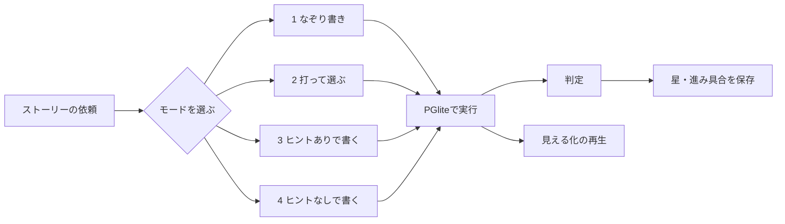

# 💡 sql-typing 初期要件メモ（壁打ちの決定事項）

> - **何を作るか**：SQLを「打ち慣れる」ことと「DBの中の動きをイメージできる」ことを目的にした、ストーリー付きのタイピング＆クイズ学習サイト
> - **形**：ブラウザだけで動く静的サイト（ログインなし）。PostgreSQL（PGlite）を画面の中で実際に動かす
> - **最初の版**：初級1章（8問＋ターニングポイント1問）で、4モード・判定・見える化・ストーリーの仕組みを全部そろえる
> - **次にやること**：このメモをもとに `/setup-project` を実行し、6つの永続ドキュメントを作る（PRDは本人の承認を待つ）

## 全体の流れ

## 決定事項

| # | 項目 | 決めたこと |
|---|---|---|
| 1 | 見える化の軸 | **DB内部の動き**（句ごとの実行順、行の変化）が中心。アプリ全体の流れ（ボタン→サーバー→SQL→DB）はストーリーの依頼文で見せる |
| 2 | 使う人 | 本人の学習用。サーバーなし・ログインなしの静的サイト。後から公開できる形にする |
| 3 | モード | プレイの仕方は4モードを切り替える：1 なぞり書き／2 タイピングして選択肢から選ぶ／3 ヒントを見ながら考えて書く／4 ヒントなしで書く |
| 4 | モード2の遊び方 | **打つことで選ぶ**。SQLの空欄の下に、似ているが意味が違う選択肢（`WHERE`と`HAVING`、`INNER JOIN`と`LEFT JOIN`など）を並べ、正しい選択肢を最後まで打ち切ると確定。間違った選択肢を打ち切ると不正解 |
| 5 | 問題とモード | 1つの問題を4モードのどれでも遊べる。進み具合は「問題 × モード」で記録（1問につき星4つ） |
| 6 | ストーリー | ネットショップ（雑貨店）に入った新人データ担当の話。**俺つええ系**（先輩がExcelで3日かかる集計をSQL1本で10秒で出す、など）。章＝レベル。DBは最初から最後まで同じお店のもので、章が進むとテーブルが増える |
| 7 | 進む条件 | 1問クリア（どのモードでもよい）で次の問題が開く。章の最後に**ターニングポイント**（「ボス」とは呼ばない）を置き、モード3か4でクリアすると次の章へ。クリア済みの問題はいつでもどのモードでも遊び直せる |
| 8 | レベルの範囲 | 下の表。さらに中級は初級の内容を、上級は初級・中級の内容を混ぜた**複合問題**も用意する（ターニングポイントは複合問題にする） |
| 9 | DB | PostgreSQL（PGlite）。ブラウザの中で動かす |
| 10 | 見える化（初級・中級） | A 実行順に1ステップずつ再生／B 書いた順→実行順の並び替えアニメ（毎回の実行前）／C モード1・2で句を打ち終えるたびに結果が変わる。D 実行前の予想クイズは後回し |
| 10+ | 用語の英語と和訳 | SQLのキーワードにカーソルを当てる（タップする）と、英語の意味とSQLでの意味が出る。全キーワードの「用語辞典」ページも作る。普段は表示しない |
| 11 | 見える化（上級） | A インデックスあり／なしの左右比較（読んだ行数のカウンター＋`EXPLAIN ANALYZE`の実測時間）／B 実行計画の木の図（行数で線の太さを変える）／C トランザクションの2列タイムライン（**シミュレーション**。PGliteは接続が1つなので）／D DBの地図（ER図、全レベル共通、今のSQLが触るテーブルを光らせる）。作る順：D→A→B→C |
| 12 | 判定（モード3・4） | 正解SQLと書いたSQLの**実行結果を比べる**＋問題ごとの「必ず使う／使ってはいけない」条件。エラーは和訳付きで表示。順番を指定した問題だけ行の順番も比べる。書き換え系は実行後のテーブルを比べ、DBを元に戻してやり直せる |
| 13 | タイピングのルール（モード1・2） | 下の表 |
| 14 | 開発の進め方 | `/setup-project` → `/add-feature` の流れ（ハーネス設計）。自動テストを安全柵にする（下の「安全柵」） |
| 15 | レビュー用の記録 | 下の「`docs/review/` の記録」 |
| 16 | 作る順番 | ①初級1章（仕組みを全部そろえる）→ ②中級の章（`JOIN`の見える化、書き換え系）→ ③上級の章（インデックス→実行計画→トランザクション） |
| 17 | 技術 | **JavaScript**（TypeScriptは使わない）。下の表 |
| 18 | 場所 | `C:\Development\sql-typing` |

### レベルの範囲（決定8）

| レベル | 扱う内容 | ターニングポイントの例 |
|---|---|---|
| 初級 | `SELECT` / `FROM` / `WHERE`（比較、`AND`・`OR`、`IN`、`BETWEEN`、`LIKE`、`IS NULL`）/ `ORDER BY` / `LIMIT` / `DISTINCT` / `AS` | セール前夜、条件に合う商品を全部リストにする（先輩は手作業であきらめた） |
| 中級 | 集計関数 / `GROUP BY` / `HAVING` / `INNER JOIN`・`LEFT JOIN` / サブクエリ / `CASE` / `INSERT`・`UPDATE`・`DELETE` | 社長に出す月次レポート（顧客・注文・商品をつないで集計） |
| 上級 | `WITH` / ウィンドウ関数 / 自己結合・3つ以上の結合 / インデックスと`EXPLAIN` / トランザクション / テーブル設計（`CREATE TABLE`、制約） | セール当日にサイトが重く、注文が二重に入る。原因を突き止めて直す |

- 書き換え系は中級から。「`WHERE`を付け忘れた`UPDATE`で全商品が0円」の事件を体験させる
- テーブルの増え方の例：`products` → `customers`・`orders` → `order_items`・ログ

### タイピングのルール（決定13）

| 項目 | 決めたこと |
|---|---|
| 打ち間違い | 間違えた文字は赤く光り、そのまま次へ進む（直さない）。2026-11-17 に本人の希望で変えた（最初の決定は「その場で止まり、正しいキーを押すまで進まない」。Caps Lock のまま打つと文字列で止まり、先に進めなくなった） |
| 大文字・小文字 | キーワードはどちらでも正解（表示は大文字） |
| 空白・改行 | 単語の区切りは Space 1回。改行は Space か Enter のどちらでもよい |
| 文字列（`'...'`の中） | 大文字・小文字も含めて正確に |
| データの値 | テーブル名・列名・値は英語と数字だけ。日本語は説明文とストーリーだけ（日本語入力の判定を避ける） |
| スコア | 1分あたりの入力文字数・正確さ（%）・時間 → 星 |
| 苦手の記録 | よく間違えるキーワードや記号（`(` `'` `,`など）を記録し、結果画面に出す |

### 技術（決定17）

| 役割 | 使うもの |
|---|---|
| 土台 | Vite + React（JavaScript）。必要な所だけJSDocで型の補助 |
| DB | PGlite |
| アニメーション | Motion（旧 Framer Motion） |
| DBの地図 | React Flow |
| 問題データ | 1問1ファイルのYAML。**Zodで実行時にチェック**（ビルドとテストで止める） |
| 進み具合 | localStorage |
| テスト | Vitest（単体）＋ Playwright（画面） |
| 公開 | Cloudflare Pages |
| 端末 | キーボードのあるPCが前提。スマホは用語辞典とストーリーを読むだけ（タイピング不可と表示） |

## 1問のデータに持たせるもの（決定5・12から）
- ストーリーの依頼文（話す人、会話）
- 正解SQL
- モード2用：空欄の位置と、選択肢（正解＋似ているが違うもの）
- モード3用：ヒント
- 判定用：正しい実行結果（または正解SQLから作る）、順番を比べるか、必ず使う／使ってはいけない条件
- 書き換え系：実行後に比べるテーブル
- 使うキーワード（用語辞典・苦手の記録とつなぐ）

## 安全柵（決定14）
- `CLAUDE.md` に必ず守ることを書く
- 問題データのチェック：全問に必要な項目がそろっているか、**正解SQLが本当にPGliteで実行できるか**、選択肢が足りているか
- 判定ロジックの単体テスト（Vitest）
- 画面の動作テスト（Playwright）：4モードそれぞれで1問を最後まで遊べるか
- 機能ごとに `/add-feature`。順番：DBが動く → モード1 → 見える化A → 判定 → モード2〜4 → ストーリー → 上級の見える化

## `docs/review/` の記録（決定15）
- コードを作成・変更したら、内容を**抜けなく** `.md` にまとめて `docs/review/` に置く
- 単位：`/add-feature` の1回（steering 1つ）ごとに1ファイル。例：`docs/review/20261112-mode1-typing.md`
- 型：`dev-log` スキルの型（挙動の変化／なぜ／検証／検証していないこと／判断してほしいこと）に、**「変更したファイル一覧」**の表（作成・変更・削除したファイルすべてと、それぞれ何をしたか）を加える
- 抜けがないことは、`git diff` のファイル一覧と表を照らし合わせて確かめる。合わなければ書き直す
- **長さの上限なし**（1000文字を超えてよい。`dev-log` の150行上限も外す）
- `/add-feature` の最後の手順と `CLAUDE.md` に「`docs/review/` の記録を書くまで完了しない」と書く
- このプロジェクトでは、保管庫の `F000_DEVLOG/` ではなく `docs/review/` に書く

まだ決めていないこと（PRD以降で決める）

- キャラクターの名前と性格（店長・先輩・営業など、依頼する人を数人に固定する方針だけ決定）
- 初級1章の8問の中身と、ターニングポイントの問題
- 画面の見た目（色、フォント、レイアウト）
- 星の付け方の基準（速さ・正確さの数値）
- 見える化D（実行前の予想クイズ）を足す時期

選ばなかった案

- 見える化：アプリ全体の流れを本格的な仕組みとして作る案 → ストーリーの演出で十分
- 1問の中で「考える→打つ→見る」を必ず通す3段階型 → タイピングを別モードとして切り替えたいので不採用
- モード2：クリックで選んでから打つ／入力補完のように候補が出る → テンポが落ちる・補完に頼る癖がつく
- 舞台：ファンタジー、推理もの → 仕事のSQLの感覚から離れる
- DB：SQLite（sql.js）→ 実行計画が簡素で、型がゆるい
- 判定：文字の比較 → 正しい別解を不正解にしてしまう
- 土台：Next.js → サーバー側の機能を使わないので重すぎる。TypeScript → 本人の希望でJavaScript

